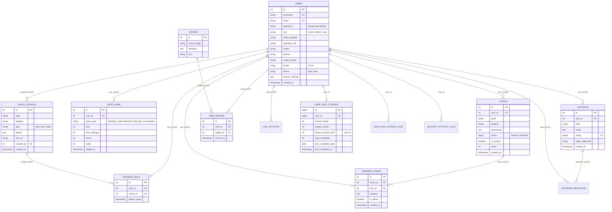
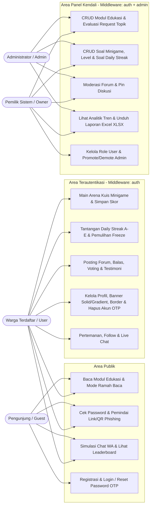
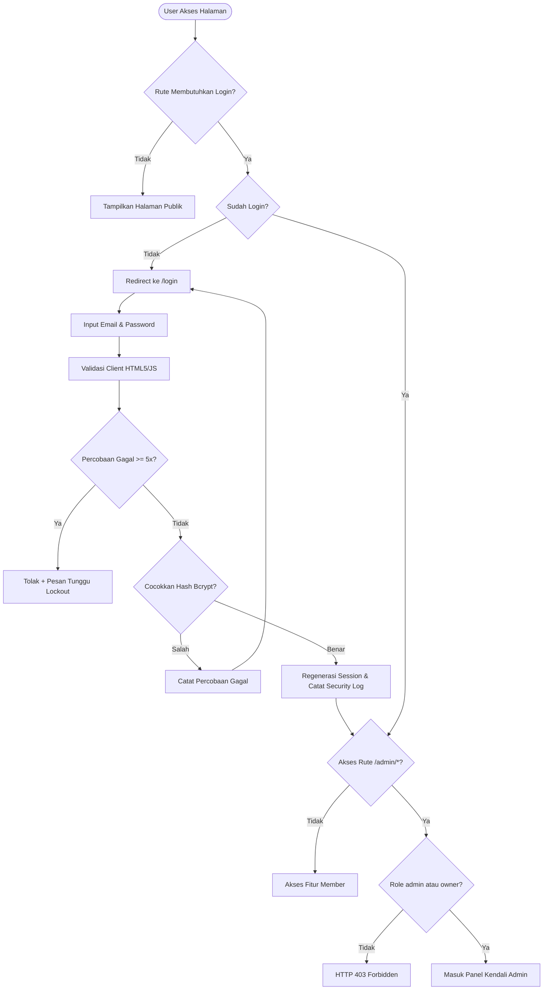
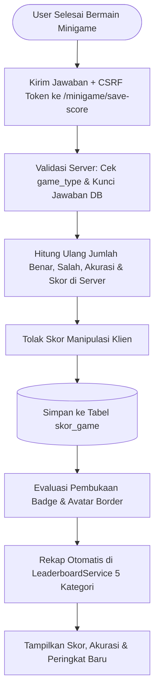
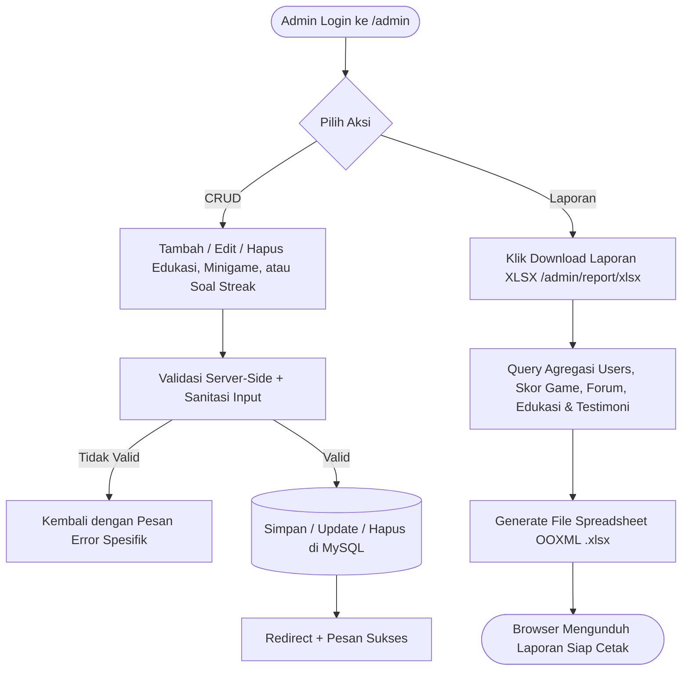

# Dokumen Perancangan Sistem (ERD, Use Case, Flowchart & Audit Basis Data)
**Proyek:** Digi-Safe Purwakarta  
**Peserta UKK:** Razief Afkar Rusli — XII RPL, SMK Negeri 2 Purwakarta  
**Skema Uji:** Junior Web Developer / Full-Stack Web Developer (PT. Pratama Solusi Teknologi)

---

## 1. Entity Relationship Diagram (ERD)

Database `digi_safe_db` menggunakan engine **InnoDB** (`utf8mb4_unicode_ci`) dengan **30 tabel** dan **13 Foreign Key constraint aktif** yang memisahkan tabel master (`users`, `modul_edukasi`, `badges`, `minigame_levels`, `soal_minigame`, `daily_streak_questions`) dan tabel transaksi (`skor_game`, `forum`, `jawaban_forum`, `progres_baca`, `testimoni`, `user_badges`, `user_daily_streaks`, `log_aktivitas`, dll.).



### Daftar 13 Foreign Key Aktif di MySQL (`digi_safe_db`)
1. `forum.user_id` -> `users.id` (`forum_ibfk_1`)
2. `jawaban_forum.forum_id` -> `forum.id` (`jawaban_forum_ibfk_1`)
3. `jawaban_forum.user_id` -> `users.id` (`jawaban_forum_ibfk_2`)
4. `log_aktivitas.user_id` -> `users.id` (`log_aktivitas_ibfk_1`)
5. `modul_edukasi.created_by` -> `users.id` (`modul_edukasi_ibfk_1`)
6. `progres_baca.user_id` -> `users.id` (`progres_baca_ibfk_1`)
7. `progres_baca.modul_id` -> `modul_edukasi.id` (`progres_baca_ibfk_2`)
8. `skor_game.user_id` -> `users.id` (`skor_game_ibfk_1`)
9. `testimoni.user_id` -> `users.id` (`testimoni_ibfk_1`)
10. `testimoni_reactions.testimoni_id` -> `testimoni.id` (`testimoni_reactions_ibfk_1`)
11. `testimoni_reactions.user_id` -> `users.id` (`testimoni_reactions_ibfk_2`)
12. `user_badges.user_id` -> `users.id` (`user_badges_ibfk_1`)
13. `user_badges.badge_id` -> `badges.id` (`user_badges_ibfk_2`)

---

## 2. Use Case Diagram (Hak Akses Multi-Role)



---

## 3. Flowchart Alur Proses Bisnis Utama

### A. Alur Autentikasi, Proteksi Rute & Brute-Force Lockout


### B. Alur Transaksi Minigame, Perhitungan Skor Server-Side & Leaderboard


### C. Alur Transaksi Admin CRUD & Cetak Laporan Excel (`.xlsx`)


---

## 4. Contoh Query SQL Relasional (JOIN & Agregasi) untuk Tahap 3 Audit Basis Data

Penguji dapat meminta pembuktian pemahaman query `JOIN` dan fungsi agregasi (`COUNT`, `MAX`, `AVG`, `SUM`, `GROUP BY`). Berikut query nyata yang langsung berjalan pada database `digi_safe_db`:

### 1. Rekap Performa Pemain per User (INNER JOIN + Agregasi `COUNT`, `SUM`, `MAX`, `AVG`)
```sql
SELECT
    u.username,
    u.nama_lengkap,
    COUNT(s.id) AS total_sesi,
    SUM(s.benar) AS total_benar,
    MAX(s.skor_tertinggi) AS rekor_skor,
    ROUND(AVG(s.skor), 1) AS rata_rata_skor
FROM users u
INNER JOIN skor_game s ON s.user_id = u.id
GROUP BY u.id, u.username, u.nama_lengkap
ORDER BY total_benar DESC, rekor_skor DESC
LIMIT 10;
```

### 2. Rekap Diskusi Forum & Jumlah Balasan (LEFT JOIN + `COUNT`)
```sql
SELECT
    f.id,
    f.judul,
    u.nama_lengkap AS penulis,
    f.kategori,
    COUNT(j.id) AS jumlah_balasan
FROM forum f
INNER JOIN users u ON u.id = f.user_id
LEFT JOIN jawaban_forum j ON j.forum_id = f.id
GROUP BY f.id, f.judul, u.nama_lengkap, f.kategori
ORDER BY jumlah_balasan DESC;
```

### 3. Peringkat Streak Harian Terpanjang (INNER JOIN `users` & `user_daily_streaks`)
```sql
SELECT
    u.nama_lengkap,
    u.username,
    ds.current_streak,
    ds.longest_streak,
    ds.total_completed
FROM user_daily_streaks ds
INNER JOIN users u ON u.id = ds.user_id
ORDER BY ds.longest_streak DESC, ds.current_streak DESC;
```
