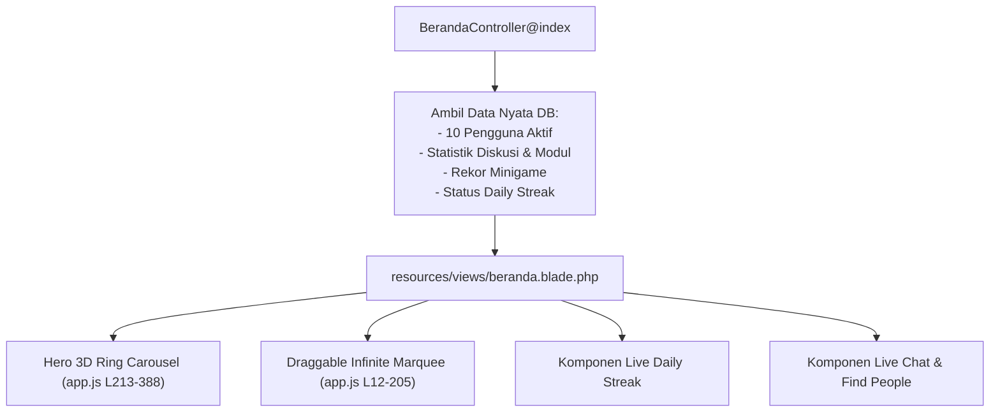
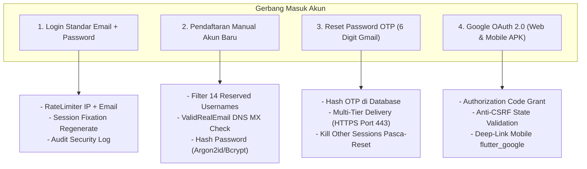
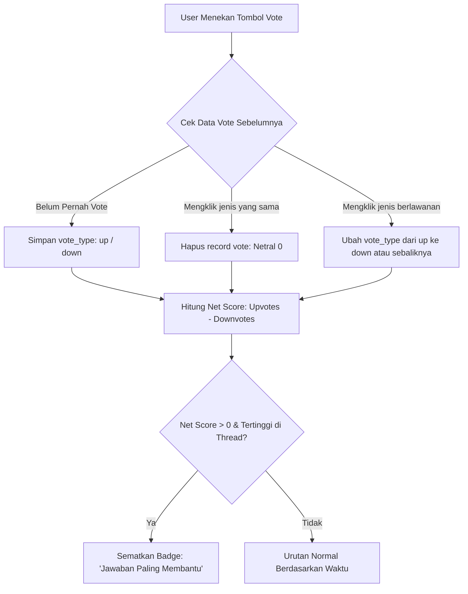
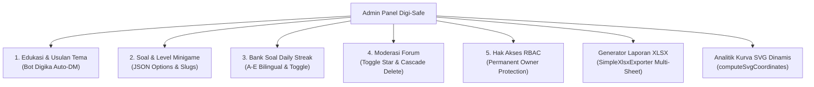

# PANDUAN TINGKAT LANJUT: BEDAH KODE, ARSITEKTUR, DAN MEKANISME SISTEM DIGI-SAFE PURWAKARTA (EDISI KHUSUS UKK - NILAI SEMPURNA)

> **Dokumen Resmi Rekayasa Perangkat Lunak (RPL) - SMK Negeri 2 Purwakarta**  
> **Aplikasi:** Digi-Safe Purwakarta (Platform Literasi Keamanan Siber & Edukasi Warga)  
> **Pengembang:** Razief Afkar Rusli (Kelas XII RPL)  
> **Stack Teknologi:** Laravel 12 / PHP 8.2+, Tailwind CSS v4, Alpine.js, Vanilla JavaScript, SQLite/MySQL, Google OAuth 2.0, HTTPS Webhook Relay, RESTful API (Flutter Ready).

---

## DAFTAR ISI LENGKAP

1. [BAB 1: Fondasi Arsitektur Global & Engine Tampilan](#bab-1-fondasi-arsitektur-global--engine-tampilan)
2. [BAB 2: Halaman Beranda (Home Page)](#bab-2-halaman-beranda-home-page)
3. [BAB 3: Sistem Autentikasi & Keamanan Akun (Auth System)](#bab-3-sistem-autentikasi--keamanan-akun-auth-system)
4. [BAB 4: Halaman Edukasi (Education Center)](#bab-4-halaman-edukasi-education-center)
5. [BAB 5: Forum Komunitas (Community Forum)](#bab-5-forum-komunitas-community-forum)
6. [BAB 6: Laboratorium Keamanan Siber Interaktif (Simulator WA, Link Scanner, Password Lab)](#bab-6-laboratorium-keamanan-siber-interaktif)
7. [BAB 7: Ulasan Warga (Testimoni) & Arena Minigame Siber](#bab-7-ulasan-warga-testimoni--arena-minigame-siber)
8. [BAB 8: Tantangan Harian (Daily Streak) & Halaman Tentang (About Us)](#bab-8-tantangan-harian-daily-streak--halaman-tentang-about-us)
9. [BAB 9: Profil Pengguna (My Profile), Leaderboard & Jaringan Sosial](#bab-9-profil-pengguna-my-profile-leaderboard--jaringan-sosial)
10. [BAB 10: Pusat Kendali Admin (Admin Panel) & Generator Laporan XLSX](#bab-10-pusat-kendali-admin-admin-panel--generator-laporan-xlsx)
11. [BAB 11: Arsitektur API Mobile Flutter & Keamanan Infrastruktur](#bab-11-arsitektur-api-mobile-flutter--keamanan-infrastruktur)
12. [BAB 12: Bank Pertanyaan & Strategi Menjawab Penguji UKK (12 Pertanyaan Kunci)](#bab-12-bank-pertanyaan--strategi-menjawab-penguji-ukk)

---

# BAB 1: FONDASI ARSITEKTUR GLOBAL & ENGINE TAMPILAN

### 1. Layout Induk (`layouts/app.blade.php`)
File layout utama terletak pada [`resources/views/layouts/app.blade.php`](file:///c:/Users/USER/Downloads/digi-safe-purwakarta/digi-safe-purwakarta/digi-safe-purwakarta/resources/views/layouts/app.blade.php). Layout ini memuat kerangka HTML5 standar, injeksi CSS Tailwind v4, pustaka Alpine.js, Font Google (Plus Jakarta Sans & Outfit), serta komponen global seperti Navbar, Chat Widget, dan Footer.

#### A. Mekanisme Anti-FOUC (Flash of Unstyled Content)
* **Lokasi Kode**: [`resources/views/layouts/app.blade.php`](file:///c:/Users/USER/Downloads/digi-safe-purwakarta/digi-safe-purwakarta/digi-safe-purwakarta/resources/views/layouts/app.blade.php#L22-L42)
* **Masalah**: Ketika user memilih tema *Dark Mode*, saat halaman di-refresh, browser seringkali merender warna putih (*light*) selama beberapa milidetik sebelum script eksternal selesai dieksekusi. Ini menyebabkan kedipan putih yang menyilaukan (*flash*).
* **Solusi Arsitektur**: Script inline disematkan tepat di dalam tag `<head>` sebelum stylesheet lain dimuat:
```javascript
(function () {
    try {
        var theme = '{{ $currentTheme ?? 'light' }}';
        var storedTheme = localStorage.getItem('digisafe_theme');
        if (storedTheme && (storedTheme === 'dark' || storedTheme === 'light')) {
            theme = storedTheme;
        }
        if (theme === 'dark') {
            document.documentElement.classList.add('dark');
            document.documentElement.setAttribute('data-theme', 'dark');
        } else {
            document.documentElement.classList.remove('dark');
            document.documentElement.setAttribute('data-theme', 'light');
        }
    } catch (e) {}
})();
```
* **Hasil**: Engine rendering browser langsung mengetahui tema aktif pada baris pertama DOM tree dibangun, sehingga halaman bebas kedipan (*zero-flash*).

#### B. Navbar Scroll Tracker & Glassmorphism Dinamis
* **Lokasi Kode**: [`resources/views/layouts/app.blade.php`](file:///c:/Users/USER/Downloads/digi-safe-purwakarta/digi-safe-purwakarta/digi-safe-purwakarta/resources/views/layouts/app.blade.php#L68-L115)
* **Mekanisme**:
  Navbar dipasang dengan properti `fixed top-0 inset-x-0 z-50`. Alpine.js memantau event scroll window melalui direktif `@scroll.window="scrolled = (window.pageYOffset > 20)"`:
  1. **Saat Scroll Posisi 0 (Paling Atas)**:
     Navbar memiliki latar belakang transparan `bg-transparent`, tanpa shadow, menyatu dengan warna hero section.
  2. **Saat Scroll Melebihi 20px**:
     State `scrolled` bernilai `true`. Kelas CSS otomatis bertransisi menjadi `bg-white/80 dark:bg-slate-900/80 backdrop-blur-md shadow-sm border-b border-gray-200/60 dark:border-slate-800`.
  3. **Efek UX**: Memberikan ruang baca yang lapang pada awalnya, namun tetap menyediakan navigasi yang kontras dan terbaca saat user membaca konten ke bawah.

#### C. Sakelar Tema 3D Flip (Light $\leftrightarrow$ Dark)
* **Lokasi Kode**: [`resources/views/layouts/app.blade.php`](file:///c:/Users/USER/Downloads/digi-safe-purwakarta/digi-safe-purwakarta/digi-safe-purwakarta/resources/views/layouts/app.blade.php#L130-L165) & [`app/Http/Controllers/ProfileController.php`](file:///c:/Users/USER/Downloads/digi-safe-purwakarta/digi-safe-purwakarta/digi-safe-purwakarta/app/Http/Controllers/ProfileController.php#L241-L273)
* **Mekanisme**:
  1. Tombol sakelar memiliki kelas CSS `perspective: 1000px` dan `transform-style: preserve-3d`.
  2. Saat ditekan, ikon matahari/bulan berputar 180 derajat di sumbu Y (`transform: rotateY(180deg)`), menciptakan transisi tiga dimensi yang halus.
  3. Secara bersamaan, JavaScript mengeksekusi request `fetch('/preferences/quick', { method: 'POST', body: JSON.stringify({ theme: nextTheme }) })`.
  4. Preferensi disimpan ke dua tempat: **Session & LocalStorage** (untuk guest) serta **Database Kolom `theme` di tabel `users`** (untuk user yang sedang login).

#### D. Sakelar Bahasa Bilingual (ID $\leftrightarrow$ EN)
* **Mekanisme**:
  * Menggunakan helper [`app/Services/BilingualHelper.php`](file:///c:/Users/USER/Downloads/digi-safe-purwakarta/digi-safe-purwakarta/digi-safe-purwakarta/app/Services/BilingualHelper.php) dan middleware [`app/Http/Middleware/SetUserPreferences.php`](file:///c:/Users/USER/Downloads/digi-safe-purwakarta/digi-safe-purwakarta/digi-safe-purwakarta/app/Http/Middleware/SetUserPreferences.php).
  * Pada setiap request, middleware mengecek apakah ada session `locale`. Jika user login, sistem membaca `auth()->user()->locale`.
  * Fungsi `App::setLocale($locale)` dipanggil sebelum view dirender, memicu pembacaan berkas bahasa di `lang/id/ui.php` dan `lang/en/ui.php`.

---

# BAB 2: HALAMAN BERANDA (HOME PAGE)

Halaman Beranda adalah etalase utama platform yang memadukan animasi grafis interaktif dengan data statistik nyata komunitas.

* **Route**: [`routes/web.php`](file:///c:/Users/USER/Downloads/digi-safe-purwakarta/digi-safe-purwakarta/digi-safe-purwakarta/routes/web.php#L26) $\rightarrow$ `Route::get('/', [BerandaController::class, 'index'])->name('beranda');`
* **Controller**: [`app/Http/Controllers/BerandaController.php`](file:///c:/Users/USER/Downloads/digi-safe-purwakarta/digi-safe-purwakarta/digi-safe-purwakarta/app/Http/Controllers/BerandaController.php)
* **View**: [`resources/views/beranda.blade.php`](file:///c:/Users/USER/Downloads/digi-safe-purwakarta/digi-safe-purwakarta/digi-safe-purwakarta/resources/views/beranda.blade.php)
* **Skrip JS Interaktif**: [`resources/js/app.js`](file:///c:/Users/USER/Downloads/digi-safe-purwakarta/digi-safe-purwakarta/digi-safe-purwakarta/resources/js/app.js)



---

### 1. Hero 3D Rotating Ring Carousel
* **Lokasi Kode View**: [`resources/views/beranda.blade.php`](file:///c:/Users/USER/Downloads/digi-safe-purwakarta/digi-safe-purwakarta/digi-safe-purwakarta/resources/views/beranda.blade.php#L166-L432)
* **Lokasi Kode Logika JS**: [`resources/js/app.js`](file:///c:/Users/USER/Downloads/digi-safe-purwakarta/digi-safe-purwakarta/digi-safe-purwakarta/resources/js/app.js#L213-L388)

#### A. Konsep Matematika & Trigonometri 3D
Carousel ini menampilkan 5 kartu pilar dalam bentuk silinder lingkaran 3D virtual yang berputar mengelilingi sumbu pusat:
1. Jumlah kartu ($N$) = 5 kartu. Sudut antar kartu:
   $$\Delta \theta = \frac{2\pi}{N} = \frac{360^\circ}{5} = 72^\circ \text{ (1.2566 rad)}$$
2. Jari-jari lingkaran virtual ($R$):
   * Desktop: $R = 360\text{px}$
   * Tablet: $R = 280\text{px}$
   * Mobile: $R = 210\text{px}$
3. Posisi setiap kartu pada sudut $\theta_i$ dihitung dengan rumus:
   $$X_i = \sin(\theta_i) \times R$$
   $$Z_i = \cos(\theta_i) \times R - R$$
   $$\text{Scale}_i = \text{mapRange}(Z_i, -2R, 0, 0.65, 1.0)$$
   $$\text{Opacity}_i = \text{mapRange}(Z_i, -2R, 0, 0.35, 1.0)$$

#### B. Mekanisme Render Frame Rate Bebas Lag (`requestAnimationFrame`)
* Kartu tidak digerakkan menggunakan manipulasi DOM `top/left` biasa, melainkan **CSS 3D Transform dengan akselerasi perangkat keras (GPU hardware acceleration)**:
  ```javascript
  card.style.transform = `translate3d(${x}px, 0px, ${z}px) scale(${scale}) rotateY(${rotY}deg)`;
  card.style.zIndex = Math.round((z + 2 * radius) * 10);
  ```
* Nilai `zIndex` dihitung secara dinamis dari kedalaman sumbu $Z$. Kartu yang berada di depan ($Z \approx 0$) memiliki zIndex tertinggi sehingga selalu berada di atas kartu yang sedang berada di sisi belakang ($Z < 0$).
* **Fisika Inersia & Dragging**:
  Saat user menyentuh atau mengklik-geser (drag):
  * Kecepatan geser dihitung: `velocity = deltaX * 0.005`.
  * Saat mouse dilepas, momentum geser diredam dengan gaya gesek buatan (*damping factor* 0.92) hingga kecepatan mendekati nol, lalu kartu terdekat mengunci secara otomatis (*auto-snap*) ke posisi depan.

---

### 2. Direktori Anggota Draggable Infinite Marquee
* **Lokasi Kode View**: [`resources/views/beranda.blade.php`](file:///c:/Users/USER/Downloads/digi-safe-purwakarta/digi-safe-purwakarta/digi-safe-purwakarta/resources/views/beranda.blade.php#L904-L990)
* **Lokasi Kode Logika JS**: [`resources/js/app.js`](file:///c:/Users/USER/Downloads/digi-safe-purwakarta/digi-safe-purwakarta/digi-safe-purwakarta/resources/js/app.js#L12-L205)

#### A. Mekanisme Infinite Seamless Loop (Kloning Elemen)
* **Tantangan**: Banner berjalan horizontal seringkali putus atau memiliki jeda kosong saat elemen terakhir selesai melintas.
* **Solusi**:
  1. Sistem membaca seluruh elemen kartu member asli di dalam kontainer `.marquee-track`.
  2. JavaScript membuat salinan identik (*clone nodes*) dari seluruh kartu member dan menempelkannya di akhir kontainer.
  3. Total lebar satu siklus dihitung: `totalWidth = originalCardsWidth`.
  4. Setiap frame animasi, posisi geser horizontal bertambah: `currentX -= speed`.
  5. Begitu `Math.abs(currentX) >= totalWidth`, posisi seketika di-reset:
     ```javascript
     currentX = currentX % totalWidth;
     ```
  6. Karena elemen klon memiliki visual dan dimensi yang sama persis dengan elemen awal, reset ini **100% tidak terlihat oleh mata manusia (seamless)**.

#### B. Interaksi Drag & Pointer Capture
* Track mendukung drag menggunakan mouse dan touch screen:
  * Event `pointerdown`: Mencatat posisi awal, memanggil `track.setPointerCapture(e.pointerId)`, dan menghentikan laju otomatis.
  * Event `pointermove`: Menghitung pergeseran $\Delta X$ dan langsung menggeser posisi track.
  * Event `pointerup`: Melepaskan pointer capture dan melanjutkan laju otomatis sesuai arah geser terakhir.

---

### 3. Widget Live Chat & Find New People
* **Lokasi Controller**: [`app/Http/Controllers/SocialChatController.php`](file:///c:/Users/USER/Downloads/digi-safe-purwakarta/digi-safe-purwakarta/digi-safe-purwakarta/app/Http/Controllers/SocialChatController.php)
* **Lokasi View**: [`resources/views/components/chat-widget.blade.php`](file:///c:/Users/USER/Downloads/digi-safe-purwakarta/digi-safe-purwakarta/digi-safe-purwakarta/resources/views/components/chat-widget.blade.php)

#### A. Alur Permintaan Pertemanan & Live Message
1. **Pencarian Warga (Find New People)**:
   * Input pencarian mengirim request AJAX ke `/chat/users/search?q={query}`.
   * Controller mengeksekusi pencarian dengan filter: mengabaikan akun sendiri dan akun bot sistem.
   * Status relasi dihitung secara dinamis: `none`, `pending_sent`, `pending_received`, atau `friend`.
2. **Kirim & Terima Pesan**:
   * Endpoint: `POST /chat/{user}/send` menerima parameter `message` (maksimal 2000 karakter).
   * Pesan disimpan ke tabel `chat_messages` dengan status `is_read = false`.
   * Komponen widget di browser melakukan polling ringan setiap 4 detik untuk memeriksa pesan baru (`/chat/unread-count`).
   * Begitu chat dibuka oleh penerima, sistem menandai `is_read = true` (*read receipt*).

---

# BAB 3: SISTEM AUTENTIKASI & KEAMANAN AKUN (AUTH SYSTEM)

Sistem autentikasi Digi-Safe Purwakarta dibangun mandiri dengan kepatuhan terhadap standar keamanan siber OWASP (*Open Worldwide Application Security Project*).



---

### 1. Fitur Login (Autentikasi & Brute-Force Shield)
* **Controller**: [`app/Http/Controllers/AuthController.php`](file:///c:/Users/USER/Downloads/digi-safe-purwakarta/digi-safe-purwakarta/digi-safe-purwakarta/app/Http/Controllers/AuthController.php#L42-L111)
* **View**: [`resources/views/auth/login.blade.php`](file:///c:/Users/USER/Downloads/digi-safe-purwakarta/digi-safe-purwakarta/digi-safe-purwakarta/resources/views/auth/login.blade.php)

#### Pembedahan Baris Kode Kunci:
1. **Validasi Email Nyata (Baris 60–67)**:
   ```php
   $credentials = $request->validate([
       'email' => ['required', 'string', 'max:100', new ValidRealEmail(checkDns: false)],
       'password' => ['required', 'string', 'max:128'],
   ]);
   ```
2. **Kunci Brute-Force Kombinasi Akun & IP (Baris 73–84)**:
   ```php
   $throttleKey = 'login-web:' . sha1($email . '|' . $request->ip());
   if (RateLimiter::tooManyAttempts($throttleKey, 5)) {
       $seconds = RateLimiter::availableIn($throttleKey);
       return back()->withErrors(['email' => "Terlalu banyak percobaan login gagal. Silakan coba lagi dalam {$seconds} detik."]);
   }
   ```
   * *Mengapa kombinasi Email + IP?* Jika hanya IP yang di-throttle, penyerang dapat mengganti IP menggunakan VPN. Jika hanya email yang di-throttle, penyerang dapat melakukan DoS pada akun pengguna asli. Menggabungkan `sha1(email|ip)` memberikan isolasi proteksi yang adil dan presisi.
3. **Pencegahan Session Fixation (Baris 97)**:
   ```php
   $request->session()->regenerate();
   ```
   * Menghancurkan ID sesi lama yang berpotensi sudah disusupi penyerang dan menerbitkan ID sesi baru yang bersih tepat saat kredensial valid.
4. **Audit Trail Digital (Baris 98)**:
   ```php
   SecurityActivityService::record(Auth::user(), SecurityActivityService::EVENT_LOGIN, $request);
   ```
   * Mencatat timestamp, alamat IP, dan User Agent ke database agar user dapat melihat histori login mereka di halaman profil.

---

### 2. Fitur Register (Pendaftaran Akun Baru)
* **Controller**: [`app/Http/Controllers/AuthController.php`](file:///c:/Users/USER/Downloads/digi-safe-purwakarta/digi-safe-purwakarta/digi-safe-purwakarta/app/Http/Controllers/AuthController.php#L113-L174)
* **View**: [`resources/views/auth/register.blade.php`](file:///c:/Users/USER/Downloads/digi-safe-purwakarta/digi-safe-purwakarta/digi-safe-purwakarta/resources/views/auth/register.blade.php)

#### Pembedahan Baris Kode Kunci:
1. **Normalisasi Case-Insensitive (Baris 122–126)**:
   ```php
   $request->merge([
       'username' => Str::lower(trim((string) $request->input('username', ''))),
       'email' => Str::lower(trim((string) $request->input('email', ''))),
   ]);
   ```
2. **Blokir 14 Reserved Usernames Sistem (Baris 25–40 & 136–138)**:
   Sistem menolak tegas pendaftaran username: `admin`, `administrator`, `owner`, `root`, `system`, `support`, `moderator`, `staff`, `digisafe`, `digisafepurwakarta`, `bot_digika`, `official`, `security`, `helpdesk` menggunakan `Rule::notIn(self::RESERVED_USERNAMES)`.
3. **Penyaringan Email Sementara / Disposable (`ValidRealEmail`)**:
   Lokasi: [`app/Rules/ValidRealEmail.php`](file:///c:/Users/USER/Downloads/digi-safe-purwakarta/digi-safe-purwakarta/digi-safe-purwakarta/app/Rules/ValidRealEmail.php).
   * Memeriksa daftar hitam lebih dari 60 domain email sementara (*mailinator.com, yopmail.com, 10minutemail.com, tempmail.com*, dsb).
   * Pada mode register (`checkDns: true`), script menjalankan fungsi PHP `checkdnsrr($domain, 'MX')` untuk memverifikasi apakah domain email tersebut benar-benar memiliki Mail Exchange Server yang valid.

---

### 3. Fitur Forgot Password (Reset Password via OTP Gmail)
* **Controller**: [`app/Http/Controllers/AccountSecurityController.php`](file:///c:/Users/USER/Downloads/digi-safe-purwakarta/digi-safe-purwakarta/digi-safe-purwakarta/app/Http/Controllers/AccountSecurityController.php#L20-L246)
* **Service Pengiriman**: [`app/Services/AccountOtpService.php`](file:///c:/Users/USER/Downloads/digi-safe-purwakarta/digi-safe-purwakarta/digi-safe-purwakarta/app/Services/AccountOtpService.php)
* **View**: [`resources/views/auth/forgot-password-otp.blade.php`](file:///c:/Users/USER/Downloads/digi-safe-purwakarta/digi-safe-purwakarta/digi-safe-purwakarta/resources/views/auth/forgot-password-otp.blade.php)

#### Pembedahan Mekanisme Keamanan OTP:
1. **Penyimpanan Ter-Hash (Zero Plain-Text Storage)**:
   Di `AccountOtpService.php` Baris 116–128:
   * Kode OTP 6-digit di-generate: `$plainOtp = str_pad((string) random_int(0, 999999), 6, '0', STR_PAD_LEFT);`
   * Yang disimpan di tabel `account_otps` adalah `Hash::make($plainOtp)`. Admin atau penyusup database sekalipun **tidak akan pernah bisa membaca kode OTP user**.
2. **Toleransi & Batas Percobaan**:
   * Masa aktif: 10 Menit (`EXPIRY_MINUTES = 10`).
   * Cooldown pengiriman ulang: 20 Detik (`RESEND_COOLDOWN_SECONDS = 20`).
   * Batas salah tebak: Maksimal 5 kali (`MAX_ATTEMPTS = 5`). Setelah 5 kali salah, seluruh record OTP untuk email tersebut langsung dibatalkan (`consumed_at = now()`).
3. **Arsitektur Multi-Tier Pengiriman Email (Tembus Firewall Jaringan)**:
   Di `AccountOtpService.php` Baris 322–411:
   * *Tier 1 (Utama)*: **Google Apps Script Webhook via Port 443 HTTPS**. Jalur ini mengirimkan email menggunakan protokol web HTTPS murni, sehingga 100% kebal dari pemblokiran port SMTP 465/587 yang sering dilakukan oleh ISP lokal atau Wi-Fi sekolah.
   * *Tier 2*: **Brevo API (HTTPS)**.
   * *Tier 3*: **SMTP Gmail** standar Laravel Mailer.
4. **Tindakan Perlindungan Pasca-Reset (Baris 211–227)**:
   Setelah password berhasil diganti:
   * Seluruh API Token di tabel `api_tokens` dihapus.
   * Seluruh sesi login di perangkat lain pada tabel `sessions` dibatalkan seketika (`sessionQuery->delete()`).

---

### 4. Fitur Login dengan Google (OAuth 2.0 Authorization Code Grant)
* **Controller**: [`app/Http/Controllers/AuthController.php`](file:///c:/Users/USER/Downloads/digi-safe-purwakarta/digi-safe-purwakarta/digi-safe-purwakarta/app/Http/Controllers/AuthController.php#L187-L450)
* **View**: [`resources/views/auth/google-customize.blade.php`](file:///c:/Users/USER/Downloads/digi-safe-purwakarta/digi-safe-purwakarta/digi-safe-purwakarta/resources/views/auth/google-customize.blade.php)

#### Pembedahan Alur OAuth 2.0 Handshake:
1. **Redirect & Anti-CSRF State**:
   * Sistem menghasilkan string acak `state`:
     * Web: Disimpan di Session `google_oauth_state`.
     * Mobile APK (`?mode=mobile`): Disimpan di Cache `google_oauth_mobile_{state}` selama 10 menit.
   * User diarahkan ke endpoint Google: `https://accounts.google.com/o/oauth2/v2/auth` dengan scope `openid email profile`.
2. **Callback & Pertukaran Token**:
   * Google mengembalikan `code` dan `state`. Sistem mencocokkan `hash_equals($expectedState, $incomingState)`.
   * Server Digi-Safe melakukan request server-to-server ke `https://oauth2.googleapis.com/token` untuk menukar authorization code dengan `access_token`.
   * Mengambil data pengguna dari `https://www.googleapis.com/oauth2/v3/userinfo` (`sub`, `email`, `email_verified`, `name`, `picture`).
3. **Auto-Link & Auto-Provisioning**:
   * Jika email sudah terdaftar: Kolom `oauth_provider = 'google'` dan `oauth_id = $sub` diisi tanpa menghapus riwayat akun lama.
   * Jika user baru: Dibuatkan akun baru dengan status `role = 'user'`.
4. **Dukungan Mobile Flutter / APK (`mode=mobile`)**:
   * Sistem menerbitkan Sanctum API Token (`ApiToken::issueFor($user, 'flutter_google')`).
   * Melakukan deep link redirect ke smartphone: `digisafe://auth/callback?token={token}&is_new={is_new}`.
5. **Halaman Onboarding Google Customize (`/auth/google/customize`)**:
   * Pengguna baru Google diarahkan ke halaman khusus untuk memilih **Username unik kustom** dan **Nickname tampilan**, serta banner profil sebelum masuk ke aplikasi utama.

---

# BAB 4: HALAMAN EDUKASI (EDUCATION CENTER)

Pusat literasi keamanan siber yang menyajikan artikel terverifikasi, video analisis, serta sistem kurikulum partisipatif.

* **Route**: [`routes/web.php`](file:///c:/Users/USER/Downloads/digi-safe-purwakarta/digi-safe-purwakarta/digi-safe-purwakarta/routes/web.php#L41-L45)
* **Controller**: [`app/Http/Controllers/EdukasiController.php`](file:///c:/Users/USER/Downloads/digi-safe-purwakarta/digi-safe-purwakarta/digi-safe-purwakarta/app/Http/Controllers/EdukasiController.php)
* **View**: [`resources/views/edukasi.blade.php`](file:///c:/Users/USER/Downloads/digi-safe-purwakarta/digi-safe-purwakarta/digi-safe-purwakarta/resources/views/edukasi.blade.php)

---

### 1. Bento Grid dengan Efek Hover Matrix Glow CSS
* **Lokasi Kode**: [`resources/views/edukasi.blade.php`](file:///c:/Users/USER/Downloads/digi-safe-purwakarta/digi-safe-purwakarta/digi-safe-purwakarta/resources/views/edukasi.blade.php#L78-L240)
* **Arsitektur Tampilan**:
  * Modul materi disusun dalam format Bento Box multi-kolom yang asimetris namun seimbang.
  * Kartu utama (*Featured Article*) berukuran span 2 kolom, sementara kartu materi ringkas berukuran span 1 kolom.
* **Efek Hover Matrix Glow**:
  Setiap kartu dilengkapi dengan lapisan pseudo-element CSS:
  ```css
  .bento-card::before {
      content: '';
      position: absolute;
      inset: -1px;
      border-radius: inherit;
      background: radial-gradient(400px circle at var(--mouse-x, 0) var(--mouse-y, 0), rgba(14, 165, 233, 0.15), transparent 40%);
      opacity: 0;
      transition: opacity 0.5s;
  }
  .bento-card:hover::before {
      opacity: 1;
  }
  ```
  JavaScript kecil menangkap posisi mouse (`e.clientX`, `e.clientY`) relatif terhadap kartu dan memperbarui variabel CSS `--mouse-x` dan `--mouse-y`. Hasilnya adalah kilauan cahaya lembut yang mengikuti kursor secara interaktif.

---

### 2. Request Topic Modal ke Bot Digika
* **Lokasi Kode Controller**: [`app/Http/Controllers/EdukasiController.php`](file:///c:/Users/USER/Downloads/digi-safe-purwakarta/digi-safe-purwakarta/digi-safe-purwakarta/app/Http/Controllers/EdukasiController.php#L65-L105)
* **Mekanisme**:
  1. Pengguna dapat mengusulkan tema edukasi baru yang belum tersedia di platform.
  2. Form meminta input: `tema`, `kategori`, dan `alasan`.
  3. Data disimpan ke tabel `edukasi_requests` dengan status awal `pending`.
  4. Pengajuan dibatasi rate-limit `throttle:5,1` untuk mencegah spam proposal.
  5. Proposal ini langsung muncul di dashboard Admin pada tab *Manajemen Edukasi* untuk ditinjau.

---

### 3. Penyesuaian Ukuran Font Baca (Reading Mode Font Size Adjuster)
* **Lokasi Kode**: [`resources/views/edukasi.blade.php`](file:///c:/Users/USER/Downloads/digi-safe-purwakarta/digi-safe-purwakarta/digi-safe-purwakarta/resources/views/edukasi.blade.php#L310-L360)
* **Tujuan Aksesibilitas**: Memudahkan pembaca lanjut usia, anak-anak, atau pengguna ponsel kecil untuk membaca artikel panjang tanpa kelelahan mata (*visual fatigue*).
* **Mekanisme Alpine.js**:
  * Variabel state: `fontSize: localStorage.getItem('digisafe_reading_fs') || 16`.
  * Terdapat slider range interaktif (14px hingga 22px) dan tombol pintasan: *Kecil (14px)*, *Normal (16px)*, *Besar (18px)*, *Ekstra Besar (22px)*.
  * Saat nilai berubah, direktif `:style="'font-size: ' + fontSize + 'px; line-height: ' + (fontSize * 1.75) + 'px;'"` langsung diaplikasikan ke elemen isi artikel `.reading-content`.
  * Nilai disimpan ke `localStorage` sehingga ketika user membuka artikel edukasi lain, preferensi ukuran huruf tetap terjaga.

---

# BAB 5: FORUM KOMUNITAS (COMMUNITY FORUM)

Ruang diskusi interaktif tempat warga saling bertanya, melaporkan indikasi modus penipuan baru, serta saling memverifikasi tautan mencurigakan.

* **Route**: [`routes/web.php`](file:///c:/Users/USER/Downloads/digi-safe-purwakarta/digi-safe-purwakarta/digi-safe-purwakarta/routes/web.php#L93-L100)
* **Controller**: [`app/Http/Controllers/ForumController.php`](file:///c:/Users/USER/Downloads/digi-safe-purwakarta/digi-safe-purwakarta/digi-safe-purwakarta/app/Http/Controllers/ForumController.php) (381 baris)
* **View**: [`resources/views/forum/index.blade.php`](file:///c:/Users/USER/Downloads/digi-safe-purwakarta/digi-safe-purwakarta/digi-safe-purwakarta/resources/views/forum/index.blade.php)

---

### 1. Struktur Database Forum
1. **Tabel `forum`**:
   * `id`, `user_id`, `judul`, `kategori`, `pertanyaan`, `status` (terbuka/ditutup), `is_starred` (sematan bintang admin), `views`, timestamps.
2. **Tabel `jawaban_forum`**:
   * `id`, `forum_id`, `user_id`, `jawaban`, timestamps.
3. **Tabel `jawaban_forum_votes`**:
   * `id`, `jawaban_id`, `user_id`, `vote_type` (`'up'` atau `'down'`), timestamps. Unique index pada `['jawaban_id', 'user_id']`.

---

### 2. Logika Voting 👍/👎 & Algoritma "Jawaban Paling Membantu"
* **Lokasi Kode**: [`app/Http/Controllers/ForumController.php`](file:///c:/Users/USER/Downloads/digi-safe-purwakarta/digi-safe-purwakarta/digi-safe-purwakarta/app/Http/Controllers/ForumController.php#L170-L245)



* **Penghitungan Net Score**:
  $$\text{Net Score} = \text{Count}(\text{Upvotes}) - \text{Count}(\text{Downvotes})$$
* **Fitur Toggle-Cancel**: Jika user menekan tombol Upvote saat suaranya sudah Upvote, sistem secara elegan menghapus suara tersebut (kembali netral).
* **Jawaban Paling Membantu**: Jawaban dengan net score tertinggi (minimal > 0) otomatis ditempatkan di paling atas thread dengan border hijau emerald dan badge *"Jawaban Paling Membantu"*.

---

### 3. Sinkronisasi Real-Time Polling (`/forum/live-data`)
* **Lokasi Kode**: [`app/Http/Controllers/ForumController.php`](file:///c:/Users/USER/Downloads/digi-safe-purwakarta/digi-safe-purwakarta/digi-safe-purwakarta/app/Http/Controllers/ForumController.php#L30-L43)
* **Cara Kerja**:
  * Di sisi klien ([`resources/views/forum/index.blade.php`](file:///c:/Users/USER/Downloads/digi-safe-purwakarta/digi-safe-purwakarta/digi-safe-purwakarta/resources/views/forum/index.blade.php)), Alpine.js menjalankan interval AJAX polling setiap 5 detik ke rute `/forum/live-data`.
  * Response JSON mengembalikan payload thread terbaru, jumlah balasan, status sematan bintang, serta perolehan suara voting terkini.
  * Jika warga lain mengirim komentar atau memberikan upvote di tempat lain, tampilan di layar pengguna langsung bertambah secara instan tanpa perlu me-reload halaman browser.

---

# BAB 6: LABORATORIUM KEAMANAN SIBER INTERAKTIF

Laboratorium interaktif ini dirancang khusus untuk membedah modus-modus kejahatan siber yang marak terjadi di Indonesia.

---

### 1. Simulator WhatsApp Penipuan Modus .APK & Social Engineering
* **Route**: [`routes/web.php`](file:///c:/Users/USER/Downloads/digi-safe-purwakarta/digi-safe-purwakarta/digi-safe-purwakarta/routes/web.php#L60-L61)
* **Controller**: [`app/Http/Controllers/WaSimulatorController.php`](file:///c:/Users/USER/Downloads/digi-safe-purwakarta/digi-safe-purwakarta/digi-safe-purwakarta/app/Http/Controllers/WaSimulatorController.php)
* **Service Mesin Simulasi**: [`app/Services/WaScamSimulatorService.php`](file:///c:/Users/USER/Downloads/digi-safe-purwakarta/digi-safe-purwakarta/digi-safe-purwakarta/app/Services/WaScamSimulatorService.php) (200 KB)
* **View**: [`resources/views/minigame/wa-simulator.blade.php`](file:///c:/Users/USER/Downloads/digi-safe-purwakarta/digi-safe-purwakarta/digi-safe-purwakarta/resources/views/minigame/wa-simulator.blade.php)

#### A. Rekreasi Antarmuka WhatsApp Asli (Android Recreation)
* Antarmuka meniru 100% tata letak WhatsApp Android resmi:
  * Header warna khas `#075E54` dengan avatar kontak dan status online.
  * Balon obrolan (*Chat Bubbles*) hijau muda dan putih dengan tanda centang biru (*read receipts*).
  * Audio notifikasi pesan masuk WhatsApp asli (`new Audio('/audio/wa-incoming.mp3').play()`).
* **Skenario Nyata Penipuan Indonesia**:
  1. *Undangan Pernikahan Digital .APK*: Penipu mengirim file bernama `Surat Undangan Pernikahan.apk` yang mengelabui korban untuk mencuri SMS OTP perbankan.
  2. *Surat Tilang Elektronik ETLE .APK*: Mengatasnamakan kepolisian dengan ancaman pemblokiran STNK.
  3. *Kurir Ekspedisi Paket J&T/JNE*: Mengirimkan foto resi palsu berformat `.apk`.
  4. *Tagihan Listrik PLN Tunggakan*: Ancaman pemutusan listrik dalam 2 jam jika tidak membuka aplikasi.
  5. *Hadiah Undian DANA Kaget*: Tautan klaim saldo palsu.

#### B. Sistem Penilaian & Perekaman Skor Otomatis
* Pada [`WaSimulatorController.php`](file:///c:/Users/USER/Downloads/digi-safe-purwakarta/digi-safe-purwakarta/digi-safe-purwakarta/app/Http/Controllers/WaSimulatorController.php#L25-L65), setiap keputusan percabangan user dievaluasi:
  * `safe` (Waspada & menolak membuka file): Mendapat **+30 Poin**, `benar = 1`, `salah = 0`.
  * `partial` (Curiga tapi salah klik opsi): Mendapat **+15 Poin**, `benar = 1`, `salah = 1`.
  * `danger` (Mengunduh dan membuka file APK): Mendapat **0 Poin**, `benar = 0`, `salah = 1`.
* Data disimpan ke tabel `skor_game` dengan `game_type = 'wa-simulator'` yang langsung mendongkrak **Kategori 3 Leaderboard Komunitas (Akurasi WA %)**.

---

### 2. Inspektur Tautan Phishing (Link Scanner)
* **Route**: [`routes/web.php`](file:///c:/Users/USER/Downloads/digi-safe-purwakarta/digi-safe-purwakarta/digi-safe-purwakarta/routes/web.php#L58)
* **Controller**: [`app/Http/Controllers/LinkScannerController.php`](file:///c:/Users/USER/Downloads/digi-safe-purwakarta/digi-safe-purwakarta/digi-safe-purwakarta/app/Http/Controllers/LinkScannerController.php)
* **Service Heuristik**: [`app/Services/PhishingLinkScannerService.php`](file:///c:/Users/USER/Downloads/digi-safe-purwakarta/digi-safe-purwakarta/digi-safe-purwakarta/app/Services/PhishingLinkScannerService.php) (350 baris)
* **View**: [`resources/views/minigame/link-scanner.blade.php`](file:///c:/Users/USER/Downloads/digi-safe-purwakarta/digi-safe-purwakarta/digi-safe-purwakarta/resources/views/minigame/link-scanner.blade.php)

#### A. Deteksi Typosquatting Terhadap 15 Brand Nasional
Di [`PhishingLinkScannerService.php`](file:///c:/Users/USER/Downloads/digi-safe-purwakarta/digi-safe-purwakarta/digi-safe-purwakarta/app/Services/PhishingLinkScannerService.php#L14-L90), sistem memetakan domain resmi brand Indonesia vs kata kunci tiruan:
* **Bank BRI**: Resmi (`bri.co.id`, `brimo.bri.co.id`) vs Keyword Tiruan (`tarif-bri`, `bri-id`, `brimo-login`).
* **Bank BCA**: Resmi (`bca.co.id`, `klikbca.com`) vs Keyword Tiruan (`klikbca-login`, `bca-id`, `bcaa`).
* **Bank Mandiri**: Resmi (`bankmandiri.co.id`, `bmri.id`) vs Keyword Tiruan (`livinmandiri-promo`).
* **DANA, OVO, Shopee, Tokopedia, DJP Pajak, Polri ETLE, PLN, BPJS, JNE**.

#### B. Mesin Pemeriksaan Heuristik Siber:
1. **IP Address Host**: Mendeteksi URL yang menggunakan angka IP mentah (misal: `http://192.168.1.1/login`) yang lazim digunakan malware hosting.
2. **Credential Hijack via Simbol `@`**: Mendeteksi trik URL spoofing (misal: `https://bca.co.id@evil-hacker.com/`). Browser modern akan mengabaikan teks sebelum `@` dan mengarahkan korban ke domain penyerang.
3. **Punycode / Homograph Attack**: Mendeteksi penggunaan karakter Cyrillic/Greek yang mirip huruf Latin (diawali `xn--`).
4. **19 High-Risk TLDs**: Mendeteksi TLD berbiaya murah yang kerap dipakai botnet (`.xyz`, `.top`, `.click`, `.site`, `.buzz`, `.cfd`, `.tk`, `.icu`, `.sbs`).
5. **URL Shorteners**: Mendeteksi tautan yang disembunyikan menggunakan penyingkat URL (`bit.ly`, `s.id`, `tinyurl.com`, `cutt.ly`).
6. **Indeks Ancaman (Threat Score)**: Menghasilkan persentase risiko 0–100% dan label keamanan: **AMAN**, **WASPADA**, atau **BAHAYA**.

---

### 3. Laboratorium Penguji Entropi Sandi (Password Strength Checker)
* **Controller**: [`app/Http/Controllers/MinigameController.php`](file:///c:/Users/USER/Downloads/digi-safe-purwakarta/digi-safe-purwakarta/digi-safe-purwakarta/app/Http/Controllers/MinigameController.php#L172-L175)
* **View**: [`resources/views/minigame/password-checker.blade.php`](file:///c:/Users/USER/Downloads/digi-safe-purwakarta/digi-safe-purwakarta/digi-safe-purwakarta/resources/views/minigame/password-checker.blade.php)

#### A. Pemrosesan 100% Sisi Klien (Zero-Knowledge Privacy)
* Password yang diketik warga **SAMA SEKALI TIDAK PERNAH DIKIRIM KE SERVER**! Seluruh kalkulasi dieksekusi secara instan di browser pengguna menggunakan Alpine.js (`passwordCheckerLab`). Hal ini menjamin privasi kata sandi warga terlindungi seutuhnya.

#### B. Rumus Penilaian Kekuatan & Estimasi Brute-Force:
* **Komponen Evaluasi**:
  * Panjang Karakter: $\ge 6$ (+15), $\ge 9$ (+15), $\ge 12$ (+15).
  * Keragaman Karakter: Huruf Besar (+15), Huruf Kecil (+10), Angka (+15), Simbol Unik (+15).
  * **Penalti Pola Kamus / Predictable Pattern**: Jika sandi mengandung kata umum (`password`, `123`, `admin`, `qwerty`, `sayang`), nilai **dipotong 25 poin** dan muncul peringatan merah.
* **Estimasi Waktu Retas (*Crack Time*)**:
  * Skor $< 35$: *"Kurang dari 1 detik"* (Sangat Lemah).
  * Skor $35 - 59$: *"Beberapa menit hingga jam"* (Cukup Lemah).
  * Skor $60 - 79$: *"Beberapa bulan hingga tahun"* (Kuat).
  * Skor $\ge 80$: *"Lebih dari 10.000 tahun"* (Sangat Kuat / Standar Industri).

---

# BAB 7: ULASAN WARGA (TESTIMONI) & ARENA MINIGAME SIBER

---

### 1. Ulasan Warga (Testimoni) & Model Accessors
* **Controller**: [`app/Http/Controllers/TestimoniController.php`](file:///c:/Users/USER/Downloads/digi-safe-purwakarta/digi-safe-purwakarta/digi-safe-purwakarta/app/Http/Controllers/TestimoniController.php)
* **Model**: [`app/Models/Testimoni.php`](file:///c:/Users/USER/Downloads/digi-safe-purwakarta/digi-safe-purwakarta/digi-safe-purwakarta/app/Models/Testimoni.php)
* **View**: [`resources/views/testimoni/index.blade.php`](file:///c:/Users/USER/Downloads/digi-safe-purwakarta/digi-safe-purwakarta/digi-safe-purwakarta/resources/views/testimoni/index.blade.php)

#### A. Perlindungan Privasi & Mode Anonim
Warga dapat memilih untuk mengirim ulasan secara publik atau mencentang opsi **"Tampilkan sebagai Warga Anonim"**.
* Pada model `Testimoni.php`:
  ```php
  public function getDisplayAuthorAttribute(): string
  {
      if ($this->is_anonymous) {
          return 'Warga Purwakarta Terverifikasi';
      }
      return $this->user ? ($this->user->nama_lengkap ?: $this->user->username) : 'Warga Siber';
  }

  public function getDisplayAvatarAttribute(): string
  {
      if ($this->is_anonymous || ! $this->user || ! $this->user->avatar) {
          return 'images/default-avatar.png';
      }
      return $this->user->avatar;
  }
  ```
* **Hasil Keamanan**: Pengguna bebas memberikan ulasan jujur atau menceritakan pengalaman menjadi korban kejahatan siber tanpa khawatir identitas aslinya tersebar.

---

### 2. Tiga Arena Minigame Siber & Anti-Cheat Scoring
* **Controller**: [`app/Http/Controllers/MinigameController.php`](file:///c:/Users/USER/Downloads/digi-safe-purwakarta/digi-safe-purwakarta/digi-safe-purwakarta/app/Http/Controllers/MinigameController.php)
* **Model**: [`app/Models/SkorGame.php`](file:///c:/Users/USER/Downloads/digi-safe-purwakarta/digi-safe-purwakarta/digi-safe-purwakarta/app/Models/SkorGame.php)
* **View Hub**: [`resources/views/minigame/index.blade.php`](file:///c:/Users/USER/Downloads/digi-safe-purwakarta/digi-safe-purwakarta/digi-safe-purwakarta/resources/views/minigame/index.blade.php)

#### A. Tiga Arena Spesialisasi:
1. **Phishing Hunter**: Melatih refleks warga membedakan pesan resmi perbankan/pemerintah dengan pesan APK penipuan kurir dan undangan nikah palsu.
2. **Cyber Defender**: Simulasi penanganan insiden kebocoran kredensial, serangan brute-force, dan proteksi multi-faktor (MFA).
3. **Link or Trap**: Mengasah ketelitian membaca domain palsu bertrik *Typosquatting* (misal: `klikbca.com` vs `kIikbca-login.top`).

#### B. Server-Side Anti-Cheat Scoring
* **Trik Curang yang Sering Terjadi di Aplikasi Siswa Lain**: Siswa sering menyimpan skor di JavaScript browser (`score = 100`) lalu mengirim angka tersebut ke server via API. Ini sangat rentan di-hack menggunakan console inspect element.
* **Solusi Arsitektur Digi-Safe**:
  1. Klien **HANYA** mengirim ID soal dan opsi pilihan (`soal_id` dan `jawaban_user: 'A'`).
  2. Kunci jawaban dan bobot nilai berada sepenuhnya di database server.
  3. Server yang menghitung apakah jawaban tersebut benar atau salah.
  4. Server yang menjumlahkan skor akhir dan memperbarui kolom `skor_tertinggi` di tabel `skor_game`.

---

# BAB 8: TANTANGAN HARIAN (DAILY STREAK) & HALAMAN TENTANG (ABOUT US)

---

### 1. Sistem Tantangan Harian (Daily Streak Engine)
* **Controller**: [`app/Http/Controllers/DailyStreakController.php`](file:///c:/Users/USER/Downloads/digi-safe-purwakarta/digi-safe-purwakarta/digi-safe-purwakarta/app/Http/Controllers/DailyStreakController.php)
* **Service Mesin Utama**: [`app/Services/DailyStreakService.php`](file:///c:/Users/USER/Downloads/digi-safe-purwakarta/digi-safe-purwakarta/digi-safe-purwakarta/app/Services/DailyStreakService.php) (766 baris)
* **Komponen View**: [`resources/views/components/daily-streak-widget.blade.php`](file:///c:/Users/USER/Downloads/digi-safe-purwakarta/digi-safe-purwakarta/digi-safe-purwakarta/resources/views/components/daily-streak-widget.blade.php) (460 baris)

#### A. Empat Karakteristik Animasi Visual Api
Diatur dalam CSS Keyframes [`daily-streak-widget.blade.php`](file:///c:/Users/USER/Downloads/digi-safe-purwakarta/digi-safe-purwakarta/digi-safe-purwakarta/resources/views/components/daily-streak-widget.blade.php#L9-L148):
1. **Dormant Gray (`.streak-flame-dormant`)**:
   `filter: grayscale(100%) opacity(0.58) scale(0.92)`. Api berwarna abu-abu redup, menandakan user belum menyalakan streak pada hari tersebut.
2. **Lit Flame (`.streak-flame-lit`)**:
   Animasi `@keyframes streakFlameBurn` 1.8 detik. Api berayun membara dengan filter drop shadow oranye-merah menyala, disertai partikel bara api melayang (`.streak-ember-1..3`).
3. **Frozen Shiver (`.streak-flame-freezing`)**:
   Animasi `@keyframes streakFreezeShiver` 2.4 detik. Api membeku menjadi kristal es biru muda yang bergetar kedinginan, disertai serpihan kristal salju melayang (`.streak-frost-1..3`).
4. **Igniting Morph (`.streak-flame-igniting`)**:
   Animasi `@keyframes streakFlameIgniteMorph` 1.25 detik disertai gelombang ring wave ekspansif saat jawaban benar berhasil dikirim.

#### B. Algoritma Hash Deterministik & Anti-Brute Force
* **Lokasi Kode**: [`app/Services/DailyStreakService.php`](file:///c:/Users/USER/Downloads/digi-safe-purwakarta/digi-safe-purwakarta/digi-safe-purwakarta/app/Services/DailyStreakService.php#L356-L364)
* **Rumus Hash Deterministik**:
  ```php
  $seed = abs(crc32('digisafe-adv-' . $dateStr));
  $idx = ($seed + $wrongToday) % $count;
  ```
  * Seluruh warga Purwakarta yang membuka web pada hari yang sama akan memperoleh soal forensik tingkat lanjut (Opsi A–E) yang seragam.
* **Pertahanan Anti-Tebak Jawaban (`$wrongToday`)**:
  Jika user salah menjawab, sistem menghitung `$wrongToday` dari tabel `user_daily_streak_logs`. Nilai `$offset` otomatis bertambah +1 sehingga soal **SEKETIKA BERGANTI KE SOAL CADANGAN BERIKUTNYA**. User tidak dapat asal menebak opsi pada soal yang sama.

#### C. Aturan 24 Jam & Sistem Pemulihan Beku (Freeze Recovery)
* Ambang batas: 24 Jam (`FREEZE_HOURS_THRESHOLD = 24`).
* Jika user lupa mengerjakan lebih dari 24 jam, streak tidak langsung padam, melainkan membeku (*Frozen*).
* User diberi **2 kali jatah pemulihan (*Freeze Recovery*)** per siklus.
* Menjawab benar dalam kondisi beku memberikan bonus **+60 Poin** (normal: +40 Poin) yang langsung disuntikkan ke leaderboard minigame.

---

### 2. Halaman Tentang Kami (About Us)
* **Controller**: [`app/Http/Controllers/TentangController.php`](file:///c:/Users/USER/Downloads/digi-safe-purwakarta/digi-safe-purwakarta/digi-safe-purwakarta/app/Http/Controllers/TentangController.php)
* **View**: [`resources/views/tentang/index.blade.php`](file:///c:/Users/USER/Downloads/digi-safe-purwakarta/digi-safe-purwakarta/digi-safe-purwakarta/resources/views/tentang/index.blade.php)

#### A. Hero Dokumen Editor & Floating Command Bar
* **Konsep Desain**: Mockup editor dokumen modern (Google Docs / VS Code) lengkap dengan tab file `digisafe-purwakarta-manifesto.doc`, toolbar formatting (*Undo, Redo, Arial 14pt, B, I, U, Edit*), serta ambient orbs organik di sudut latar belakang.
* **Floating Command Bar**: Kotak terminal mengambang dengan efek glassmorphism dan kursor berkedip (`animate-pulse`) yang dilengkapi tombol pintasan scroll ke identitas pengembang.

#### B. Identitas Pengembang & Geolocation Peta Sekolah
* Menampilkan profil pengembang: **Razief Afkar Rusli** (Siswa Kelas XII RPL SMK Negeri 2 Purwakarta).
* Dilengkapi tautan media sosial (Instagram, TikTok, Portofolio Web) dan badge spesialisasi teknologi: Laravel 12, Tailwind CSS, Alpine.js, Cyber Security.
* Peta interaktif SMKN 2 Purwakarta menggunakan Google Maps Embed responsif (`<iframe>`) dan tautan langsung ke aplikasi Google Maps.
* **Gerbang Unduhan APK Mobile Android**:
  Route `/download-apk` mengecek keberadaan file fisik di server laptop. Jika tersedia, file di-download langsung; jika belum, otomatis dialihkan ke cloud mirror MediaFire.

---

# BAB 9: PROFIL PENGGUNA (MY PROFILE), LEADERBOARD & JARINGAN SOSIAL

---

### 1. Profil Pengguna (My Profile)
* **Controller**: [`app/Http/Controllers/ProfileController.php`](file:///c:/Users/USER/Downloads/digi-safe-purwakarta/digi-safe-purwakarta/digi-safe-purwakarta/app/Http/Controllers/ProfileController.php) (416 baris)
* **View**: [`resources/views/profile/show.blade.php`](file:///c:/Users/USER/Downloads/digi-safe-purwakarta/digi-safe-purwakarta/digi-safe-purwakarta/resources/views/profile/show.blade.php) & [`resources/views/profile/edit.blade.php`](file:///c:/Users/USER/Downloads/digi-safe-purwakarta/digi-safe-purwakarta/digi-safe-purwakarta/resources/views/profile/edit.blade.php)

#### A. Verifikasi Password Lama & Revokasi Massal
* Mengganti password pada user non-Google mewajibkan input `current_password` yang divalidasi via `Hash::check()`.
* Saat password berhasil diganti:
  1. Token sesi diregenerasi (`session()->regenerate()`).
  2. Seluruh token API di tabel `api_tokens` dihapus.
  3. Seluruh sesi login di perangkat lain pada tabel `sessions` dihapus seketika.

#### B. Gamifikasi 5 Border Avatar (`AvatarBorderService`)
Lokasi: [`app/Services/AvatarBorderService.php`](file:///c:/Users/USER/Downloads/digi-safe-purwakarta/digi-safe-purwakarta/digi-safe-purwakarta/app/Services/AvatarBorderService.php).
Border avatar tidak bisa dipasang sembarangan; sistem mengevaluasi kriteria secara ketat di server:
1. **Aqua Crest (Tier 1)**: Menyelesaikan minimal 1 sesi Minigame.
2. **Astral Orbit (Tier 2)**: Mengirimkan minimal 1 diskusi/balasan Forum atau 1 ulasan Testimoni.
3. **Cosmic Horizon (Tier 3)**: Meraih skor tertinggi Minigame minimal 80.
4. **Crimson Sentinel (Tier 4)**: Meraih skor 100+ dan memainkan minimal 3 sesi Minigame.
5. **Obsidian Astrolabe (Tier 5)**: Memiliki minimal 3 lencana achievement atau 3 pengikut (*followers*).

---

### 2. Leaderboard Komunitas (Papan Peringkat Literasi Digital)
* **Controller**: [`app/Http/Controllers/LeaderboardController.php`](file:///c:/Users/USER/Downloads/digi-safe-purwakarta/digi-safe-purwakarta/digi-safe-purwakarta/app/Http/Controllers/LeaderboardController.php)
* **Service**: [`app/Services/LeaderboardService.php`](file:///c:/Users/USER/Downloads/digi-safe-purwakarta/digi-safe-purwakarta/digi-safe-purwakarta/app/Services/LeaderboardService.php)
* **View**: [`resources/views/leaderboard.blade.php`](file:///c:/Users/USER/Downloads/digi-safe-purwakarta/digi-safe-purwakarta/digi-safe-purwakarta/resources/views/leaderboard.blade.php)

#### A. Lima Dimensi Pemeringkatan:
1. `minigame_benar`: Total jawaban benar minigame $\rightarrow$ akurasi % $\rightarrow$ skor tertinggi.
2. `streak`: Rekor hari streak terpanjang $\rightarrow$ streak aktif saat ini $\rightarrow$ total tantangan selesai.
3. `wa_accuracy`: Persentase akurasi deteksi modus penipuan di Simulator WhatsApp.
4. `forum`: Total balasan diskusi $\rightarrow$ perolehan vote membantu (*helpful votes*).
5. `badges`: Jumlah koleksi lencana prestasi yang berhasil dibuka.

#### B. Rotary Dial Selector & Podium Top 3
* Navigasi kategori menggunakan visual roda putar interaktif (*Rotary Dial*) dengan sudut -60° hingga +60°.
* Tiga peringkat teratas ditampilkan di podium khusus dengan mahkota Emas (Juara 1), Perak (Juara 2), dan Perunggu (Juara 3).
* **Kartu Posisi Personal (`$mySummary`)**: Menghitung secara real-time posisi peringkat user yang sedang login dari 500 besar peserta komunitas.

---

### 3. Jaringan Sosial: Sistem Follower & Following
* **Controller**: [`app/Http/Controllers/FollowController.php`](file:///c:/Users/USER/Downloads/digi-safe-purwakarta/digi-safe-purwakarta/digi-safe-purwakarta/app/Http/Controllers/FollowController.php)
* **Model**: [`app/Models/UserFollow.php`](file:///c:/Users/USER/Downloads/digi-safe-purwakarta/digi-safe-purwakarta/digi-safe-purwakarta/app/Models/UserFollow.php)
* **Mekanisme**:
  * Pengguna dapat mengikuti (*follow*) warga siber berprestasi lainnya.
  * Hubungan relasi disimpan di tabel pivot `user_follows` (`follower_id`, `following_id`).
  * Jumlah followers ini langsung memicu pembukaan border avatar Tier 5 (*Obsidian Astrolabe*).

---

# BAB 10: PUSAT KENDALI ADMIN (ADMIN PANEL) & GENERATOR LAPORAN XLSX

Pusat kendali operasional platform yang dilindungi otorisasi ganda dan dilengkapi sistem audit pelaporan mandiri.

* **Middleware Gerbang**: [`app/Http/Middleware/AdminMiddleware.php`](file:///c:/Users/USER/Downloads/digi-safe-purwakarta/digi-safe-purwakarta/digi-safe-purwakarta/app/Http/Middleware/AdminMiddleware.php) (Cek `auth` + role `admin`/`owner`).
* **Dashboard View**: [`resources/views/admin/dashboard.blade.php`](file:///c:/Users/USER/Downloads/digi-safe-purwakarta/digi-safe-purwakarta/digi-safe-purwakarta/resources/views/admin/dashboard.blade.php) (488 baris)



---

### 1. Pembedahan 5 Tab Modul Kendali Admin

#### TAB 1: Manajemen Edukasi & Otomasi Bot Digika
* **Controller**: [`app/Http/Controllers/Admin/EdukasiController.php`](file:///c:/Users/USER/Downloads/digi-safe-purwakarta/digi-safe-purwakarta/digi-safe-purwakarta/app/Http/Controllers/Admin/EdukasiController.php)
* **Otomasi Pesan Notifikasi (Baris 130–194)**:
  Saat admin menyetujui atau menolak usulan tema warga, sistem memanggil `User::ensureBotDigika()` dan secara otomatis mengirim pesan pribadi (DM) bilingual ke inbox pengguna terkait status pengajuannya beserta catatan evaluasi admin.

#### TAB 2: Soal & Level Minigame
* **Controller**: [`app/Http/Controllers/Admin/MinigameController.php`](file:///c:/Users/USER/Downloads/digi-safe-purwakarta/digi-safe-purwakarta/digi-safe-purwakarta/app/Http/Controllers/Admin/MinigameController.php)
* Mengelola bank soal pilihan ganda A–D yang disimpan dalam kolom `pilihan_json` serta mengatur ambang batas level kesulitan dinamis (`MinigameLevel`).

#### TAB 3: Bank Soal Tantangan Harian (Daily Streak)
* **Controller**: [`app/Http/Controllers/Admin/StreakQuestionController.php`](file:///c:/Users/USER/Downloads/digi-safe-purwakarta/digi-safe-purwakarta/digi-safe-purwakarta/app/Http/Controllers/Admin/StreakQuestionController.php)
* Mengelola soal tingkat lanjut forensik 5 opsi (A–E) bilingual, kunci jawaban, penjelasan teknis, dan switch toggle aktif/nonaktif.

#### TAB 4: Moderasi Forum Komunitas
* **Controller**: [`app/Http/Controllers/Admin/ForumController.php`](file:///c:/Users/USER/Downloads/digi-safe-purwakarta/digi-safe-purwakarta/digi-safe-purwakarta/app/Http/Controllers/Admin/ForumController.php)
* **Penyematan Bintang (*Toggle Star*)**: Menyematkan diskusi penting ke posisi paling atas forum publik.
* **Cascade Deletion Aman**: Menghapus thread spam yang secara otomatis membersihkan seluruh jawaban dan data voting di tabel `jawaban_forum_votes` tanpa meninggalkan orphan data.

#### TAB 5: Manajemen Hak Akses Pengguna (RBAC Berlapis)
* **Controller**: [`app/Http/Controllers/Admin/UserController.php`](file:///c:/Users/USER/Downloads/digi-safe-purwakarta/digi-safe-purwakarta/digi-safe-purwakarta/app/Http/Controllers/Admin/UserController.php)
* **Proteksi Akun Owner Utama (Baris 28–32)**:
  Akun Owner bersifat permanen dan kebal terhadap penurunan hak akses oleh siapapun.
* **Anti-Lateral Demotion (Baris 35–40)**:
  Admin biasa dilarang mencopot hak akses sesama Admin; hanya akun Owner yang memiliki otoritas mempromosikan atau mendegradasi Admin.

---

### 2. Generator Laporan Multi-Sheet Excel (.XLSX)
* **Controller**: [`app/Http/Controllers/Admin/ReportController.php`](file:///c:/Users/USER/Downloads/digi-safe-purwakarta/digi-safe-purwakarta/digi-safe-purwakarta/app/Http/Controllers/Admin/ReportController.php) (350 baris)
* **Keunggulan Teknis**:
  * Menggunakan `SimpleXlsxExporter` yang membangun struktur XML murni terkompresi ZIP (*Office Open XML*) tanpa library pihak ketiga yang berat.
  * Menghasilkan dokumen laporan resmi yang memuat:
    1. *Rekapitulasi Eksekutif*: Ringkasan statistik dan milestone capaian warga.
    2. *Data Pengguna & RBAC*: Daftar lengkap pengguna dan status hak akses.
    3. *Log Sesi Minigame*: Catatan riwayat skor dan akurasi permainan.
    4. *Koleksi Lencana*: Distribusi penghargaan lencana warga.
    5. *Modul Edukasi & Progres*: Evaluasi materi yang telah diselesaikan.
    6. *Moderasi Forum*: Catatan interaksi dan voting komunitas.

---

### 3. Analitik Native & Kurva SVG Dinamis
* **Service**: [`app/Services/AdminAnalyticsService.php`](file:///c:/Users/USER/Downloads/digi-safe-purwakarta/digi-safe-purwakarta/digi-safe-purwakarta/app/Services/AdminAnalyticsService.php)
* **Matematika Koordinat SVG (Baris 299–360)**:
  Sistem menghitung koordinat $(X, Y)$ kurva grafik tren pengguna dan diagram distribusi bintang testimoni secara matematis di PHP. Grafik dirender sebagai elemen SVG vektor murni yang sangat tajam, ringan, dan **bebas ketergantungan library JavaScript eksternal**.

---

# BAB 11: ARSITEKTUR API MOBILE FLUTTER & KEAMANAN INFRASTRUKTUR

---

### 1. Arsitektur RESTful API untuk Aplikasi Mobile Android (Flutter)
Digi-Safe Purwakarta telah dilengkapi arsitektur antarmuka API lengkap untuk aplikasi smartphone:
* **Autentikasi Token Stateless**: [`app/Models/ApiToken.php`](file:///c:/Users/USER/Downloads/digi-safe-purwakarta/digi-safe-purwakarta/digi-safe-purwakarta/app/Models/ApiToken.php)
  * Menghasilkan Bearer Token aman yang disimpan dalam bentuk hash `sha256`.
* **Middleware API**: [`app/Http/Middleware/ApiTokenAuth.php`](file:///c:/Users/USER/Downloads/digi-safe-purwakarta/digi-safe-purwakarta/digi-safe-purwakarta/app/Http/Middleware/ApiTokenAuth.php)
  * Memvalidasi header `Authorization: Bearer <token>` pada setiap request dari aplikasi Flutter.
* **Controllers API**:
  * `Api/AuthApiController.php`: Login, register, Google OAuth deep link.
  * `Api/ProfileApiController.php`: Pengambilan statistik profil, perubahan role, dan border.
  * `Api/ForumApiController.php`: Partisipasi forum secara mobile.

---

### 2. Prosedur Hapus Akun Permanen (Two-Factor Account Deletion)
* **Lokasi Kode**: [`app/Http/Controllers/AccountSecurityController.php`](file:///c:/Users/USER/Downloads/digi-safe-purwakarta/digi-safe-purwakarta/digi-safe-purwakarta/app/Http/Controllers/AccountSecurityController.php#L249-L350)
* **SOP Keamanan**:
  1. *Lapis 1*: User wajib mengonfirmasi password akun saat ini (dibatasi 5x salah tebak per IP).
  2. *Lapis 2*: Sistem mengirimkan kode OTP 6-digit ke alamat Gmail user.
  3. *Eksekusi Penghapusan Menyeluruh (Cascade Hard-Delete)*:
     * Menghapus file foto avatar dan banner dari disk fisik.
     * Menghapus data di tabel `testimonis`, `forums`, `jawaban_forums`, `jawaban_forum_votes`.
     * Menghapus seluruh relasi pertemanan `friendships` dan pengikut `user_follows`.
     * Menghapus seluruh histori skor permainan `skor_game` dan streak `user_daily_streaks`.
     * Menghancurkan sesi aktif dan token API, lalu mengembalikan user ke halaman depan.
  4. *Proteksi Owner*: Akun Owner platform memiliki proteksi mutlak yang menolak request hapus akun (`isOwner() -> abort(403)`).

---

### 3. Keamanan Shared Hosting & Anti-Path Traversal
* **Lokasi Kode**: [`routes/web.php`](file:///c:/Users/USER/Downloads/digi-safe-purwakarta/digi-safe-purwakarta/digi-safe-purwakarta/routes/web.php#L174-L200)
* **Tantangan Shared Hosting**: Pada hosting cPanel konvensional (seperti RumahWeb) tanpa akses terminal SSH untuk menjalankan perintah `php artisan storage:link`, file avatar atau banner yang diunggah seringkali tidak dapat diakses publik.
* **Solusi Arsitektur Digi-Safe**:
  Dibuatkan rute perantara aman `/storage/{path}`:
  ```php
  Route::get('/storage/{path}', function (string $path) {
      $baseDir = realpath(storage_path('app/public'));
      $fullPath = $baseDir ? realpath($baseDir . DIRECTORY_SEPARATOR . ltrim($path, '/\\')) : false;

      // 1. Tangkal Path Traversal (../)
      if (! $baseDir || ! $fullPath || ! str_starts_with($fullPath, $baseDir . DIRECTORY_SEPARATOR) || ! is_file($fullPath)) {
          abort(404);
      }

      // 2. Blokir Ekstensi Berbahaya
      $ext = strtolower(pathinfo($fullPath, PATHINFO_EXTENSION));
      if (in_array($ext, ['php', 'phtml', 'phar', 'html', 'htm', 'svg', 'js'], true)) {
          abort(403);
      }

      return response()->file($fullPath);
  });
  ```
  * Kode di atas secara mutlak mencegah serangan **Local File Inclusion (LFI)** dan **Path Traversal**, serta memblokir eksekusi script PHP liar di folder penyimpanan aset publik.

---

### 4. Middleware Header Keamanan HTTP (`SecurityHeaders.php`)
Lokasi: [`app/Http/Middleware/SecurityHeaders.php`](file:///c:/Users/USER/Downloads/digi-safe-purwakarta/digi-safe-purwakarta/digi-safe-purwakarta/app/Http/Middleware/SecurityHeaders.php).
Menyematkan response header keamanan tingkat tinggi:
* `X-Frame-Options: SAMEORIGIN`: Menangkal serangan Clickjacking dari iframe luar.
* `X-Content-Type-Options: nosniff`: Mencegah manipulasi MIME-type sniffing.
* `X-XSS-Protection: 1; mode=block`: Menghalau serangan Cross-Site Scripting (XSS).
* `Referrer-Policy: strict-origin-when-cross-origin`: Melindungi data rute URL sensitif.

---

# BAB 12: BANK PERTANYAAN & STRATEGI MENJAWAB PENGUJI UKK

Berikut adalah 12 pertanyaan penguji paling krusial beserta rekomendasi jawaban berbobot teknis tinggi:

| No | Aspek Pengujian | Pertanyaan Potensial Penguji | Rekomendasi Jawaban Mahir & Tuntas |
| :---: | :--- | :--- | :--- |
| **1** | **Arsitektur Layout** | *"Bagaimana Anda mengatasi kedipan putih (FOUC) saat halaman Dark Mode di-refresh?"* | *"Saya menanamkan script inline IIFE di `<head>` sebelum stylesheet eksternal dimuat. Script ini langsung membaca localStorage dan menyuntikkan kelas `.dark` ke elemen `<html>` pada milidetik pertama sebelum DOM tree dibangun."* |
| **2** | **Hero 3D Carousel** | *"Mengapa animasi rotasi 3D pada beranda terasa sangat halus dan tidak lag di perangkat mobile?"* | *"Saya menggunakan CSS 3D Transforms dengan akselerasi GPU (`translate3d` dan `rotateY`) di dalam loop `requestAnimationFrame`. Posisi setiap kartu dihitung berdasarkan trigonometri silinder lingkaran `sin(theta)` dan `cos(theta)`."* |
| **3** | **Marquee Loop** | *"Bagaimana cara membuat teks berjalan horizontal tanpa ada jeda kosong saat elemen terakhir selesai melintas?"* | *"Saya menerapkan teknik Seamless Clone Loop. JavaScript menduplikasi seluruh elemen kartu member, lalu saat pergeseran mencapai batas lebar asli, posisi seketika di-reset menggunakan operasi modulus (`currentX % totalWidth`)."* |
| **4** | **Keamanan Login** | *"Bagaimana sistem Anda melindungi akun dari serangan Brute-Force pada form login?"* | *"Kami menerapkan pembatasan ganda: Route Throttle Laravel dan RateLimiter kustom berbasis kombinasi hash `sha1(email|ip)` maksimal 5 percobaan per menit. Jika berhasil, kami langsung mengeksekusi `session()->regenerate()` untuk menangkal Session Fixation."* |
| **5** | **Reset Password OTP** | *"Jika jaringan Wi-Fi sekolah memblokir port SMTP email (465/587), bagaimana kode OTP bisa tetap terkirim?"* | *"Kami merancang arsitektur pengiriman Multi-Tier. Prioritas utama dialihkan ke Google Apps Script Webhook yang berjalan di atas port HTTPS 443 murni, sehingga lalu lintas email diperlakukan sebagai web traffic biasa yang tidak pernah diblokir firewall."* |
| **6** | **Tantangan Harian** | *"Bagaimana cara sistem memastikan bahwa user tidak bisa asal menebak-nebak jawaban tantangan harian?"* | *"Pertanyaan harian di-hash secara deterministik menggunakan `crc32(tanggal)`. Namun kami menambahkan offset `$wrongToday`. Setiap kali user salah menebak, offset bertambah sehingga soal otomatis diganti ke soal forensik cadangan berikutnya."* |
| **7** | **Integritas Skor** | *"Bagaimana Anda mencegah manipulasi skor minigame melalui browser inspect element?"* | *"Klien sama sekali tidak pernah mengirimkan nilai skor akhir. Klien hanya mengirimkan ID soal dan opsi A/B/C/D. Seluruh kunci jawaban, pembobotan nilai, dan penjumlahan skor dieksekusi 100% di server."* |
| **8** | **Link Scanner** | *"Bagaimana cara Link Scanner mendeteksi domain tiruan (phishing) tanpa harus membuka website berbahaya tersebut?"* | *"Kami menerapkan analisis heuristik statis: pencocokan kamus typosquatting terhadap 15 brand nasional (BCA, BRI, Mandiri, DANA), deteksi Punycode homograph, deteksi pemakaian IP mentah, simbol `@`, serta penyaringan 19 TLD berisiko tinggi."* |
| **9** | **Simulator WhatsApp** | *"Mengapa Simulator WhatsApp bisa membedakan poin safe, partial, dan danger?"* | *"Karena setiap percabangan keputusan chat di `WaScamSimulatorService` memiliki metadata ending_type. Jika user menolak membuka APK, server memberi +30 poin; jika membuka APK, server mencatat danger dan memberi 0 poin serta skor_game langsung mencatat salah."* |
| **10** | **RBAC Admin Panel** | *"Apakah seorang Admin yang nakal bisa mencopot hak akses sesama Admin di database?"* | *"Tidak bisa. Di `Admin\UserController`, kami menanamkan proteksi Anti-Lateral Demotion: jika aktor bukan Owner utama, sistem menolak request pengubahan role Admin lain. Selain itu, akun Owner utama dikunci permanen dari degradasi."* |
| **11** | **Pelaporan Excel** | *"Mengapa Anda tidak menggunakan library PhpSpreadsheet untuk fitur download laporan Excel?"* | *"PhpSpreadsheet membutuhkan memori RAM besar dan dependensi Composer yang berat. Saya mengimplementasikan `SimpleXlsxExporter` yang membangun struktur XML murni terkompresi ZIP berstandar Office Open XML langsung dari core PHP."* |
| **12** | **Keamanan Shared Hosting**| *"Bagaimana Anda melindungi folder upload publik dari serangan LFI / Path Traversal pada shared hosting?"* | *"Di rute `/storage/{path}`, kami memvalidasi `realpath()` memastikan file berada di dalam root storage, dan secara tegas memblokir ekstensi berbahaya seperti `.php`, `.phtml`, `.phar`, `.svg`, dan `.js` dengan HTTP 403 Forbidden."* |

---

> **Pesan Penutup untuk Siswa:**  
> Seluruh kode sumber, skema tabel, dan struktur controller pada dokumen ini mencerminkan aplikasi nyata yang telah dibangun dengan standar industri rekayasa perangkat lunak modern. Pelajari konsep di atas dengan percaya diri. Nilai sempurna ada di tangan Anda! Selamat berjuang di UKK!