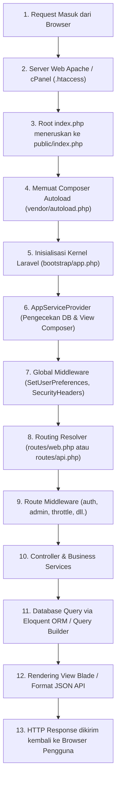
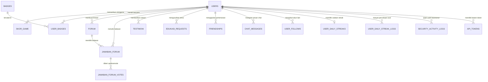

# 📘 PANDUAN LENGKAP & BEDAH KODE SELURUH FITUR DIGI-SAFE PURWAKARTA (ALL-IN-ONE)

Dokumen ini adalah **panduan induk tunggal (1 file mencakup seluruhnya)** untuk mempelajari secara mendalam aplikasi **Digi-Safe Purwakarta** dari A sampai Z. Dokumen ini dirancang khusus untuk persiapan menghadapi **Uji Kompetensi Keahlian (UKK) Rekayasa Perangkat Lunak / Web Development**: mulai dari arsitektur MVC, siklus hidup request (_request lifecycle_), perancangan 24 tabel database, sistem autentikasi (Login/Register/Logout/Google OAuth/OTP Gmail), arsitektur antarmuka (navbar transparan ke solid saat di-scroll, transisi tema 3D, toast stack), bedah tuntas **seluruh fitur warga dan panel Admin/Owner**, hingga **simulasi tanya jawab penguji UKK** lengkap dengan **nama file dan nomor baris kode aslinya**.

---

## 📋 DAFTAR ISI

1. [Bagian 1: Pondasi Arsitektur, Siklus Hidup Request & Middleware](#bagian-1-pondasi-arsitektur-siklus-hidup-request--middleware)
   - [1.1 Tech Stack Lengkap](#11-tech-stack-lengkap)
   - [1.2 Alur Masuknya Request (Lifecycle dari Browser ke Controller)](#12-alur-masuknya-request-lifecycle-dari-browser-ke-controller)
   - [1.3 Inisialisasi Otomatis MySQL Port 3306 di Windows](#13-inisialisasi-otomatis-mysql-port-3306-di-windows)
   - [1.4 View Composer Global Admin](#14-view-composer-global-admin)
   - [1.5 Bedah Tuntas 3 Middleware Inti](#15-bedah-tuntas-3-middleware-inti)
2. [Bagian 2: Bedah Perancangan Database Lengkap (24 Tabel & Self-Healing Schema)](#bagian-2-bedah-perancangan-database-lengkap-24-tabel--self-healing-schema)
   - [2.1 Filosofi Relasional Database MySQL](#21-filosofi-relasional-database-mysql)
   - [2.2 Konsep Unggulan Self-Healing Schema](#22-konsep-unggulan-self-healing-schema)
   - [2.3 Diagram Relasi Entitas (ERD)](#23-diagram-relasi-entitas-erd)
   - [2.4 Bedah Tuntas 24 Tabel Database & Fungsinya](#24-bedah-tuntas-24-tabel-database--fungsinya)
3. [Bagian 3: Sistem Autentikasi Lengkap & Keamanan Kriptografis](#bagian-3-sistem-autentikasi-lengkap--keamanan-kriptografis)
   - [3.1 Validasi Email Asli & Anti-Disposable Email](#31-validasi-email-asli--anti-disposable-email)
   - [3.2 Siklus Hidup Register Akun Baru](#32-siklus-hidup-register-akun-baru)
   - [3.3 Siklus Hidup Login Manual & Proteksi Brute-Force](#33-siklus-hidup-login-manual--proteksi-brute-force)
   - [3.4 Siklus Hidup Logout Aman](#34-siklus-hidup-logout-aman)
   - [3.5 Integrasi Google OAuth 2.0 & Onboarding Kustomisasi Profil](#35-integrasi-google-oauth-20--onboarding-kustomisasi-profil)
   - [3.6 Bedah Tuntas Sistem OTP Gmail (Reset Password & Hapus Akun)](#36-bedah-tuntas-sistem-otp-gmail-reset-password--hapus-akun)
4. [Bagian 4: Bedah Tuntas Arsitektur Frontend & UI/UX](#bagian-4-bedah-tuntas-arsitektur-frontend--uiux)
   - [4.1 Mekanisme Perubahan Navbar Saat Di-Scroll (Transparan ke Solid)](#41-mekanisme-perubahan-navbar-saat-di-scroll-transparan-ke-solid)
   - [4.2 Sistem Transisi Tema Light & Dark Mode 3D (Anti-FOUC)](#42-sistem-transisi-tema-light--dark-mode-3d-anti-fouc)
   - [4.3 Sistem Dwi-Bahasa (Bilingual ID / EN)](#43-sistem-dwi-bahasa-bilingual-id--en)
   - [4.4 Global Toast Notification Stack (Anti-Layout-Shift)](#44-global-toast-notification-stack-anti-layout-shift)
5. [Bagian 5: Bedah Tuntas Seluruh Fitur Pengguna (User Features)](#bagian-5-bedah-tuntas-seluruh-fitur-pengguna-user-features)
   - [5.1 Beranda, Direktori Warga & Eager Aggregation](#51-beranda-direktori-warga--eager-aggregation)
   - [5.2 Tantangan Harian (Daily Streak), Animasi Api/Es & Anti-Tebak](#52-tantangan-harian-daily-streak-animasi-apies--anti-tebak)
   - [5.3 Pusat Edukasi & Usulan Tema ke Bot Digika](#53-pusat-edukasi--usulan-tema-ke-bot-digika)
   - [5.4 Arena Minigame Kuis (Phishing Hunter, Cyber Defender, Link Trap)](#54-arena-minigame-kuis-phishing-hunter-cyber-defender-link-trap)
   - [5.5 Password Strength Checker (Laboratorium Sandi Klien)](#55-password-strength-checker-laboratorium-sandi-klien)
   - [5.6 Simulator Chat Penipuan WhatsApp (15 Skenario Kontak Lokal)](#56-simulator-chat-penipuan-whatsapp-15-skenario-kontak-lokal)
   - [5.7 Pemindai Tautan & QR Code Phishing (Link & QR Scanner)](#57-pemindai-tautan--qr-code-phishing-link--qr-scanner)
   - [5.8 Leaderboard 5 Kategori & Sistem 5 Border Avatar Prestasi](#58-leaderboard-5-kategori--sistem-5-border-avatar-prestasi)
   - [5.9 Forum Diskusi Komunitas Real-Time, Voting & Most Helpful](#59-forum-diskusi-komunitas-real-time-voting--most-helpful)
   - [5.10 Testimoni Warga (Publik / Anonim & Rating Bintang 1–5)](#510-testimoni-warga-publik--anonim--rating-bintang-15)
   - [5.11 Profil Pengguna, Canvas Cropper, Banner Color Picker & Privasi](#511-profil-pengguna-canvas-cropper-banner-color-picker--privasi)
   - [5.12 Jejaring Sosial: Follow, Pertemanan & Live Chat + Bot Digika](#512-jejaring-sosial-follow-pertemanan--live-chat--bot-digika)
6. [Bagian 6: Bedah Tuntas Seluruh Fitur Panel Admin & Owner](#bagian-6-bedah-tuntas-seluruh-fitur-panel-admin--owner)
   - [6.1 Layout Induk Admin & View Composer](#61-layout-induk-admin--view-composer)
   - [6.2 Pop-Up Diagram Analitik Interaktif (SVG Garis & Titik User + Rating 5★–1★)](#62-pop-up-diagram-analitik-interaktif-svg-garis--titik-user--rating-51)
   - [6.3 Tab 1: Manajemen Modul Edukasi & Evaluasi Usulan Tema](#63-tab-1-manajemen-modul-edukasi--evaluasi-usulan-tema)
   - [6.4 Tab 2: Manajemen Bank Soal & Pengaturan Level Minigame](#64-tab-2-manajemen-bank-soal--pengaturan-level-minigame)
   - [6.5 Tab 3: Manajemen Bank Soal Daily Streak (Pilihan A–E Tanpa Ngoding)](#65-tab-3-manajemen-bank-soal-daily-streak-pilihan-ae-tanpa-ngoding)
   - [6.6 Tab 4: Moderasi Forum (Pin/Star Thread & Hapus Pelanggaran)](#66-tab-4-moderasi-forum-pinstar-thread--hapus-pelanggaran)
   - [6.7 Tab 5: Manajemen Hak Akses User & Proteksi Mutlak Akun Owner](#67-tab-5-manajemen-hak-akses-user--proteksi-mutlak-akun-owner)
   - [6.8 Tab 6: Export Laporan Resmi Excel (.xlsx) Multi-Sheet](#68-tab-6-export-laporan-resmi-excel-xlsx-multi-sheet)
7. [Bagian 7: REST API Mobile (Flutter APK) & Progressive Web App (PWA)](#bagian-7-rest-api-mobile-flutter-apk--progressive-web-app-pwa)
   - [7.1 Arsitektur Bearer Token SHA-256](#71-arsitektur-bearer-token-sha-256)
   - [7.2 Daftar Endpoint REST API](#72-daftar-endpoint-rest-api)
   - [7.3 Progressive Web App (PWA) & Offline Fallback](#73-progressive-web-app-pwa--offline-fallback)
8. [Bagian 8: Panduan Setup Laptop, Sinkronisasi Git & Hosting RumahWeb](#bagian-8-panduan-setup-laptop-sinkronisasi-git--hosting-rumahweb)
   - [8.1 Cara Setup & Sinkronisasi Git di Laptop](#81-cara-setup--sinkronisasi-git-di-laptop)
   - [8.2 Akun Default Siap Pakai](#82-akun-default-siap-pakai)
   - [8.3 Checklist Anti-Gagal Deploy Hosting cPanel RumahWeb](#83-checklist-anti-gagal-deploy-hosting-cpanel-rumahweb)
9. [Bagian 9: Simulasi Tanya Jawab Penguji UKK (12 Pertanyaan Kunci)](#bagian-9-simulasi-tanya-jawab-penguji-ukk-12-pertanyaan-kunci)

---

## Bagian 1: Pondasi Arsitektur, Siklus Hidup Request & Middleware

### 1.1 Tech Stack Lengkap

- **Backend**: **PHP 8.2+** dengan **Laravel 12** (`composer.json` Baris 8–12).
- **Database**: **MySQL 8.0+** / **MariaDB 10.4+** (`digi_safe_db` di laptop XAMPP, `digj6533_digisafepurwakarta1` di cPanel RumahWeb).
- **Frontend Reactive**: **Blade Template Engine** + **Tailwind CSS 3.4** + **Alpine.js 3.x** (interaktivitas reaktif tanpa beban framework berat) + **Vite 7** (`package.json`, `vite.config.js`).
- **Penyimpanan Berkas (Media)**: Dual-Write Filesystem (`public/images/` dan `storage/app/public/`) agar gambar profil dan banner langsung tampil tanpa wajib menjalankan `php artisan storage:link`.
- **Pengiriman Email (Relay OTP)**: Multi-channel delivery: **Google Apps Script Webhook HTTPS Port 443** (utama, anti-blokir firewall) $\rightarrow$ **Brevo REST API Port 443** $\rightarrow$ **Laravel Native SMTP**.

---

### 1.2 Alur Masuknya Request (Lifecycle dari Browser ke Controller)

Ketika seorang pengguna mengetik alamat `https://digisafepurwakarta.web.id` atau mengklik sebuah tombol di browser, berikut adalah perjalanan request tersebut langkah demi langkah di dalam server:



1. **Pintu Masuk Server Web (`.htaccess` & `public/index.php`)**:
   - Di shared hosting (cPanel), file `.htaccess` di folder root (**Baris 16–21**) memblokir akses langsung pengunjung ke folder internal (`.env`, `storage/`, `vendor/`, `bootstrap/`) demi keamanan, lalu membelokkan seluruh request ke folder `public/`.
   - File `index.php` di root (**Baris 7**) meneruskan eksekusi ke `public/index.php`.
   - `public/index.php` (**Baris 14–20**) memanggil `vendor/autoload.php` (autoloader standar PSR-4) dan mem-bootstrap aplikasi Laravel melalui `bootstrap/app.php`.
2. **Pendaftaran Routing & Middleware (`bootstrap/app.php` Baris 13–38)**:
   - **Baris 14–19**: Mendaftarkan rute web (`routes/web.php`) dan rute API mobile (`routes/api.php`).
   - **Baris 22–25**: Menempelkan 2 middleware global ke seluruh halaman web: `SetUserPreferences` dan `SecurityHeaders`.
   - **Baris 29–34**: Mendaftarkan alias middleware:
     - `'admin'` $\rightarrow$ `AdminMiddleware::class` (melindungi panel admin).
     - `'api.optional'` $\rightarrow$ `ApiTokenOptional::class` (mengenali user jika token disertakan).
     - `'api.auth'` $\rightarrow$ `ApiTokenAuth::class` (wajib token untuk endpoint privat).
     - `'api.admin'` $\rightarrow$ `ApiAdminMiddleware::class` (khusus admin di REST API).

---

### 1.3 Inisialisasi Otomatis MySQL Port 3306 di Windows

File: **`app/Providers/AppServiceProvider.php`** (**Baris 20–42**).

- **Masalah Nyata**: Siswa atau penguji UKK sering lupa menyalakan tombol MySQL di XAMPP Control Panel saat menjalankan `php artisan serve`, yang berakibat website langsung melempar error merah menyala: `SQLSTATE[HY000] [2002] No connection could be made because the target machine actively refused it`.
- **Solusi Cerdas di Digi-Safe**:
  Di dalam method `register()`, sistem memeriksa apakah environment adalah lokal Windows (`PHP_OS_FAMILY === 'Windows'`). Sistem mencoba membuka koneksi socket cepat ke port 3306:
  ```php
  $connection = @fsockopen('127.0.0.1', 3306, $errno, $errstr, 0.4);
  ```
  Jika socket gagal terbuka (berarti MySQL mati), kode secara otomatis mengeksekusi perintah shell background Windows:
  ```php
  @pclose(@popen("start /B {$defaultMysqld}", 'r'));
  ```
  sehingga service `mysqld.exe` menyala otomatis di latar belakang tanpa memblokir proses Laravel. Pengguna tidak akan pernah mengalami error MySQL mati di laptop!

---

### 1.4 View Composer Global Admin

File: **`app/Providers/AppServiceProvider.php`** (**Baris 55–85**).

- **Tujuan**: Menerapkan prinsip **DRY (Don't Repeat Yourself)**. Daripada setiap controller admin (`Admin\DashboardController`, `Admin\EdukasiController`, `Admin\StreakQuestionController`, dll.) harus melakukan query hitung data statistik secara berulang-ulang, Laravel menyediakan fitur **View Composer**:
  ```php
  View::composer('admin.*', function ($view) { ... });
  ```
- **Data yang Disuplai Otomatis ke Seluruh Panel Admin**:
  Variabel `$adminStats` yang berisi:
  - Jumlah total modul edukasi (`ModulEdukasi::count()`).
  - Jumlah usulan tema warga yang masih `pending` (`EdukasiRequest::where('status', 'pending')->count()`).
  - Jumlah bank soal kuis minigame (`SoalMinigame::count()`).
  - Jumlah bank soal daily streak aktif (`DailyStreakQuestion::where('is_active', true)->count()`).
  - Jumlah warga terdaftar (`User::humans()->count()`).
  - Data grafik koordinat SVG interaktif dari `AdminAnalyticsService::build()` (**Baris 78–82**).

---

### 1.5 Bedah Tuntas 3 Middleware Inti

| Middleware | Lokasi File & Baris | Cara Kerja Teknis & Fungsinya |
| :--- | :--- | :--- |
| **`SetUserPreferences`** | `app/Http/Middleware/SetUserPreferences.php` **Baris 14–55** | 1. Memeriksa bahasa (`locale`: `id` atau `en`) dan tema (`theme`: `light` atau `dark`) dari session.<br>2. Jika user sedang login dan session belum ada, otomatis membaca kolom `locale` dan `theme` dari database user (**Baris 24–35**).<br>3. Menjalankan `App::setLocale($locale)` dan membagikan `$currentLocale` serta `$currentTheme` ke seluruh file Blade (**Baris 37–40**).<br>4. Memeriksa status onboarding Google (`session('google_onboarding_pending') === true`). Jika user login lewat Google dan belum memilih username/avatar, otomatis dipaksa redirect ke `/auth/google/customize` (**Baris 43–52**). |
| **`SecurityHeaders`** | `app/Http/Middleware/SecurityHeaders.php` **Baris 11–33** | Menambahkan header standar keamanan web internasional pada response HTTP:<br>- `X-Frame-Options: SAMEORIGIN` (mencegah website dibungkus iframe oleh situs penipu / serangan Clickjacking).<br>- `X-Content-Type-Options: nosniff` (mencegah browser mengeksekusi file teks sebagai script berbahaya / MIME sniffing).<br>- `Referrer-Policy: strict-origin-when-cross-origin`.<br>- **Cache-Control No-Store** (**Baris 27–30**): Khusus halaman sensitif (`login`, `register`, `lupa-password*`, `profile*`, `admin*`), browser dilarang menyimpan cache halaman di disk agar jika murid menggunakan komputer lab sekolah bersama, orang setelahnya tidak bisa menekan tombol _Back_ browser untuk melihat data akun sebelumnya! |
| **`AdminMiddleware`** | `app/Http/Middleware/AdminMiddleware.php` **Baris 12–20** | 1. Memeriksa apakah user sudah login (`Auth::check()`). Jika belum, langsung diarahkan ke halaman login.<br>2. Memeriksa apakah role user termasuk kelompok pengelola: `in_array(Auth::user()->role, ['admin', 'owner'], true)`.<br>3. Jika user biasa mencoba mengetik URL `/admin` secara manual, sistem langsung membatalkan request dengan status **HTTP 403 Forbidden** (`abort(403, 'Akses ditolak.')`). |

---

## Bagian 2: Bedah Perancangan Database Lengkap (24 Tabel & Self-Healing Schema)

### 2.1 Filosofi Relasional Database MySQL

Aplikasi ini menggunakan perancangan database relasional (**RDBMS MySQL**) dengan standar industri:
1. **Integritas Referensial (Foreign Key)**: Relasi antar tabel dilindungi kunci asing bertingkat (misal saat sebuah thread forum dihapus, seluruh jawaban dan riwayat vote di tabel anak otomatis terhapus bersih via `ON DELETE CASCADE`).
2. **Indeks B-Tree**: Kolom yang sering dijadikan filter query (`user_id`, `email`, `status`, `created_at`, `challenge_date`) diberi indeks database agar pembacaan jutaan data tetap instan (< 5 milidetik).
3. **Penyimpanan Hibrida Relasional & JSON**: Untuk data dinamis yang fleksibel (seperti daftar badge yang diraih, opsi kuis A–E, dan konfigurasi sakelar privasi), Laravel memanfaatkan tipe data kolom `JSON` modern di MySQL yang cepat dan tidak memerlukan puluhan tabel pivot baru yang memperlambat database.

---

### 2.2 Konsep Unggulan Self-Healing Schema

Salah satu inovasi terbesar dalam kode Digi-Safe Purwakarta adalah **Self-Healing Schema**:
Di lingkungan ujian UKK atau shared hosting cPanel murah, siswa sering kali **tidak memiliki akses terminal SSH** untuk mengetik perintah `php artisan migrate`. Jika file database baru di-upload tanpa tabel yang lengkap, aplikasi pada umumnya akan langsung mengalami _Fatal Error / 500 Internal Server Error_.

Di Digi-Safe, seluruh service penting dilengkapi method `ensureTable()` atau `ensureInitialized()`:
- `AccountOtpService::ensureTable()` (`app/Services/AccountOtpService.php` **Baris 27–49**): Mengecek keberadaan tabel `account_otps`. Jika belum ada, otomatis membuat tabel lengkap dengan skema indeksnya.
- `DailyStreakService::ensureTables()` (`app/Services/DailyStreakService.php` **Baris 17–54**): Otomatis membuat tabel `user_daily_streaks` dan `user_daily_streak_logs`.
- `DailyStreakQuestion::ensureInitialized()` (`app/Models/DailyStreakQuestion.php` **Baris 36–96**): Otomatis membuat tabel `daily_streak_questions` dan menyuntikkan 12 bank soal bawaan.
- `User::ensurePreferenceColumns()` (`app/Models/User.php` **Baris 66–107**): Mengecek dan otomatis menambahkan kolom `locale`, `theme`, `privacy_settings`, `avatar_border`, `specialty_role` jika tabel `users` lama belum memilikinya.
- `SocialSchemaHelper::ensureReady()` (`app/Services/SocialSchemaHelper.php`): Memastikan tabel pertemanan, follow, dan chat siap digunakan.
- `MinigameLevel::ensureInitialized()` (`app/Models/MinigameLevel.php`): Menjamin tabel level game selalu memiliki data default.

Hasilnya: **Website dapat di-upload ke server cPanel mana pun dan langsung bekerja sempurna 100% tanpa perlu menyentuh terminal!**

---

### 2.3 Diagram Relasi Entitas (ERD)



---

### 2.4 Bedah Tuntas 24 Tabel Database & Fungsinya

#### A. Kelompok Pengguna, Autentikasi & Keamanan Akun

1. **`users`** (Model: `app/Models/User.php` **Baris 17–504**):
   - Tabel pusat penyimpan data warga, Admin, Owner, dan akun sistem Bot Digika.
   - **Kolom Utama**:
     - `id` (BigInt PK Auto-Increment).
     - `username` (Varchar 50, Unik, indeks pencarian).
     - `email` (Varchar 120, Unik, dinormalisasi huruf kecil).
     - `password` (Varchar 255, Bcrypt hash 12 rounds; nullable untuk user murni Google OAuth).
     - `role` (Enum: `'owner'`, `'admin'`, `'user'`).
     - `specialty_role` (Varchar 50, gelar keahlian: `Cyber Guardian`, `Digital Educator`, `Phishing Hunter`, `Tech Explorer`).
     - `nama_lengkap`, `bio` (Teks profil pengguna).
     - `avatar`, `banner` (Path file foto yang tersimpan di disk).
     - `avatar_border` (Varchar 40, kunci bingkai prestasi yang sedang dipasang).
     - `badge_json` (JSON, daftar slug lencana yang berhasil dibuka).
     - `oauth_provider` (`'google'`), `oauth_uid` (ID unik akun Google).
     - `locale` (`'id'` / `'en'`), `theme` (`'light'` / `'dark'`).
     - `privacy_settings` (JSON, konfigurasi 6 switch privasi, preset warna banner, status verifikasi onboarding Google, dan flag password lokal).
2. **`account_otps`** (`app/Services/AccountOtpService.php` **Baris 34–45**):
   - Menyimpan kode OTP 6 digit yang telah di-hash untuk fitur Reset Password dan Hapus Akun.
   - **Kolom**: `id`, `email`, `purpose` (`'password_reset'` / `'delete_account'`), `code_hash` (Bcrypt hash), `attempts` (penghitung salah tebak, maks 5), `expires_at` (timestamp kedaluwarsa 10 menit), `consumed_at` (waktu pemakaian, null jika belum terpakai), `created_at`, `updated_at`.
3. **`security_activity_logs`** (`app/Services/SecurityActivityService.php`):
   - Mencatat seluruh riwayat keamanan akun yang dapat dilihat pengguna di halaman Profil miliknya.
   - **Kolom**: `id`, `user_id`, `event` (`login_web`, `login_google`, `password_reset_otp`, `password_changed`, `account_delete_requested`), `ip_address`, `device_label` (informasi jenis browser & OS pengguna), `user_agent`, `created_at`.
4. **`api_tokens`** (Model: `app/Models/ApiToken.php`):
   - Menyimpan token autentikasi Bearer REST API untuk aplikasi mobile Flutter Android.
   - **Kolom**: `id`, `user_id`, `name`, `token_hash` (SHA-256 hash token 64 karakter), `last_used_at`, `expires_at`, `created_at`, `updated_at`.
5. **`sessions`**:
   - Menyimpan session aktif (`SESSION_DRIVER=database`). Digunakan saat user mereset kata sandi via OTP untuk mencabut (_force logout_) seluruh sesi aktif di perangkat lain secara instan.

#### B. Kelompok Tantangan Harian (Daily Streak)

6. **`user_daily_streaks`** (`app/Services/DailyStreakService.php` **Baris 24–38**):
   - Menyimpan status api keaktifan belajar harian setiap pengguna.
   - **Kolom**: `id`, `user_id` (Unik), `current_streak` (jumlah hari berturut-turut saat ini), `longest_streak` (rekor terbaik sepanjang masa), `freeze_recovery_left` (sisa kesempatan mencairkan es, default 2), `total_completed`, `status` (`'idle'`, `'active'`, `'frozen'`, `'broken'`), `last_completed_at`, `last_completed_date` (format `YYYY-MM-DD`), `weekly_days_json` (progres 7 hari Senin–Minggu), `timestamps`.
7. **`user_daily_streak_logs`** (`DailyStreakService.php` **Baris 40–53**):
   - Mencatat setiap percobaan jawaban user per tanggal (`challenge_date`). Digunakan untuk menghitung jumlah salah (`$wrongToday`) sehingga jika user salah menjawab, soal otomatis diganti ke soal baru dan user tidak bisa mengulang tebak di soal yang sama.
8. **`daily_streak_questions`** (Model: `app/Models/DailyStreakQuestion.php`):
   - Bank soal tantangan harian A–E dinamis yang dapat dikelola Admin dari web.
   - **Kolom**: `id`, `question_key` (Unik), `category_id`, `category_en`, `difficulty_id`, `difficulty_en`, `prompt_id`, `prompt_en`, `options_id_json` (JSON opsi A–E Bahasa Indonesia), `options_en_json` (JSON opsi A–E Bahasa Inggris), `answer` (`'A'`/`'B'`/`'C'`/`'D'`/`'E'`), `explanation_id`, `explanation_en`, `is_active` (boolean), `created_by`, `timestamps`.

#### C. Kelompok Edukasi & Arena Minigame

9. **`modul_edukasi`** (Model: `app/Models/ModulEdukasi.php`):
   - Menyimpan materi literasi siber publik bertipe teks interaktif maupun tautan jurnal/portal resmi eksternal.
10. **`edukasi_requests`** (Model: `app/Models/EdukasiRequest.php`):
    - Menyimpan usulan tema dari warga yang menunggu evaluasi Admin (`pending`, `approved`, `rejected`) lengkap dengan catatan tim penilai (`admin_note`).
11. **`progres_baca`** (Model: `app/Models/ProgresBaca.php`):
    - Mencatat riwayat modul mana saja yang telah dibaca dan dituntaskan oleh setiap pengguna.
12. **`minigame_levels`** (Model: `app/Models/MinigameLevel.php`):
    - Konfigurasi parameter tingkat kesulitan minigame yang dapat diubah Admin (`waktu_detik`, `poin_benar`, `penalti_salah`, `hp_awal`, warna tampilan, dan urutan).
13. **`soal_minigame`** (Model: `app/Models/SoalMinigame.php`):
    - Bank soal kuis 4 pilihan (A–D) untuk 3 arena permainan (`phishing`, `cyber-defender`, `link-trap`).
14. **`skor_game`** (Model: `app/Models/SkorGame.php`):
    - Mencatat setiap sesi permainan kuis, simulator WhatsApp, maupun bonus streak harian (`skor`, `benar`, `salah`, `played_at`).
15. **`badges` & `user_badges`** (Model: `Badge.php`, `UserBadge.php`):
    - Master daftar lencana prestasi dan tabel pivot riwayat tanggal user mendapatkan lencana tersebut.

#### D. Kelompok Forum Komunitas, Testimoni & Jejaring Sosial

16. **`forum`** (Model: `app/Models/Forum.php`):
    - Thread diskusi warga (`judul`, `kategori`, `pertanyaan`, `status` [terbuka/terjawab], `is_hidden`, `is_starred` [disematkan admin], `views`).
17. **`jawaban_forum`** (Model: `app/Models/JawabanForum.php`):
    - Balasan pada thread forum (`jawaban`, `is_admin`, timestamps).
18. **`jawaban_forum_votes`** (Model: `app/Models/JawabanForumVote.php`):
    - Mencatat vote pembaca (👍 `up` atau 👎 `down`) dengan proteksi unik 1 vote per user per jawaban.
19. **`testimoni` & `testimoni_reactions`** (Model: `app/Models/Testimoni.php`):
    - Ulasan warga (`cerita`, `rating` bintang 1–5, `is_anonymous` [1 = sembunyikan nama asli jadi "Warga Purwakarta"]).
20. **`friendships`** (Model: `app/Models/Friendship.php`):
    - Relasi pertemanan 2 arah (`requester_id`, `addressee_id`, status: `pending`, `accepted`, `declined`).
21. **`chat_messages`** (Model: `app/Models/ChatMessage.php`):
    - Pesan obrolan real-time antar warga dan pesan resmi dari akun sistem **Bot Digika**.
22. **`user_follows`** (Model: `app/Models/UserFollow.php`):
    - Relasi jejaring sosial 1 arah (`follower_id` mengikuti `following_id`).
23. **`cache` & `jobs`**:
    - Penyimpanan cache database dan antrean tugas background Laravel.
24. **`log_aktivitas`**:
    - Pencatatan aktivitas umum sistem.

---

## Bagian 3: Sistem Autentikasi Lengkap & Keamanan Kriptografis

### 3.1 Validasi Email Asli & Anti-Disposable Email

File: **`app/Rules/ValidRealEmail.php`** (**Baris 9–165**).

Sebelum email diterima saat Register atau Login, rule kustom `ValidRealEmail` menjalankan 4 lapis filter ketat:
1. **Daftar Hitam Domain Sampah (`BLOCKED_DOMAINS`, Baris 14–92)**:
   Memblokir lebih dari 60 domain email sementara sekali pakai (_disposable_) seperti `yopmail.com`, `tempmail.com`, `guerrillamail.com`, `10minutemail.com`, domain palsu ngasal (`test.com`, `asdf.com`, `coba.com`), dan salah ketik populer (`gmail.con`, `gamil.com`, `yaho.com`).
2. **Validasi Sintaks RFC (`validateFormat`, Baris 103–129)**:
   Memastikan format email standar, memeriksa panjang bagian sebelum `@` minimal 2 karakter, serta menolak adanya titik ganda berturut-turut (`..`).
3. **Validasi Struktur Domain (`validateDomain`, Baris 131–153)**:
   Memeriksa bahwa domain memiliki label TLD yang valid dengan regex `^[a-z0-9]([a-z0-9-]*[a-z0-9])?(\.[a-z0-9]([a-z0-9-]*[a-z0-9])?)+$`.
4. **Pemeriksaan DNS MX Nyata di Internet (`checkDnsRecord`, Baris 155–163)**:
   Saat registrasi akun baru (`checkDns: true`), sistem memanggil fungsi PHP `checkdnsrr($domain, 'MX')` untuk memastikan domain tersebut benar-benar memiliki server email aktif di dunia nyata.

---

### 3.2 Siklus Hidup Register Akun Baru

File: **`app/Http/Controllers/AuthController.php`** (**Baris 113–174**).

- **Rute**: `GET /register` (`showRegister`) dan `POST /register` (`register`), dilindungi rate-limiter `throttle:5,1` di `routes/web.php` **Baris 109** (maksimal 5x submit per menit untuk mencegah bot registrasi massal).
- **Alur Eksekusi Kode**:
  1. **Normalisasi Huruf Kecil (Baris 123–126)**:
     `username` dan `email` diproses dengan `Str::lower(trim(...))` sebelum divalidasi agar tidak terjadi duplikasi akun akibat huruf kapital.
  2. **Validasi Ketat (Baris 129–156)**:
     - `nama_lengkap`: Wajib, 2–100 karakter.
     - `username`: Wajib, 3–50 karakter, alfanumerik strip underscore (`alpha_dash`), unik di tabel `users`, dan **dilarang menggunakan nama sistem** (`Rule::notIn(self::RESERVED_USERNAMES)` pada **Baris 25–40**, seperti `admin`, `owner`, `bot_digika`, `root`, `administrator`).
     - `email`: Wajib, unik di database, dan lolos uji `new ValidRealEmail(checkDns: true)`.
     - `password`: Wajib, minimal 8 karakter, maksimal 128 karakter (mencegah eksploitasi CPU DoS pada algoritma Bcrypt), dan wajib sama dengan field konfirmasi password (`confirmed`).
  3. **Penyimpanan Hash Bcrypt (Baris 159–168)**:
     Password disimpan ke database dalam bentuk hash menggunakan `Hash::make($validated['password'])` (Bcrypt 12 rounds). Akun baru otomatis diberi `role => 'user'`, mengadopsi preferensi `locale` dan `theme` yang sedang aktif di navbar, serta diberi flag `privacy_settings => ['has_local_password' => true]`.
  4. **Auto-Login & Regenerasi Session ID (Baris 170–173)**:
     Sistem memanggil `Auth::login($user)`, lalu **wajib** memanggil `$request->session()->regenerate()` untuk membuat ID sesi baru demi mencegah serangan **Session Fixation Attack**.

---

### 3.3 Siklus Hidup Login Manual & Proteksi Brute-Force

File: **`app/Http/Controllers/AuthController.php`** (**Baris 42–111**).

- **Rute**: `GET /login` (`showLogin`) dan `POST /login` (`login`).
- **Alur Eksekusi Kode**:
  1. **Peringatan Ramah Tamu (Baris 45–50)**:
     Jika pengguna umum diarahkan ke halaman login karena mencoba masuk ke arena minigame, sistem otomatis menampilkan notifikasi flash yang mengedukasi bahwa kuis minigame memerlukan login untuk menyimpan skor dan lencana.
  2. **Proteksi Anti-Brute-Force per Akun + IP (Baris 73–84)**:
     Sistem membuat kunci unik `$throttleKey = 'login-web:' . sha1($email . '|' . $request->ip())`. Jika terjadi kegagalan login 5 kali (`RateLimiter::tooManyAttempts($throttleKey, 5)`), akun dikunci selama 60 detik dan menampilkan hitung mundur sisa detik ke layar pengguna.
  3. **Proteksi Khusus Akun Sistem Bot Digika (Baris 86–93)**:
     Sistem mengecek `$targetUser->isBot()`. Jika seseorang mencoba login menggunakan email `bot.digika@digisafe.id`, sistem langsung menolak login meskipun password yang dimasukkan benar.
  4. **Pencocokan Kredensial & Audit Trail (Baris 95–104)**:
     `Auth::attempt($credentials)` mencocokkan password dengan hash di database. Jika sukses, counter gagal dihapus (`RateLimiter::clear`), ID sesi di-regenerasi, aktivitas login dicatat di tabel `security_activity_logs` (`SecurityActivityService::record()`), lalu user diarahkan ke `/admin` jika role-nya `admin`/`owner` atau ke Beranda jika warga biasa.

---

### 3.4 Siklus Hidup Logout Aman

File: **`app/Http/Controllers/AuthController.php`** (**Baris 176–184**).

- **Rute**: `POST /logout` (`routes/web.php` **Baris 127–129**). Wajib menggunakan metode **`POST`** ber-token CSRF agar tidak bisa dieksploitasi oleh pihak ketiga via tag gambar `` di website lain (Cross-Site Request Forgery).
- **Alur Eksekusi Kode**:
  1. `Auth::logout()` (**Baris 178**): Menghapus identitas pengguna dari session guard Laravel.
  2. `$request->session()->invalidate()` (**Baris 180**): Menghapus seluruh data sesi aktif dan membersihkan ID sesi lama dari tabel database `sessions`.
  3. `$request->session()->regenerateToken()` (**Baris 181**): Menghasilkan token CSRF baru agar form lama tidak dapat dikirim ulang.
  4. Mengarahkan kembali ke halaman Beranda (`redirect('/')`).

---

### 3.5 Integrasi Google OAuth 2.0 & Onboarding Kustomisasi Profil

File: **`app/Http/Controllers/AuthController.php`** (**Baris 189–524**).

Fitur ini memungkinkan warga masuk tanpa perlu mengingat password menggunakan akun Google resmi:
1. **Redirect ke Google (`redirectToGoogle`, Baris 189–224)**:
   - Membuat parameter acak `state` sepanjang 40 karakter menggunakan `Str::random(40)` dan menyimpannya di session (`google_oauth_state`, **Baris 207–208**).
   - Mengarahkan browser ke `https://accounts.google.com/o/oauth2/v2/auth` dengan scope `openid email profile`.
2. **Validasi Callback Google (`handleGoogleCallback`, Baris 229–329)**:
   - Membandingkan parameter `state` yang dikembalikan Google dengan token `state` yang tersimpan di session menggunakan fungsi perbandingan waktu-konstan:
     ```php
     hash_equals($expectedState, $incomingState)
     ```
     Langkah ini **sangat penting dalam UKK** karena mematikan potensi serangan **Login CSRF**.
   - Menukar kode otorisasi (`code`) menjadi `access_token` melalui HTTP POST ke `https://oauth2.googleapis.com/token`.
   - Mengambil identitas user dari `https://www.googleapis.com/oauth2/v3/userinfo` dan memastikan `email_verified` bernilai `true`.
   - Memanggil `findOrCreateGoogleUser()` (**Baris 465–502**): Mencari user berdasarkan `oauth_uid` atau `email`. Jika belum terdaftar, akun baru dibuatkan secara otomatis dengan username unik dari fungsi `generateUniqueUsername()`.
3. **Alur Onboarding Kustomisasi Wajib (`google_onboarding_pending`, Baris 315–322)**:
   - Jika akun baru pertama kali login via Google dan belum pernah mengatur profil, sistem menandai session `google_onboarding_pending = true` dan mengarahkan ke halaman `/auth/google/customize`.
   - Middleware `SetUserPreferences` (**Baris 43–52**) mengunci pengguna di halaman ini sampai pengguna selesai memilih Nickname, Username unik, serta foto profil/banner. Setelah disimpan, sistem menandai `privacy_settings['google_onboarded'] = true` dan menghapus kunci session.

---

### 3.6 Bedah Tuntas Sistem OTP Gmail (Reset Password & Hapus Akun)

Dikelola oleh **`app/Http/Controllers/AccountSecurityController.php`** (**Baris 20–509**) dan **`app/Services/AccountOtpService.php`** (**Baris 17–412**).

#### A. Mengapa Port SMTP Standar Sering Gagal di Lingkungan Uji Coba?
Di lingkungan sekolah, universitas, jaringan Wi-Fi publik, maupun shared hosting murah (seperti cPanel RumahWeb), **port keluar SMTP (Port 465 SSL dan Port 587 TLS) hampir selalu diblokir oleh firewall ISP atau hosting** untuk mencegah spammer mengirimkan jutaan email liar. Akibatnya, aplikasi Laravel yang hanya mengandalkan SMTP standar akan mengalami error _Connection timed out_ (kode 110/10060).

#### B. Solusi Multi-Channel Relay Otomatis Digi-Safe Purwakarta
File: `AccountOtpService.php` (**Baris 326–411**).
Digi-Safe Purwakarta mengimplementasikan arsitektur pengiriman email 3 lapis yang cerdas:
1. **Kanal 1 (Utama) — Google Apps Script Webhook via HTTPS Port 443 (Baris 354–379)**:
   - **Port 443 adalah port HTTPS web standar yang tidak pernah diblokir oleh jaringan atau firewall mana pun di seluruh dunia**.
   - Server Laravel mengirimkan data email (`to`, `subject`, `html`, `from_name`) dalam bentuk JSON payload melalui HTTP POST ke endpoint Google Apps Script Web App:
     ```
     https://script.google.com/macros/s/AKfycbxEf_lh3nTOkzJxJ37cuXm9ufJF5ndoroqgZ6cfModLx2wWX1NU6PZ6ZBSFyw2B2g-mvA/exec
     ```
   - Skrip Google Apps Script yang berjalan di server Google langsung memanggil fungsi bawaan `MailApp.sendEmail()` menggunakan infrastruktur Google resmi, sehingga email OTP masuk ke kotak masuk Gmail pengguna dalam hitungan 2–3 detik!
   - **Portabilitas Antar Komputer**: Fallback URL webhook ini telah disematkan langsung di `config/services.php` (**Baris 44–48**). Ketika proyek di-git pull di laptop mana pun, fitur kirim email langsung aktif tanpa perlu setup ulang file `.env`!
2. **Kanal 2 (Sekunder) — Brevo HTTPS REST API Port 443 (Baris 381–408)**:
   - Jika `BREVO_API_KEY` terkonfigurasi, sistem dapat mengirim email lewat API Brevo via HTTPS Port 443.
3. **Kanal 3 (Fallback) — Laravel Native SMTP / Log (Baris 410)**:
   - Menggunakan driver bawaan Laravel jika kedua kanal HTTPS di atas tidak aktif.

#### C. Arsitektur Keamanan Kriptografis Kode OTP
1. **Generator Acak Kriptografis (`random_int`)**:
   Kode OTP 6 digit dibuat dengan fungsi `random_int(0, 999999)` yang aman secara kriptografi dan di-pad dengan nol di depan (`str_pad(..., 6, '0', STR_PAD_LEFT)`, **Baris 116**).
2. **Kode Asli TIDAK PERNAH Disimpan Plaintext**:
   Di dalam database tabel `account_otps`, yang disimpan adalah hash Bcrypt dari kode tersebut:
   ```php
   'code_hash' => Hash::make($plainOtp)
   ```
   Bahkan jika database bocor, penyerang tidak bisa membaca kode OTP pengguna!
3. **Masa Berlaku Ketat 10 Menit (`expires_at`)**:
   Setelah 10 menit (`EXPIRY_MINUTES = 10`), kode otomatis kedaluwarsa dan ditolak oleh query verifikasi (`where('expires_at', '>', now())`, **Baris 200**).
4. **Proteksi Anti-Brute-Force (Maksimal 5x Salah Tebak)**:
   Setiap kali user salah memasukkan kode, kolom `attempts` bertambah 1 (**Baris 278**). Jika mencapai 5 kali salah (`MAX_ATTEMPTS = 5`), seluruh OTP aktif untuk email tersebut langsung dihanguskan (`consumed_at = now()`, **Baris 237–240**) dan user wajib meminta kode baru.
5. **Rate Limiting Ganda (Anti-Spam & Kuota)**:
   - **Cooldown 20 Detik (`RESEND_COOLDOWN_SECONDS = 20`)**: User wajib menunggu 20 detik sebelum tombol "Kirim Ulang OTP" bisa diklik kembali (**Baris 93–105**).
   - **Batas Per Jam (`MAX_SENDS_PER_HOUR = 8`)**: Maksimal 8 kali permintaan OTP per email dalam 1 jam (**Baris 65–81**) untuk mencegah pengurasan kuota email.
6. **Konsumsi Sekali Pakai (One-Time Use)**:
   Saat kode benar diverifikasi, seluruh record OTP untuk email dan tujuan tersebut langsung ditandai `consumed_at = now()` (**Baris 260–267**) sehingga kode tidak pernah bisa dipakai dua kali.
7. **Pencabutan Sesi Multi-Perangkat (Global Session Revocation)**:
   Saat password baru berhasil disimpan di `resetPasswordWithOtp()` (`AccountSecurityController.php` **Baris 185–230**):
   - Seluruh token API mobile dicabut: `ApiToken::where('user_id', $user->id)->delete()` (**Baris 211–213**).
   - Seluruh sesi login di perangkat/browser lain dihapus seketika dari tabel `sessions` (**Baris 220–226**).
   - Aktivitas dicatat di `security_activity_logs` (**Baris 229**).

#### D. Alur Hapus Akun Permanen dengan OTP
File: `AccountSecurityController.php` (**Baris 251–508**).
- **Proteksi Akun Owner & Bot Digika (Baris 264–274)**: Sistem secara mutlak menolak permintaan hapus akun jika user memiliki role `owner` atau akun bot sistem.
- **Wajib Verifikasi Password Saat Ini (Baris 291–315)**: Sebelum OTP hapus akun dikirim, user wajib memasukkan password akun miliknya untuk mencegah pihak lain yang meminjam HP/laptop mengirimkan OTP sembarangan.
- **Pembersihan Bersih 15 Tabel dalam Transaksi Atomik (`DB::transaction`, Baris 417–486)**:
  Saat OTP terverifikasi, sistem mengeksekusi penghapusan di dalam satu transaksi database untuk menghapus: riwayat streak harian, progres baca edukasi, skor minigame, lencana pengguna, balasan forum, vote jawaban, relasi pertemanan, pesan chat, relasi follow, log keamanan, token API, dan session, serta menghapus file gambar profil & banner dari disk penyimpanan (**Baris 488–489**).

---

## Bagian 4: Bedah Tuntas Arsitektur Frontend & UI/UX

### 4.1 Mekanisme Perubahan Navbar Saat Di-Scroll (Transparan ke Solid)

File: **`resources/views/layouts/app.blade.php`** (**Baris 158–203**).

Salah satu fitur UI/UX paling menonjol pada Digi-Safe Purwakarta adalah **navbar adaptif** yang berubah tampilan secara dinamis dan mulus saat pengguna menggulir halaman.

#### A. Logika Deteksi PHP di Header Blade (Baris 158–171)
```php
@php
    $isBeranda = request()->routeIs('beranda');
    $isEdukasi = request()->routeIs('edukasi');
    $isMinigame = request()->routeIs('minigame.*');
    $isForum = request()->routeIs('forum.*');
    $isTestimoni = request()->routeIs('testimoni.*');
    $isTentang = request()->routeIs('tentang.*');
    $isAdminPage = request()->routeIs('admin.*');
    $isProfilePage = request()->routeIs('profile.*');
    $isUsersDirectory = request()->routeIs('users.directory');
    $isLeaderboard = request()->routeIs('leaderboard.*');
    $forceSolidNav = $isEdukasi || $isTentang || $isMinigame || $isForum || $isTestimoni || $isAdminPage || $isProfilePage || $isUsersDirectory || $isLeaderboard;
    $isDark = ($currentTheme ?? 'light') === 'dark';
@endphp
```
- **Mengapa ada `$forceSolidNav`?**
  Di halaman Beranda, terdapat _Hero Banner_ besar berwarna biru gelap bergradasi, sehingga navbar transparan di bagian atas terlihat sangat elegan dengan teks putih.
  Namun pada halaman subpage (seperti Edukasi, Forum, Leaderboard, Profil, dll.), konten langsung dimulai dengan latar belakang putih terang (Light Mode) atau abu-abu gelap (Dark Mode). Jika navbar di subpage dibiarkan transparan, teks menu putih akan bertabrakan dengan latar belakang halaman sehingga tidak terbaca. Oleh karena itu, `$forceSolidNav` memaksa navbar selalu dalam kondisi solid di seluruh subpage!

#### B. Deklarasi Reaktif Alpine.js pada Elemen `<header>` (Baris 174–180)
```blade
<header x-data="{ scrolled: {{ $forceSolidNav ? 'true' : 'false' }}, mobileOpen: false, profileOpen: false }"
    @scroll.window.passive="scrolled = {{ $forceSolidNav ? 'true' : 'window.scrollY > 50' }}"
    @click.outside="mobileOpen = false"
    @keydown.escape.window="mobileOpen = false; profileOpen = false"
    :class="scrolled
        ? '{{ $isDark ? 'bg-[#0F172A]/95 border-slate-800 text-slate-100' : 'bg-white/95 border-gray-100 text-ink' }} backdrop-blur-md shadow-neutral py-3 border-b'
        : '{{ $isEdukasi ? 'bg-ink/20 backdrop-blur-xs py-4 text-white' : 'bg-transparent py-4 sm:py-5 text-white' }}'"
    class="fixed top-0 left-0 right-0 w-full max-w-[100vw] z-50 transition-all duration-300">
```

- **Bedah Baris per Baris**:
  1. `x-data="{ scrolled: ..., mobileOpen: false, profileOpen: false }"`: Menginisialisasi state reaktif lokal Alpine.js. Nilai awal `scrolled` bernilai `true` jika di subpage, atau `false` jika di Beranda.
  2. `@scroll.window.passive="scrolled = ..."`: Event listener global yang memantau pergerakan scroll jendela browser.
     - **Mengapa memakai modifier `.passive`?**
       Dalam standar performa web browser (Lighthouse / Core Web Vitals), menambahkan `.passive` memberi tahu browser bahwa fungsi JavaScript tidak akan memanggil `event.preventDefault()`. Hal ini memungkinkan browser menjalankan animasi scrolling di **thread kompositor GPU terpisah tanpa lag / stuttering (bebas frame drop, 60–120 FPS konstan)**.
     - **Ambang Batas `window.scrollY > 50`**: Saat posisi scroll melewati 50 pixel dari atas, variabel `scrolled` berubah menjadi `true`.
  3. `:class="scrolled ? '...' : '...'"`: Tailwind CSS binding dinamis:
     - **Saat Belum Di-Scroll (`scrolled: false`)**:
       Padding vertikal lebih lapang (`py-4 sm:py-5`), background transparan (`bg-transparent`), dan teks berwarna putih bersih (`text-white`).
     - **Saat Di-Scroll (`scrolled: true`)**:
       Padding vertikal mengecil menjadi `py-3` (menghasilkan efek navbar compact / menciut yang rapi), background berubah menjadi **Frosted Glass semi-transparan dengan efek blur kaca** (`backdrop-blur-md bg-white/95` di mode terang atau `bg-[#0F172A]/95` di mode gelap), dilengkapi garis batas bawah halus (`border-b`) dan bayangan lembut (`shadow-neutral`).
  4. `transition-all duration-300`: Memastikan semua perubahan ukuran padding, warna latar belakang, dan bayangan berlangsung secara mulus selama 300 milidetik tanpa sentakan tiba-tiba.

#### C. Detail Perubahan Komponen Anak di Dalam Navbar
1. **Logo Kiri (Baris 187–202)**:
   Wadah logo (`<span>`) bertransisi dari `bg-white/95 shadow-sm` menjadi `bg-white border border-gray-100 shadow-xs`. Subtitle teks "Purwakarta" bertransisi warnanya dari `text-white/80` menjadi `text-muted` saat navbar solid.
2. **Indikator Halaman Aktif (Active Indicator, Baris 208–220)**:
   Link halaman yang sedang aktif menampilkan titik bulat hijau menyala (`w-1.5 h-1.5 rounded-full bg-lime`) di samping teks serta garis bawah melengkung (`absolute -bottom-1 left-0 right-0 h-[2px] rounded-full`). Saat posisi scroll di atas, garis ini berwarna hijau lime (`bg-lime`), dan saat di-scroll ke bawah otomatis berubah menjadi biru langit (`bg-sky`).
3. **Menu Hamburger Mobile (Baris 526–540)**:
   Tombol hamburger menggunakan Alpine.js `@click="mobileOpen = !mobileOpen"`. Drawer navigasi mobile (`Baris 544–690`) dilengkapi `max-h-[calc(100dvh-5.5rem)] overflow-y-auto overscroll-contain` agar pada layar HP berukuran pendek (seperti iPhone SE), menu tetap dapat di-scroll dengan nyaman tanpa memotong tombol logout atau profil di bagian bawah.

---

### 4.2 Sistem Transisi Tema Light & Dark Mode 3D (Anti-FOUC)

File: **`resources/views/layouts/app.blade.php`** (**Baris 27–81 & 818–950**).

#### A. Masalah Flash of Unstyled Content (FOUC) & Solusinya
Pada website biasa yang memiliki fitur tema gelap, sering terjadi masalah di mana layar berkedip putih sesaat sebelum JavaScript selesai dieksekusi saat refresh halaman.
Digi-Safe Purwakarta mengatasinya dengan **Early Inline Script di dalam `<head>` (Baris 51–81)**:
Sebelum browser mulai menggambar elemen `<body>`, script inline ini langsung membaca `sessionStorage.getItem('digisafe_pref_tx')`. Jika terdeteksi transaksi pergantian tema, script langsung menyuntikkan class `.pref-enter-active` ke tag `<html>` dan membuat elemen tirai `#pref-transition-veil` dengan warna latar belakang target (`#0B1120` untuk gelap atau `#F4F6FB` untuk terang) sehingga layar tidak pernah berkedip putih!

#### B. Widget Animasi 3D Theme Switch (`createIllustratedThemeSwitch`, Baris 870–950)
Saat pengguna mengklik tombol ikon matahari/bulan di navbar:
1. JavaScript mengambil koordinat titik klik pengguna (`originX`, `originY`).
2. Sebuah elemen switch 3D tercipta dan terbang dari posisi tombol toggle di navbar menuju tepat ke tengah-tengah layar pengguna (`transform: translate3d(...) scale(0.34)` $\rightarrow$ `scale(1)`).
3. Bentuknya yang semula bulatan kecil berdiameter 100px **melebar (_expand_) menjadi kapsul switch 3D sepanjang 228px** dengan efek pantulan cahaya dan bayangan realistis.
4. Di dalam kapsul, bola geser 3D (thumb) meluncur mulus, disertai animasi bintang-bintang bersudut 4 (untuk mode malam) atau lapisan awan bertingkat (untuk mode siang).
5. Teks status ("Mode Gelap" / "Mode Terang") bergeser dengan efek scroll vertikal, posisi scroll pengguna disimpan di `sessionStorage`, dan saat halaman baru selesai dimuat, tirai transisi memudar halus dan posisi scroll dipulihkan ke posisi semula (`window.scrollTo(0, incoming.scrollY)`).

---

### 4.3 Sistem Dwi-Bahasa (Bilingual ID / EN)

- **File Terjemahan Statis**: `lang/id/ui.php` dan `lang/en/ui.php`. Di dalam template Blade, teks dipanggil dengan helper `__('ui.nav.beranda')` atau `@lang(...)`.
- **Helper Terjemahan Dinamis Database**: `app/Services/BilingualHelper.php`.
  Menerjemahkan data dinamis yang disimpan di database:
  - `translateLevel()` (**Baris 12–42**): Menerjemahkan nama dan deskripsi tingkat kesulitan minigame.
  - `translateDbQuestion()` (**Baris 44–110**): Menerjemahkan soal dan opsi jawaban kuis minigame.
  - `translateModule()` (**Baris 112–165**): Menerjemahkan modul materi edukasi.
- **Rute Toggle Cepat**: `POST /preferences/quick` di `ProfileController.php` (**Baris 241–273**) memperbarui session dan mengupdate kolom `locale` di tabel `users` jika sedang login.

---

### 4.4 Global Toast Notification Stack (Anti-Layout-Shift)

File: **`resources/views/layouts/app.blade.php`** (**Baris 91–156 & 758–816**).

- **Masalah Umum**: Notifikasi flash bawaan framework sering diletakkan di atas konten halaman, sehingga saat notifikasi muncul atau hilang, seluruh halaman terdorong ke bawah lalu tertarik ke atas (_Cumulative Layout Shift / CLS_).
- **Arsitektur Toast Digi-Safe**:
  - Wadah notifikasi `#digisafe-toast-stack` diposisikan mengambang di pojok kanan atas (`fixed top-20 right-4 sm:right-6 z-[95]`).
  - Menggunakan kombinasi kelas Tailwind cerdas:
    - Kontainer induk menggunakan **`pointer-events-none`**: Area kosong di sekitar notifikasi tidak menghalangi klik mouse pengguna pada tombol atau link di bawahnya.
    - Setiap kartu notifikasi anak menggunakan **`pointer-events-auto`**: Tombol close (silang) pada kartu tetap bisa diklik untuk menutup notifikasi lebih cepat.
  - Notifikasi otomatis menutup sendiri setelah 4,2 detik (`setTimeout(() => show = false, 4200)`).
  - Tersedia fungsi JavaScript global `window.digisafeToast(message, type)` yang dapat dipanggil dari mana saja tanpa perlu reload halaman!

---

## Bagian 5: Bedah Tuntas Seluruh Fitur Pengguna (User Features)

### 5.1 Beranda, Direktori Warga & Eager Aggregation

File: **`app/Http/Controllers/BerandaController.php`** (**Baris 15–144**).

- **Pencegahan Masalah N+1 Query**:
  Di Beranda dan Direktori Warga, aplikasi menampilkan puluhan kartu profil warga lengkap dengan jumlah diskusi forum, jumlah jawaban, jumlah testimoni, jumlah followers, following, dan total skor game mereka.
  Jika ditulis dengan query manual biasa, mengambil 20 user akan mengeksekusi 140 query SQL ke database!
  Di Digi-Safe, seluruh metrik tersebut ditarik dalam **1 query SQL super cepat menggunakan Eager Aggregation (Baris 111–117)**:
  ```php
  User::humans()
      ->withCount(['forumThreads', 'forumReplies', 'testimonies', 'followers', 'following'])
      ->withSum('gameScores as total_game_points', 'skor')
      ->orderByDesc('total_game_points')
      ->paginate(12);
  ```

---

### 5.2 Tantangan Harian (Daily Streak), Animasi Api/Es & Anti-Tebak

File: **`app/Http/Controllers/DailyStreakController.php`**, **`app/Services/DailyStreakService.php`**, dan **`resources/views/components/daily-streak-widget.blade.php`**.

1. **Animasi Api Menyala vs Es Membeku**:
   - Status `active`: Ikon api menyala dengan animasi bara api bergolak (`streakFlameBurn` & `streakFlameGlow`, **Baris 45–96** di `daily-streak-widget.blade.php`).
   - Status `frozen`: Ikon es membeku dengan partikel kristal salju melayang (`streakFrostDrift`).
   - Status `idle`: Ikon api abu-abu tidur (`streak-flame-dormant`).
2. **Aturan 24 Jam & 2x Pemulihan Freeze (`DailyStreakService.php` Baris 120–148)**:
   - Jika pengguna tidak menjawab soal dalam kurun waktu $\ge 24$ jam sejak tantangan terakhir:
     - Jika masih memiliki jatah pemulihan (`freeze_recovery_left > 0`), status berubah menjadi **`frozen`**. Pengguna diberi kesempatan mencairkan es dengan menjawab soal harian, dan jatah pemulihan berkurang 1.
     - Jika jatah pemulihan sudah habis (`freeze_recovery_left === 0`), streak padam/reset ke 0 (`status = 'broken'`).
3. **Algoritma Pemilihan Soal Deterministik Anti-Tebak (`questionForDate`, Baris 354–362)**:
   - Soal harian dipilih secara deterministik per tanggal menggunakan fungsi hash:
     ```php
     $seed = crc32('digisafe-adv-' . $dateStr) + $wrongToday;
     $index = $seed % $totalQuestions;
     ```
   - **Mekanisme Anti-Tebak**: Jika pengguna menjawab **salah**, log dicatat ke `user_daily_streak_logs`. Variabel `$wrongToday` bertambah 1, yang menyebabkan nilai `$seed` bergeser. Pengguna langsung disuguhkan **soal yang berbeda** dari bank soal! Pengguna tidak akan pernah bisa menebak-nebak opsi A, B, C, D, E pada soal yang sama.
4. **Bonus Poin Leaderboard**:
   Menjawab benar memberikan bonus **+40 poin** pada hari biasa atau **+60 poin** jika berhasil mencairkan streak yang membeku.

---

### 5.3 Pusat Edukasi & Usulan Tema ke Bot Digika

File: **`app/Http/Controllers/EdukasiController.php`** (**Baris 16–126**).

- Memuat materi literasi siber publik yang terbagi menjadi tipe **`teks`** (dibaca langsung di dalam modal baca terpadu tanpa berpindah halaman) dan **`link`** (membuka portal/jurnal eksternal resmi).
- **Fitur Usulan Tema Edukasi (`storeRequest`, Baris 79–111)**:
  Warga dapat mengusulkan materi baru yang belum ada di platform. Usulan ini masuk ke Panel Admin. Ketika Admin menyetujui atau menolak usulan tersebut, sistem memicu akun resmi **Bot Digika** untuk mengirimkan pesan penjelasan langsung ke obrolan Live Chat pengguna tersebut.

---

### 5.4 Arena Minigame Kuis (Phishing Hunter, Cyber Defender, Link Trap)

File: **`app/Http/Controllers/MinigameController.php`** (**Baris 16–313**).

1. **3 Arena Kuis**:
   - `phishing`: Mengenali ciri email dan pesan manipulatif.
   - `cyber-defender`: Pertahanan malware, keamanan sandi, dan enkripsi jaringan.
   - `link-trap`: Mengidentifikasi jebakan tautan palsu dan domain tiruan.
2. **Validasi Skor Server-Side Anti-Cheat (Baris 248–252)**:
   Skor yang dikirim via AJAX divalidasi dengan rumus batas logis server:
   ```php
   $validatedScore = min($skorBaru, max(100, $benar * 250));
   ```
   Pengguna nakal yang memanipulasi angka skor lewat inspect element JavaScript browser tidak akan bisa memasukkan nilai curang ke database!
3. **Otomatis Buka Lencana Prestasi (Baris 271–293)**:
   - Selesai tanpa ada salah $\rightarrow$ Lencana **`Tanpa Salah (Flawless)`**.
   - Waktu rata-rata $< 10$ detik per soal $\rightarrow$ Lencana **`Speed Runner`**.
   - Skor $\ge 60$ $\rightarrow$ Lencana spesialis arena terkait.
   - Skor $\ge 100$ $\rightarrow$ Lencana tertinggi **`Master Siber`**.

---

### 5.5 Password Strength Checker (Laboratorium Sandi Klien)

File: **`resources/views/minigame/password-checker.blade.php`**.

- **Keamanan Privasi 100%**: Berjalan sepenuhnya di sisi klien (browser) menggunakan Alpine.js. Kata sandi yang diketikkan warga **sama sekali tidak pernah dikirim ke jaringan internet / server**.
- **Analisis Entropi & Heuristik**:
  - Menghitung entropi panjang karakter, variasi huruf kapital, angka, dan simbol.
  - Mendeteksi pola umum yang sering ditebak peretas (seperti `123456`, urutan keyboard `qwerty`, pengulangan huruf, dan kata sandi umum).
  - Menghitung estimasi waktu retas (_crack time_ secara matematis terhadap serangan brute-force GPU).
  - Menghasilkan 3 variasi saran kata sandi yang jauh lebih kuat namun tetap mudah diingat.

---

### 5.6 Simulator Chat Penipuan WhatsApp (15 Skenario Kontak Lokal)

File: **`app/Services/WaScamSimulatorService.php`** (**Baris 1–2828**) dan **`resources/views/minigame/wa-simulator.blade.php`**.

Menyediakan simulasi obrolan WhatsApp yang sangat mirip aslinya dengan **15 skenario kejahatan siber nyata di Indonesia** dalam dua bahasa:
1. Kurir Paket `.APK`
2. Undangan Pernikahan Digital `.APK`
3. Lowongan Kerja Freelance Like-Subscribe
4. CS Bank Palsu (BJB/BRI Perubahan Tarif Transfer)
5. Akun Teman Diretas Pinjam Uang Mendesak
6. Undian Berhadiah Menggiurkan
7. Tagihan Listrik PLN Tunggakan
8. Surat Tilang Elektronik ETLE Kepolisian `.APK`
9. Lelang Barang Sitaan Bea Cukai
10. Grup Investasi Kripto VIP
11. Surat Tagihan Kurang Bayar DJP Pajak
12. Pengurus DKM Masjid Palsu
13. Kurir COD Salah Alamat
14. Pinjaman Online Salah Transfer
15. Pembajakan Kode OTP 6 Digit WhatsApp

Setiap skenario memiliki pohon percakapan multi-cabang (_state machine_) dengan 3 akhir:
- **`safe` (Aman)**: Berhasil mendeteksi jebakan (+30 poin).
- **`partial` (Waspada)**: Ragu-ragu namun tidak menginstal malware (+15 poin).
- **`danger` (Terjebak)**: Mengunduh file `.APK` atau memberikan kode OTP (0 poin).

---

### 5.7 Pemindai Tautan & QR Code Phishing (Link & QR Scanner)

File: **`app/Services/PhishingLinkScannerService.php`** (**Baris 7–350**).

Menganalisis keamanan sebuah link secara heuristik tanpa membuka link berbahaya tersebut:
1. **Deteksi 15 Brand Resmi Indonesia (`PROTECTED_BRANDS`)**: BRI, BCA, Mandiri, BNI, Bank BJB, DANA, OVO, Shopee, Tokopedia, DJP Pajak, Polri ETLE, PLN, BPJS, JNE, dan Digi-Safe. Jika link membawa nama brand tersebut tetapi domain utamanya bukan domain resmi, link langsung diberi vonis **Impersonasi Brand / Trik Subdomain Palsu**.
2. **Pemeriksaan Karakter Berbahaya**: Simbol `@` (mengelabui host), Punycode IDN Homograph (`xn--`), IP address mentah, protokol HTTP tanpa TLS, ekstensi file berbahaya (`.apk`, `.exe`, `.scr`), dan domain berisiko tinggi (`.xyz`, `.top`, `.click`, `.icu`, dll.).
3. **Pemindaian Gambar QR Code**: Warga dapat mengunggah file foto QR Code, browser mengekstrak teks URL dari gambar via HTML5 Canvas, lalu mengirimkannya ke server untuk dianalisis risikonya.

---

### 5.8 Leaderboard 5 Kategori & Sistem 5 Border Avatar Prestasi

File: **`app/Services/LeaderboardService.php`** dan **`app/Services/AvatarBorderService.php`**.

1. **5 Kategori Papan Peringkat**:
   - `minigame_benar`: Total jawaban benar di arena minigame.
   - `streak`: Rekor hari berturut-turut terpanjang pada Tantangan Harian.
   - `wa_accuracy`: Persentase ketepatan mendeteksi penipuan di Simulator WhatsApp.
   - `forum`: Jumlah balasan forum yang divote paling membantu (_Helpful_).
   - `badges`: Total koleksi lencana prestasi yang berhasil dikumpulkan.
2. **5 Tingkatan Bingkai Avatar Prestasi (PNG Transparan)**:
   - **Tier 1 — Aqua Crest**: Menyelesaikan minimal 1 sesi Minigame.
   - **Tier 2 — Astral Orbit**: Menulis minimal 1 topik/balasan di Forum atau 1 Testimoni.
   - **Tier 3 — Cosmic Horizon**: Meraih skor kuis minigame $\ge 80$.
   - **Tier 4 — Crimson Sentinel**: Meraih skor kuis $\ge 100$ dan memainkan minimal 3 sesi game.
   - **Tier 5 — Obsidian Astrolabe**: Mengoleksi minimal 3 lencana prestasi atau memiliki $\ge 3$ pengikut.
   Validasi syarat unlock dievaluasi ulang di sisi server (`AvatarBorderService::isUnlockedForUser`) sebelum disimpan ke kolom `users.avatar_border`.

---

### 5.9 Forum Diskusi Komunitas Real-Time, Voting & Most Helpful

File: **`app/Http/Controllers/ForumController.php`** (**Baris 14–381**).

- **Sinkronisasi Reaktif**: Menggunakan polling ringan JSON ke `GET /forum/live-data` sehingga diskusi dan balasan baru muncul tanpa perlu refresh halaman.
- **Sistem Voting 👍 / 👎 (`voteJawaban`, Baris 213–256)**:
  Tabel `jawaban_forum_votes` menjamin satu user hanya memiliki 1 vote per balasan. Jika user mengklik tombol vote yang sama dua kali, vote dicabut (`removed`). Jika mengklik tombol lawan, status vote berpindah (`switched`).
- **Algoritma "Most Helpful Reply" (Baris 284–314)**:
  Sistem menghitung skor bersih `$netScore = $upCount - $downCount`. Balasan dengan `$upCount > 0` dan skor bersih tertinggi secara otomatis dianugerahi predikat `'is_most_helpful' => true` dan ditandai lencana hijau khusus di antarmuka.

---

### 5.10 Testimoni Warga (Publik / Anonim & Rating Bintang 1–5)

File: **`app/Http/Controllers/TestimoniController.php`** (**Baris 12–85**) dan Model `app/Models/Testimoni.php`.

- Warga dapat memberikan review platform dengan rating 1 hingga 5 bintang.
- **Fitur Anonimitas Cerdas (Model Accessor)**:
  Jika pengguna mencentang kotak "Kirim sebagai Anonim", model `Testimoni` menggunakan method accessor:
  - `getNamaTampilAttribute()`: Mengembalikan teks `"Warga Purwakarta (Anonim)"`.
  - `getInisialTampilAttribute()`: Mengembalikan `"WP"`.
  - `getAvatarTampilAttribute()`: Mengembalikan avatar default netral tanpa foto asli, dan tautan ke halaman profil pengguna dinonaktifkan.

---

### 5.11 Profil Pengguna, Canvas Cropper, Banner Color Picker & Privasi

File: **`app/Http/Controllers/ProfileController.php`** (**Baris 23–416**).

1. **Interactive HTML5 Canvas Cropper (`resources/js/image-cropper.js`)**:
   Pengguna dapat memotong foto avatar (rasio 1:1) atau foto banner (rasio 16:5) langsung di browser sebelum diunggah ke server.
2. **Dual-Write File Upload**:
   File foto disimpan ke `public/images/avatars/` sekaligus `storage/app/public/avatars/` (**Baris 124–130**) sehingga gambar profil dijamin tidak akan pernah hilang atau rusak di localhost maupun shared hosting.
3. **Banner Color Picker Dinamis**:
   Pengguna yang tidak ingin mengunggah foto banner dapat memilih dari 6 preset warna solid, 6 preset gradien siber, atau memilih warna hex bebas dari Color Picker browser (`solid-custom:#RRGGBB`).
4. **6 Sakelar Privasi Granular**:
   Pengguna dapat menyembunyikan profil dari publik, menyembunyikan lokasi, menyembunyikan email, statistik minigame, koleksi lencana, dan riwayat aktivitas keamanan.

---

### 5.12 Jejaring Sosial: Follow, Pertemanan & Live Chat + Bot Digika

File: **`app/Http/Controllers/FollowController.php`** dan **`app/Http/Controllers/SocialChatController.php`**.

1. **Sistem Follow / Unfollow**:
   Hubungan satu arah untuk mengikuti aktivitas warga berprestasi di platform.
2. **Sistem Pertemanan & Live Chat**:
   - Jika dua warga belum berteman, pesan pertama otomatis membuat permintaan pertemanan (`pending_outgoing`).
   - **Fitur Anti-Spam Pertemanan (Baris 302–307)**: Selama permintaan pertemanan belum disetujui pihak penerima, pengirim dibatasi **maksimal hanya boleh mengirim 3 pesan pengantar**. Setelah disetujui (`accepted`), kedua pihak dapat mengobrol bebas.
3. **Akun Sistem Bot Digika (`User::ensureBotDigika`)**:
   Akun bot otomatis ber-avatar khusus yang mengirimkan notifikasi sistem dan hasil evaluasi usulan materi langsung ke widget obrolan pengguna.

---

## Bagian 6: Bedah Tuntas Seluruh Fitur Panel Admin & Owner

Semua rute admin berada di bawah grup rute:
```php
Route::middleware(['auth', 'admin'])->prefix('admin')->name('admin.')
```

### 6.1 Layout Induk Admin & View Composer

Layout induk admin berada di **`resources/views/admin/dashboard.blade.php`** (**Baris 1–488**). Berkat View Composer yang didaftarkan di `AppServiceProvider.php` (**Baris 55–85**), seluruh tab admin otomatis mendapatkan akses ke variabel statistik global `$adminStats`.

---

### 6.2 Pop-Up Diagram Analitik Interaktif (SVG Garis & Titik User + Rating 5★–1★)

File Service: **`app/Services/AdminAnalyticsService.php`** (**Baris 10–391**).
File Komponen Modal: **`resources/views/components/admin-analytics-modal.blade.php`** (**Baris 1–454**).

#### A. Perhitungan Koordinat SVG di Backend (Baris 299–364)
- Layanan analitik membagi pendaftaran user ke dalam 2 mode waktu: **6 Bulan Terakhir** dan **7 Hari Terakhir**.
- Fungsi `computeSvgCoordinates()` menghitung titik-titik $(x, y)$ pada kanvas SVG `530x180`. Hasil perhitungan dikemas dalam format string SVG:
  - `polyline_new`: String koordinat garis grafik user baru (`"30,150 120,110 210,80..."`).
  - `area_new`: String polygon area berwarna lembut di bawah garis grafik.
  - `polyline_cum`: Garis putus-putus akumulasi total user.
  - Serta distribusi ulasan Bintang 5 sampai Bintang 1 beserta persentase selisih kenaikan/penurunannya.

#### B. Modal Pop-Up Interaktif Penuh (Anti-Tertimpa Navbar/Sidebar)
- **`<template x-teleport="body">` dengan `z-[9999]`**:
  Komponen modal dibungkus dalam tag teleport Alpine.js ke elemen `<body>`. Hal ini menjamin bahwa jendela pop-up grafik analitik berada di lapisan paling depan halaman dan **tidak akan pernah tertimpa oleh navbar (`z-50`) maupun sidebar admin**.
- **Seluruh Elemen Bisa Diklik & Dianalisis**:
  - Klik titik data (dot) atau batang pada grafik SVG untuk memunculkan garis bantu vertikal (_crosshair_) dan membuka panel detail data periode tersebut.
  - Tombol keyboard panah kiri (`←`) dan panah kanan (`→`) dapat digunakan untuk berpindah antar titik data.
  - Klik tombol legenda (**Garis & Titik Baru**, **Akumulasi**, **Batang Bantu**) untuk menyembunyikan atau menampilkan layer grafik secara instan.
  - Klik baris bintang ulasan (**5★ sampai 1★**) untuk membuka kartu analisis sentimen warga.

---

### 6.3 Tab 1: Manajemen Modul Edukasi & Evaluasi Usulan Tema

File Controller: **`app/Http/Controllers/Admin/EdukasiController.php`** (**Baris 16–195**).

- Menambah, mengedit, dan menghapus materi literasi siber.
- **Evaluasi Usulan Tema Warga (`applyEvaluationDecision`, Baris 130–194)**:
  Admin dapat memilih opsi **Setujui (Approve)** atau **Tolak (Reject)** serta menambahkan catatan evaluasi. Ketika tombol simpan ditekan, status database diperbarui dan sistem memicu **Bot Digika** untuk mengirimkan pesan konfirmasi langsung ke kotak chat pengusul.

---

### 6.4 Tab 2: Manajemen Bank Soal & Pengaturan Level Minigame

File Controller: **`app/Http/Controllers/Admin/MinigameController.php`** (**Baris 14–231**).

- **Kelola Bank Soal Kuis**: Menambah dan mengedit pertanyaan kuis pilihan ganda A–D untuk 3 arena permainan.
- **Kelola Konfigurasi Level Permainan**: Mengatur durasi waktu per soal (`waktu_detik`), perolehan skor benar, penalti salah, dan jumlah nyawa (`hp_awal`).

---

### 6.5 Tab 3: Manajemen Bank Soal Daily Streak (Pilihan A–E Tanpa Ngoding)

File Controller: **`app/Http/Controllers/Admin/StreakQuestionController.php`** (**Baris 14–244**).
File Tampilan: **`resources/views/admin/streak/index.blade.php`** (**Baris 1–509**).

- Admin dapat menambah soal harian baru dengan 5 pilihan jawaban (`A`, `B`, `C`, `D`, `E`).
- **Penetapan Kunci Jawaban Fleksibel**:
  Kunci jawaban benar **tidak harus A**. Admin dapat memilih huruf mana pun (`A` sampai `E`) melalui tombol radio alfabet atau mengklik tombol **"Jadikan Kunci Jawaban Ini"** di setiap kartu opsi.
- Mendukung input pembahasan teknis serta terjemahan Bahasa Inggris opsional.
- Tombol toggle untuk mengaktifkan/menonaktifkan soal dengan proteksi agar bank soal tidak pernah kosong.

---

### 6.6 Tab 4: Moderasi Forum (Pin/Star Thread & Hapus Pelanggaran)

File Controller: **`app/Http/Controllers/Admin/ForumController.php`** (**Baris 14–67**).

- **Sematkan Diskusi (`toggleStar`)**: Menandai thread penting dengan bintang (`is_starred = true`) sehingga selalu berada di urutan teratas forum warga.
- **Hapus Diskusi (`destroy`)**: Menghapus thread yang melanggar aturan beserta seluruh jawaban dan data votingnya secara bersih.

---

### 6.7 Tab 5: Manajemen Hak Akses User & Proteksi Mutlak Akun Owner

File Controller: **`app/Http/Controllers/Admin/UserController.php`** (**Baris 12–54**).

- Menampilkan seluruh pengguna terdaftar (diurutkan dari `owner` $\rightarrow$ `admin` $\rightarrow$ `user`).
- **2 Lapis Proteksi Hak Akses (Baris 28–40)**:
  1. **Proteksi Mutlak Akun Owner**: Akun dengan role `owner` (`owner@digisafe.id`) tidak bisa diubah rolenya atau diturunkan oleh siapa pun.
  2. **Proteksi Sesama Admin**: Seorang Admin biasa hanya berhak menaikkan User biasa menjadi Admin; seorang Admin biasa **dilarang menurunkan sesama Admin**. Hanya Owner yang memiliki kewenangan mencabut jabatan Admin!

---

### 6.8 Tab 6: Export Laporan Resmi Excel (.xlsx) Multi-Sheet

File Controller: **`app/Http/Controllers/Admin/ReportController.php`** (**Baris 20–349**).
File Service: **`app/Services/SimpleXlsxExporter.php`** (**Baris 1–408**).

- Menghasilkan berkas spreadsheet OpenXML `.xlsx` asli yang terdiri dari 4 Sheet:
  1. _Ringkasan Digi-Safe_ (Statistik platform).
  2. _Pengguna & Pencapaian_ (Daftar warga, role, tanggal daftar, lencana).
  3. _Detail Pencapaian Titik_ (Statistik minigame dan streak).
  4. _Forum & Edukasi_ (Aktivitas komunitas).
- **Keunggulan Teknis**: Dibuat menggunakan `SimpleXlsxExporter` yang merakit struktur XML file Excel secara native murni dengan ekstensi Zip PHP standar. **Tidak memerlukan library pihak ketiga yang berat (seperti PhpSpreadsheet)**, sehingga ekspor laporan dijamin 100% cepat dan tidak pernah kehabisan memory limit di shared hosting!

---

## Bagian 7: REST API Mobile (Flutter APK) & Progressive Web App (PWA)

### 7.1 Arsitektur Bearer Token SHA-256

File Model: **`app/Models/ApiToken.php`** dan Middleware **`app/Http/Middleware/ApiTokenAuth.php`**.

- Digi-Safe Purwakarta juga berfungsi sebagai server backend untuk aplikasi Android native Flutter (`Digi-Safe-Purwakarta.apk`).
- Saat aplikasi mobile melakukan login (`POST /api/auth/login` atau Google OAuth mobile), server menghasilkan token acak 64 karakter.
- Di database tabel `api_tokens`, yang disimpan adalah hash SHA-256 dari token tersebut (`token_hash = hash('sha256', $plainTextToken)`).
- Setiap request dari aplikasi Flutter mengirimkan header `Authorization: Bearer <plainTextToken>`. Middleware `ApiTokenAuth` mencocokkan hash token tersebut dan mengotentikasi pengguna secara otomatis.

---

### 7.2 Daftar Endpoint REST API

Didefinisikan di **`routes/api.php`** (**Baris 14–93**):

1. **Endpoint Publik / Opsional Token**:
   - `GET /api/health`: Health check status server.
   - `POST /api/auth/login`: Login akun warga/admin.
   - `POST /api/auth/register`: Registrasi akun baru.
   - `POST /api/auth/google`: Login/register akun Google.
   - `GET /api/beranda`: Data statistik dan modul beranda.
   - `GET /api/users`: Daftar direktori warga.
   - `GET /api/edukasi`: Daftar modul literasi siber.
   - `GET /api/leaderboard`: Data 5 kategori papan peringkat.
   - `GET /api/minigame`: Konfigurasi minigame dan soal kuis.
   - `GET /api/forum`: Daftar diskusi forum komunitas.
2. **Endpoint Terproteksi (Wajib Bearer Token)**:
   - `GET /api/auth/me`: Data profil akun login.
   - `POST /api/auth/logout`: Cabut token aktif.
   - `POST /api/profile/update`: Ubah foto profil, nama, bio, dan banner.
   - `POST /api/minigame/score`: Simpan skor game dan evaluasi badge.
   - `POST /api/forum`: Buat thread diskusi baru.
   - `POST /api/chat/send`: Kirim pesan obrolan real-time.
   - `POST /api/friends/request`: Kirim permintaan pertemanan.
   - `POST /api/users/{user}/follow`: Ikuti/berhenti mengikuti warga.
3. **Endpoint Khusus Admin**:
   - `GET /api/admin/summary`: Ringkasan statistik operasional.
   - CRUD edukasi, bank soal minigame, moderasi forum, dan manajemen role pengguna.

---

### 7.3 Progressive Web App (PWA) & Offline Fallback

File: `public/manifest.webmanifest`, `public/sw.js`, dan `public/offline.html`.

- Memungkinkan pengguna menginstal website Digi-Safe langsung ke layar utama (_Home Screen_) smartphone Android/iOS atau desktop Chrome layaknya aplikasi native.
- **Service Worker Caching**: Menyimpan aset statis (CSS, icon, logo) di cache browser pengguna.
- **Offline Fallback**: Jika koneksi internet pengguna terputus saat membuka aplikasi, Service Worker secara otomatis menampilkan halaman edukasi offline interaktif (`public/offline.html`).

---

## Bagian 8: Panduan Setup Laptop, Sinkronisasi Git & Hosting RumahWeb

### 8.1 Cara Setup & Sinkronisasi Git di Laptop

Jika Anda berpindah dari komputer ke laptop (atau sebaliknya):
1. Buka **XAMPP Control Panel**, pastikan modul **Apache** dan **MySQL** berstatus **Start (Warna Hijau)**.
2. Buka terminal PowerShell di folder proyek:
   ```powershell
   git pull origin main
   ```
3. Terapkan pembaruan database terbaru:
   ```powershell
   php artisan migrate
   ```
4. Build aset CSS/JS dan bersihkan cache:
   ```powershell
   npm install
   npm run build
   php artisan optimize:clear
   ```
5. Jalankan server lokal:
   ```powershell
   php artisan serve
   ```
   Buka di browser: **`http://127.0.0.1:8000`**. Seluruh fitur (termasuk OTP Gmail dan Google OAuth) langsung bekerja normal tanpa perlu konfigurasi tambahan!

---

### 8.2 Akun Default Siap Pakai

| Role | Nama Akun | Email Login | Kata Sandi | Deskripsi Hak Akses |
| :--- | :--- | :--- | :--- | :--- |
| 👑 **Owner** | Razief Afkar Rusli | `owner@digisafe.id` | `password123` | Hak akses tertinggi mutlak, kelola panel admin, angkat/turunkan Admin, lencana Mahkota permanen. |
| 🛡️ **Admin** | Administrator | `admin@digisafe.id` | `password123` | Kelola modul edukasi, bank soal minigame & streak, moderasi forum, angkat user biasa. |
| 👤 **User** | Demo User | `user@digisafe.id` | `password123` | Akses seluruh fitur warga (Streak harian, minigame kuis, simulator WA, scanner link, forum, chat). |

---

### 8.3 Checklist Anti-Gagal Deploy Hosting cPanel RumahWeb

Agar website tidak mengalami error **`This page isn't working (HTTP 500)`** saat di-hosting di cPanel RumahWeb:

1. **Folder yang WAJIB Masuk ke File `.zip` untuk Diunggah ke `public_html`**:
   - `app/`, `bootstrap/`, `config/`, `database/`, `lang/`, `public/` _(pastikan folder `public/build/` sudah dibuat via `npm run build`)_, `resources/`, `routes/`, `storage/`, dan **`vendor/`** _(sangat penting agar library PHP tersedia)_.
   - File di root: `.htaccess`, `index.php`, `artisan`, `composer.json`, `composer.lock`.
2. **Folder yang DILARANG Masuk ke File `.zip`**:
   - `node_modules/` (ukurannya ratusan megabyte dan hanya dipakai saat compile di laptop).
   - `.git/`, `.agents/`, `tests/`, `docs/`, `digi_safe_app/`, `phpunit.zip`, `.env` lokal laptop.
3. **Konfigurasi Versi PHP di cPanel**:
   - Buka menu **Select PHP Version** di cPanel, pilih **PHP 8.2** atau **PHP 8.3** (Laravel 12 wajib minimal PHP 8.2).
4. **Konfigurasi File `.env` di Hosting**:
   - Salin isi dari `.env.rumahweb.example` ke file `.env` di hosting.
   - Masukkan nama database, user database, dan password database cPanel Anda.
   - Konfigurasi mail relay: Pastikan `MAIL_HTTPS_WEBHOOK_URL` terisi URL Google Apps Script agar email OTP tetap terkirim via HTTPS Port 443.
5. **Standar Izin Hak Akses Berkas (CHMOD Permissions)**:
   - Seluruh **Folder** wajib berizin **`0755`** (dilarang `0777`).
   - Seluruh **File PHP / .htaccess / .env** wajib berizin **`0644`** (dilarang `0666`).
   Server cPanel dengan keamanan SuPHP / suEXEC akan **otomatis memblokir (HTTP 500)** setiap file yang memiliki izin tulis publik (`0777` atau `0666`).
6. **Bersihkan Cache Laptop**:
   Di folder `public_html/bootstrap/cache/`, hapus file cache Windows (`config.php`, `services.php`, `packages.php`) dan sisakan file `.gitignore` saja.

---

## Bagian 9: Simulasi Tanya Jawab Penguji UKK (12 Pertanyaan Kunci)

Berikut adalah ringkasan pertanyaan teknis yang paling sering diajukan oleh penguji UKK beserta jawaban taktis yang tepat dan mendalam:

### Q1: "Jelaskan konsep arsitektur MVC pada aplikasi ini dan tunjukkan alur datanya!"
> **Jawaban**:
> "Aplikasi ini mengadopsi pola arsitektur **Model-View-Controller (MVC)** dengan pemisahan tanggung jawab yang jelas:
> 1. **Model** (`app/Models/*`): Merepresentasikan struktur data dan aturan bisnis relasi database menggunakan Eloquent ORM (misal `User.php`, `DailyStreakQuestion.php`, `Forum.php`).
> 2. **View** (`resources/views/*`): Menangani antarmuka visual pengguna menggunakan template engine Blade, Tailwind CSS, dan Alpine.js.
> 3. **Controller** (`app/Http/Controllers/*`): Menjadi jembatan logika pengendali request.
> 
> **Contoh Alur**: Saat warga menjawab kuis harian, request dikirim ke rute `POST /daily-streak/answer` di `routes/web.php`. Rute memanggil `DailyStreakController::submitAnswer()`. Controller meneruskan input ke `DailyStreakService::submitAnswer()`. Service memvalidasi jawaban terhadap Model `DailyStreakQuestion`, menghitung streak di Model `UserDailyStreak`, mencatat log di `UserDailyStreakLog`, lalu mengembalikan response JSON ke antarmuka Blade untuk memicu animasi api menyala."

---

### Q2: "Mengapa password pengguna di-hash dengan Bcrypt dan bukan algoritma MD5 atau SHA256?"
> **Jawaban**:
> "MD5 dan SHA256 adalah fungsi hash kriptografis bertipe _fast-hash_ yang dirancang untuk integritas file, bukan untuk kata sandi. Karena sangat cepat, peretas dapat menguji miliaran tebakan per detik menggunakan GPU (serangan Brute-Force dan Rainbow Table).
> Sebaliknya, aplikasi ini menggunakan **Bcrypt** (`Hash::make()` dengan work factor/cost 12 di `AuthController.php` Baris 160). Bcrypt dirancang sebagai _slow-hash_ adaptif yang secara otomatis menghasilkan **garam acak (Salt)** unik sepanjang 16 byte pada setiap password. Hal ini membuat dua kata sandi yang persis sama akan menghasilkan string hash yang sama sekali berbeda di database, sehingga kebal terhadap serangan Rainbow Table."

---

### Q3: "Bagaimana cara aplikasi ini mencegah serangan SQL Injection dan Cross-Site Request Forgery (CSRF)?"
> **Jawaban**:
> "1. **Anti-SQL Injection**: Seluruh interaksi database di aplikasi ini menggunakan **PDO Prepared Statements & Parameter Binding** bawaan Laravel Eloquent ORM. Input pengguna tidak pernah digabungkan secara mentah dengan string query SQL, melainkan dikirim sebagai parameter terpisah yang diperlakukan murni sebagai nilai data.
> 2. **Anti-CSRF**: Setiap formulir web ber-metode `POST`, `PUT`, atau `DELETE` diwajibkan menyertakan direktif `@csrf` (`csrf_token()`). Token kriptografis ini divalidasi oleh middleware `VerifyCsrfToken` di setiap request. Jika ada situs luar yang mencoba memicu aksi sensitif (seperti `/logout` atau transfer data), request akan langsung ditolak dengan status HTTP 419 Page Expired."

---

### Q4: "Bagaimana mekanisme teknis yang membuat navbar bisa berubah dari transparan menjadi solid berbayang saat di-scroll?"
> **Jawaban**:
> "Mekanisme ini dikendalikan oleh **Alpine.js** pada file `resources/views/layouts/app.blade.php` (**Baris 174–180**).
> Tag `<header>` memiliki state reaktif `x-data="{ scrolled: false }"`.
> Terdapat event listener jendela browser `@scroll.window.passive="scrolled = (window.scrollY > 50)"`.
> Modifier `.passive` digunakan agar scrolling berjalan di thread kompositor GPU terpisah tanpa membebani browser.
> Begitu scroll pengguna melebihi 50px, Alpine.js mengaktifkan binding kelas dinamis `:class`. Kelas Tailwind otomatis berganti dari `bg-transparent py-4 text-white` menjadi `bg-white/95 border-b shadow-neutral py-3 text-ink backdrop-blur-md` (atau warna slate di Dark Mode). Padding mengecil secara mulus berkat kelas `transition-all duration-300`."

---

### Q5: "Bagaimana sistem tema Light & Dark Mode bekerja dan bagaimana cara mencegah kedipan putih (FOUC) saat halaman dibuka?"
> **Jawaban**:
> "Aplikasi menerapkan strategi **Early Execution Script** di dalam `<head>` (`app.blade.php` **Baris 51–81**).
> Sebelum browser sempat merender tag `<body>`, script inline JavaScript memeriksa preferensi yang tersimpan di `sessionStorage.getItem('digisafe_pref_tx')`. Script tersebut langsung menyematkan class `.pref-enter-active` dan mengaktifkan elemen tirai `#pref-transition-veil` dengan warna latar belakang yang sesuai.
> Saat pengguna menekan tombol matahari/bulan, fungsi JavaScript `createIllustratedThemeSwitch()` (**Baris 870–950**) menghitung koordinat tombol toggle di navbar, menerbangkan tombol switch 3D ke tengah layar, memperlebar ukurannya dari 100px menjadi 228px, menggerakkan bola 3D matahari/bulan, lalu menyimpan posisi scroll pengguna sebelum halaman berganti."

---

### Q6: "Bagaimana sistem dwi-bahasa (Bilingual ID/EN) menangani teks statis dan data dinamis dari database?"
> **Jawaban**:
> "Sistem dwi-bahasa ditangani secara bertingkat:
> 1. **Teks Antarmuka Statis**: Menggunakan file kamus bahasa Laravel di folder `lang/id/ui.php` dan `lang/en/ui.php`, dipanggil di template dengan helper `__('ui.nav.nama_kunci')`.
> 2. **Data Dinamis Database**: Ditangani oleh service helper `app/Services/BilingualHelper.php`. Misalnya pada method `translateDbQuestion()`, teks pertanyaan dan opsi kuis minigame dari database diterjemahkan ke Bahasa Inggris secara cerdas saat locale aktif adalah `en`.
> 3. **Tantangan Harian**: Tabel `daily_streak_questions` menyimpan kolom terpisah: `prompt_id` & `prompt_en`, serta `options_id_json` & `options_en_json` sehingga admin dapat mengelola kedua versi bahasa secara langsung."

---

### Q7: "Jelaskan arsitektur pengiriman email OTP Gmail dan mengapa sistem ini tetap bekerja meskipun port SMTP diblokir!"
> **Jawaban**:
> "Fitur OTP dikelola oleh `AccountOtpService.php` (**Baris 17–412**).
> Di jaringan sekolah atau shared hosting, port keluar SMTP standar (465 dan 587) sering kali diblokir oleh firewall jaringan.
> Untuk mengatasinya, aplikasi ini menggunakan **Arsitektur Multi-Channel Relay**:
> Kanal utamanya adalah **Google Apps Script Webhook melalui HTTPS Port 443**. Port 443 adalah port standar web internet yang tidak pernah diblokir oleh firewall mana pun. Server Laravel mengirimkan data email dalam format JSON payload ke endpoint Google Apps Script. Skrip di cloud Google mengeksekusi `MailApp.sendEmail()` menggunakan server Google resmi.
> Selain itu, kode OTP disimpan dalam bentuk hash Bcrypt dengan batas kedaluwarsa 10 menit, batas salah tebak 5 kali, jeda cooldown 20 detik, dan maksimal 8 pengiriman per jam."

---

### Q8: "Bagaimana perancangan database relasional di aplikasi ini, dan mengapa digunakan tabel pivot serta relasi self-referencing?"
> **Jawaban**:
> "Database dirancang memenuhi prinsip normalisasi relasional:
> 1. **Tabel Pivot Many-to-Many**: Digunakan pada tabel `user_badges` yang menghubungkan tabel `users` dan `badges`, mencatat kapan pengguna mendapatkan lencana tertentu.
> 2. **Relasi Self-Referencing / Direct-Messaging**: Digunakan pada tabel `chat_messages` (`sender_id` dan `receiver_id`) serta `friendships` (`requester_id` dan `addressee_id`), di mana kedua foreign key merujuk kembali ke tabel `users.id` yang sama untuk memodelkan interaksi jejaring sosial antar pengguna."

---

### Q9: "Bagaimana sistem Daily Streak mendeteksi keterlambatan 24 jam dan bagaimana mekanisme anti-curangnya?"
> **Jawaban**:
> "Dikelola oleh `DailyStreakService.php` (**Baris 61–185**).
> Sistem menghitung selisih jam antara waktu saat ini dengan kolom `last_completed_at`. Jika selisih $\ge 24$ jam:
> - Jika user masih memiliki sisa pemulihan (`freeze_recovery_left > 0`), status berubah menjadi `frozen` (ikon es membeku).
> - Jika jatah pemulihan habis, streak padam dan reset ke 0 (`broken`).
> 
> **Mekanisme Anti-Curang (Anti-Tebak)**:
> Soal dipilih berdasarkan hash `crc32('digisafe-adv-' . $dateStr) + $wrongToday`. Jika pengguna salah menjawab opsi A, nilai `$wrongToday` bertambah 1 dan dicatat di database, sehingga sistem langsung mengganti soal ke nomor berikutnya. Pengguna tidak bisa asal klik tombol A sampai E pada soal yang sama!"

---

### Q10: "Bagaimana cara kerja algoritma heuristik pada Pemindai Tautan Phishing (Link Scanner)?"
> **Jawaban**:
> "Dikelola oleh `PhishingLinkScannerService.php` (**Baris 7–350**).
> Analisis dilakukan secara heuristik di backend tanpa membuka situs berbahaya tersebut:
> 1. **Pemeriksaan 15 Brand Resmi**: Membandingkan kata kunci brand (misal `bca`, `bri`, `shopee`) dengan domain resmi yang terdaftar di `PROTECTED_BRANDS`. Jika nama brand muncul di subdomain situs yang berbeda (contoh: `brimo-login.xyz`), sistem langsung mendeteksi upaya impersonasi brand.
> 2. **Pemeriksaan Ciri Teknis Phishing**: Mendeteksi simbol `@` di URL, punycode IDN homograph (`xn--`), penggunaan IP mentah tanpa nama domain, protokol tidak terenkripsi (HTTP), ekstensi malware (`.apk`, `.exe`), dan TLD berisiko tinggi. Hasilnya dirangkum menjadi skor risiko 0–100 dan status rekomendasi aman/bahaya."

---

### Q11: "Bagaimana sistem hierarki hak akses membedakan wewenang Owner, Admin, dan User biasa?"
> **Jawaban**:
> "Dikelola oleh `AdminMiddleware.php` dan `Admin\UserController.php` (**Baris 25–53**):
> 1. **User Biasa**: Hanya dapat mengakses halaman fitur publik dan data miliknya sendiri. Akses ke `/admin` langsung dibatalkan dengan error HTTP 403 Forbidden.
> 2. **Admin**: Memiliki wewenang mengelola konten edukasi, bank soal minigame & streak, memoderasi forum, serta mengangkat User biasa menjadi Admin. Namun, seorang Admin biasa **dilarang keras menurunkan jabatan sesama Admin**.
> 3. **Owner**: Merupakan hak akses tertinggi (`owner@digisafe.id`). Memiliki wewenang mutlak mencabut jabatan Admin. Akun Owner dilindungi secara permanen di tingkat kode program sehingga tidak dapat diubah rolenya, diturunkan, maupun dihapus oleh siapa pun."

---

### Q12: "Bagaimana sistem menghasilkan laporan resmi Excel (.xlsx) tanpa ketergantungan library pihak ketiga yang berat?"
> **Jawaban**:
> "Dikelola oleh `SimpleXlsxExporter.php` (**Baris 1–408**).
> Format berkas `.xlsx` modern pada dasarnya adalah arsip ZIP yang berisi serangkaian berkas dokumen XML standar OpenXML (`[Content_Types].xml`, `workbook.xml`, `styles.xml`, dan `sheet*.xml`).
> Layanan `SimpleXlsxExporter` merakit seluruh struktur XML tersebut secara native murni menggunakan ekstensi `ZipArchive` bawaan PHP. Pendekatan ini menghasilkan berkas Excel 4 Sheet yang valid dan rapi, menghemat penggunaan memory RAM server secara drastis, serta menjamin fitur ekspor laporan selalu berjalan cepat di shared hosting cPanel mana pun tanpa risiko kehabisan memory limit!"
