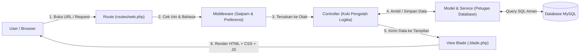

# Modul 1: Arsitektur, Teknologi, & Peta Direktori Digi-Safe Purwakarta

Dokumen ini dirancang agar Anda memahami **pondasi utama** aplikasi **Digi-Safe Purwakarta** dari gambaran paling besar hingga letak setiap file di dalam folder proyek. Gunakan panduan ini sebagai pegangan utama sebelum dan saat menghadapi sesi tanya-jawab dengan penguji.

---

## 1. Ringkasan Identitas Aplikasi (Cara Menjelaskan di Pembukaan Sidang)

Jika penguji bertanya: **"Ceritakan secara singkat apa itu website Digi-Safe Purwakarta dan teknologi apa yang kamu gunakan?"**, Anda bisa menjawab dengan pola ini:

> "Digi-Safe Purwakarta adalah platform edukasi dan komunitas literasi keamanan siber interaktif untuk warga dan pelajar di Kabupaten Purwakarta. Berbeda dengan web artikel biasa yang pasif, website ini menggabungkan **Pusat Modul Edukasi** (dengan fitur usulan materi yang dievaluasi Admin dan diberitahukan otomatis oleh **Bot Digika**), **Arena Simulasi Minigame & Password Strength Checker**, **Leaderboard & Sistem Unlock 5 Border Avatar**, **Forum Diskusi Real-time dengan Voting Most Helpful**, **Jejaring Sosial (Follow, Pertemanan, Live Chat)**, serta **Panel Admin dengan Diagram Tren Pertumbuhan User & Rating Testimoni dan Ekspor Laporan Excel (.xlsx)**.
>
> Aplikasi ini dibangun menggunakan bahasa **PHP 8.2+** dengan framework **Laravel** berarsitektur **MVC (Model-View-Controller)**, database **MySQL**, tampilan **Blade + Tailwind CSS v4**, serta interaktivitas *real-time* menggunakan **Alpine.js** dan **Fetch API**."

---

## 2. Daftar Lengkap Bahasa & Teknologi (Tech Stack)

Berikut adalah daftar seluruh bahasa, framework, dan alat (*tools*) yang bekerja di balik layar beserta **alasan teknis** mengapa teknologi tersebut dipilih:

| Komponen | Teknologi / Bahasa | Fungsi & Alasan Pemilihan (Jawaban untuk Penguji) |
| :--- | :--- | :--- |
| **Bahasa Backend** | **PHP 8.2+** | Bahasa sisi server (*server-side*) yang memproses logika bisnis, koneksi database, autentikasi, dan keamanan. |
| **Framework Utama** | **Laravel (v11/12)** | Mengatur struktur **MVC**, keamanan *CSRF*, *Routing*, *Eloquent ORM* (anti-SQL Injection), *Rate Limiting*, dan *Automated Testing*. |
| **Template Engine** | **Laravel Blade** (`.blade.php`) | Memungkinkan penulisan HTML yang bersih dengan pewarisan layout (`@extends('layouts.app')`), komponen reusable (`<x-user-avatar>`), dan proteksi *auto-escaping* `{{ ... }}` (anti-XSS). |
| **Bahasa & Framework CSS** | **CSS3 & Tailwind CSS v4** | Mengatur tata letak responsif (*mobile-first*), tipografi (`Plus Jakarta Sans` & `Inter`), animasi, serta *Global Dark Mode* (`html.dark`) di `resources/css/app.css`. |
| **Bahasa & Framework JS** | **JavaScript (ES6+) & Alpine.js v3** | Mengendalikan interaksi di browser tanpa reload halaman: pop-up modal, filter *real-time*, *live chat*, animasi *toggle switch* 3D, *cropper* foto profil, dan *Password Strength Checker*. |
| **Build Tool / Bundler** | **Vite 7** | Mengompilasi dan memadatkan (*minify*) file CSS & JS dari `resources/` menjadi file produksi yang ringan dan cepat di `public/build/`. |
| **Database** | **MySQL / MariaDB (`digi_safe_db`)** | Menyimpan data relasional: pengguna (`users`), modul (`modul_edukasi`), usulan tema (`edukasi_requests`), soal & skor minigame (`soal_minigame`, `skor_game`), forum (`forum`, `jawaban_forum`, `jawaban_forum_votes`), testimoni (`testimoni`), serta sosial (`user_follows`, `friendships`, `chat_messages`). |
| **Automated Testing** | **PHPUnit + SQLite In-Memory** | Menguji 30 skenario fitur dan keamanan secara otomatis (`php artisan test`) hanya dalam ~1,5 detik tanpa mengotori data MySQL asli. |
| **Integrasi Aplikasi Mobile** | **REST API JSON (`routes/api.php`)** | Menyediakan jalur komunikasi data JSON dengan autentikasi *Bearer Token* (SHA-256 di tabel `api_tokens`) agar aplikasi Android (APK) selalu sinkron dengan website. |

---

## 3. Memahami Konsep MVC (Model - View - Controller) dengan Analogi Restoran

Penguji hampir pasti akan bertanya: **"Jelaskan bagaimana alur kerja MVC di proyek Laravel kamu!"**
Bayangkan website ini seperti sebuah **Restoran Modern**:



1. **Route (`routes/web.php` & `routes/api.php`) = Resepsionis / Daftar Menu**:
   - Saat user mengetik alamat seperti `/forum` atau mengklik tombol simpan, *Route* menentukan siapa *Controller* yang bertugas menanganinya.
   - Contoh di `routes/web.php`:
     ```php
     Route::get('/leaderboard', [LeaderboardController::class, 'index'])->name('leaderboard.index');
     ```
2. **Middleware (`bootstrap/app.php` & `app/Http/Middleware/`) = Satpam & Pelayan Penyambut**:
   - Sebelum permintaan masuk ke *Controller*, *Middleware* memeriksa aturan terlebih dahulu:
     - `ApplyUserPreferences`: Menyiapkan bahasa (`id` atau `en`) dan tema layar (`light` atau `dark`) milik user.
     - `SecurityHeaders`: Memasang tameng keamanan HTTP pada setiap respons halaman.
     - `auth`: Memastikan user sudah login (jika belum, diarahkan ke `/login`).
     - `admin` (`EnsureUserIsAdmin`): Memastikan hanya `admin` atau `owner` yang boleh masuk ke `/admin/...`.
3. **Controller (`app/Http/Controllers/`) = Koki / Otak Pengatur**:
   - Menerima input dari user, memvalidasi data, meminta data ke *Model/Service*, lalu mengirimkan hasilnya ke *View*.
4. **Model (`app/Models/`) & Service (`app/Services/`) = Petugas Gudang Data & Ahli Spesialis**:
   - **Model** berhubungan langsung dengan tabel di database MySQL (misal `app/Models/User.php` mewakili tabel `users`, `app/Models/Testimoni.php` mewakili tabel `testimoni`).
   - **Service** membantu *Controller* mengerjakan perhitungan khusus agar kode tetap rapi (misal `AvatarBorderService.php` menghitung syarat buka 5 border avatar, `AdminAnalyticsService.php` menghitung diagram naik/turun user & rating bintang 5-1).
5. **View (`resources/views/`) = Penata Hidangan (Tampilan Layar)**:
   - File `.blade.php` yang merakit data dari *Controller* menjadi halaman HTML yang rapi, responsif, dan interaktif di layar pengguna.

---

## 4. Peta Direktori Lengkap (Contekan Lokasi File)

Hafalkan peta folder ini agar ketika penguji meminta Anda membuka bagian kode tertentu, Anda langsung tahu lokasi filenya:

### A. Folder `app/` (Jantung Logika Backend PHP)
- **`app/Http/Controllers/`** (Pengendali halaman pengguna):
  - [AuthController.php](file:///d:/digisafepurwakarta/Digi-Safe-Purwakarta/app/Http/Controllers/AuthController.php): Mengatur Login, Register, Logout, dan Login Google OAuth 2.0.
  - [BerandaController.php](file:///d:/digisafepurwakarta/Digi-Safe-Purwakarta/app/Http/Controllers/BerandaController.php): Mengatur halaman utama (`/`) dan direktori seluruh warga siber (`/pendaftar`).
  - [EdukasiController.php](file:///d:/digisafepurwakarta/Digi-Safe-Purwakarta/app/Http/Controllers/EdukasiController.php): Mengatur halaman modul edukasi (`/edukasi`) dan pengajuan usulan tema dari pengguna.
  - [MinigameController.php](file:///d:/digisafepurwakarta/Digi-Safe-Purwakarta/app/Http/Controllers/MinigameController.php): Mengatur hub minigame (`/minigame`), arena kuis (`/minigame/{type}`), validasi simpan skor, dan *Password Strength Checker* (`/minigame/password-checker`).
  - [LeaderboardController.php](file:///d:/digisafepurwakarta/Digi-Safe-Purwakarta/app/Http/Controllers/LeaderboardController.php): Mengatur klasemen komunitas, rekor per arena, posisi peringkat user saat ini, dan aktivitas skor terbaru (`/leaderboard`).
  - [ForumController.php](file:///d:/digisafepurwakarta/Digi-Safe-Purwakarta/app/Http/Controllers/ForumController.php): Mengatur halaman diskusi (`/forum`), sinkronisasi JSON *real-time* (`/forum/live-data`), buat/edit/hapus topik, balasan, dan sistem *voting* membantu (*Most Helpful*).
  - [TestimoniController.php](file:///d:/digisafepurwakarta/Digi-Safe-Purwakarta/app/Http/Controllers/TestimoniController.php): Mengatur halaman ulasan warga (`/testimoni`) dan penyimpanan rating bintang 1-5.
  - [TentangController.php](file:///d:/digisafepurwakarta/Digi-Safe-Purwakarta/app/Http/Controllers/TentangController.php): Mengatur halaman Tentang Kami, profil pengembang, lokasi peta, dan visi-misi (`/tentang`).
  - [ProfileController.php](file:///d:/digisafepurwakarta/Digi-Safe-Purwakarta/app/Http/Controllers/ProfileController.php): Mengatur halaman profil sendiri (`/profile`), profil orang lain (`/profile/{user}`), upload & crop avatar/banner, ganti *Specialty Role*, pasang *Avatar Border*, pengaturan privasi, dan tombol cepat ganti tema/bahasa (`/preferences/quick`).
  - [FollowController.php](file:///d:/digisafepurwakarta/Digi-Safe-Purwakarta/app/Http/Controllers/FollowController.php): Mengatur fitur *Follow / Unfollow* satu arah dan daftar *Followers / Following*.
  - [SocialChatController.php](file:///d:/digisafepurwakarta/Digi-Safe-Purwakarta/app/Http/Controllers/SocialChatController.php): Mengatur permintaan pertemanan (*Friend Request*), persetujuan teman, dan pengiriman pesan *Live Chat*.
- **`app/Http/Controllers/Admin/`** (Pengendali khusus Panel Admin & Owner):
  - [EdukasiController.php](file:///d:/digisafepurwakarta/Digi-Safe-Purwakarta/app/Http/Controllers/Admin/EdukasiController.php): CRUD modul edukasi & persetujuan/penolakan request tema user (yang otomatis memicu pesan **Bot Digika**).
  - [MinigameController.php](file:///d:/digisafepurwakarta/Digi-Safe-Purwakarta/app/Http/Controllers/Admin/MinigameController.php): CRUD bank soal pilihan ganda & manajemen level kesulitan minigame.
  - [ForumController.php](file:///d:/digisafepurwakarta/Digi-Safe-Purwakarta/app/Http/Controllers/Admin/ForumController.php): Moderasi diskusi & sematkan (*Pin / Star*) topik penting ke urutan paling atas.
  - [UserController.php](file:///d:/digisafepurwakarta/Digi-Safe-Purwakarta/app/Http/Controllers/Admin/UserController.php): Mengatur hak akses `user` vs `admin` dengan proteksi mutlak untuk akun `owner`.
  - [ReportController.php](file:///d:/digisafepurwakarta/Digi-Safe-Purwakarta/app/Http/Controllers/Admin/ReportController.php): Menyusun data laporan lengkap 4 *sheets* dan mengunduhnya sebagai file Excel `.xlsx`.
- **`app/Http/Middleware/`** (Penjaga akses & preferensi):
  - [ApplyUserPreferences.php](file:///d:/digisafepurwakarta/Digi-Safe-Purwakarta/app/Http/Middleware/ApplyUserPreferences.php): Menetapkan bahasa (`id`/`en`) dan tema (`light`/`dark`) di setiap halaman.
  - [EnsureUserIsAdmin.php](file:///d:/digisafepurwakarta/Digi-Safe-Purwakarta/app/Http/Middleware/EnsureUserIsAdmin.php): Menolak user biasa yang mencoba membuka URL `/admin`.
  - [SecurityHeaders.php](file:///d:/digisafepurwakarta/Digi-Safe-Purwakarta/app/Http/Middleware/SecurityHeaders.php): Menyuntikkan *HTTP Security Headers* anti-Clickjacking & anti-MIME sniffing.
  - [AuthenticateApiToken.php](file:///d:/digisafepurwakarta/Digi-Safe-Purwakarta/app/Http/Middleware/AuthenticateApiToken.php): Memvalidasi *Bearer Token* untuk endpoint API aplikasi Android.
- **`app/Models/`** (Representasi tabel database):
  - [User.php](file:///d:/digisafepurwakarta/Digi-Safe-Purwakarta/app/Models/User.php), [ModulEdukasi.php](file:///d:/digisafepurwakarta/Digi-Safe-Purwakarta/app/Models/ModulEdukasi.php), [EdukasiRequest.php](file:///d:/digisafepurwakarta/Digi-Safe-Purwakarta/app/Models/EdukasiRequest.php), [SoalMinigame.php](file:///d:/digisafepurwakarta/Digi-Safe-Purwakarta/app/Models/SoalMinigame.php), [MinigameLevel.php](file:///d:/digisafepurwakarta/Digi-Safe-Purwakarta/app/Models/MinigameLevel.php), [SkorGame.php](file:///d:/digisafepurwakarta/Digi-Safe-Purwakarta/app/Models/SkorGame.php), [Forum.php](file:///d:/digisafepurwakarta/Digi-Safe-Purwakarta/app/Models/Forum.php), [JawabanForum.php](file:///d:/digisafepurwakarta/Digi-Safe-Purwakarta/app/Models/JawabanForum.php), [JawabanForumVote.php](file:///d:/digisafepurwakarta/Digi-Safe-Purwakarta/app/Models/JawabanForumVote.php), [Testimoni.php](file:///d:/digisafepurwakarta/Digi-Safe-Purwakarta/app/Models/Testimoni.php), [UserFollow.php](file:///d:/digisafepurwakarta/Digi-Safe-Purwakarta/app/Models/UserFollow.php), [Friendship.php](file:///d:/digisafepurwakarta/Digi-Safe-Purwakarta/app/Models/Friendship.php), [ChatMessage.php](file:///d:/digisafepurwakarta/Digi-Safe-Purwakarta/app/Models/ChatMessage.php), [ApiToken.php](file:///d:/digisafepurwakarta/Digi-Safe-Purwakarta/app/Models/ApiToken.php).
- **`app/Rules/`** (Aturan validasi khusus):
  - [ValidRealEmail.php](file:///d:/digisafepurwakarta/Digi-Safe-Purwakarta/app/Rules/ValidRealEmail.php): Filter anti-email palsu, pendeteksi typo domain, pemblokir email sementara (*disposable*), dan pengecek DNS MX aktif.
- **`app/Services/`** (Mesin pembantu logika spesifik):
  - [AvatarBorderService.php](file:///d:/digisafepurwakarta/Digi-Safe-Purwakarta/app/Services/AvatarBorderService.php): Mengatur katalog 5 border avatar dan syarat *unlock* otomatis tiap user.
  - [AdminAnalyticsService.php](file:///d:/digisafepurwakarta/Digi-Safe-Purwakarta/app/Services/AdminAnalyticsService.php): Menghitung tren pertumbuhan pendaftar (Menaik/Menurun) dan tren rating Bintang 5-1 di Panel Admin.
  - [LeaderboardBuilder.php](file:///d:/digisafepurwakarta/Digi-Safe-Purwakarta/app/Services/LeaderboardBuilder.php): Menyusun peringkat klasemen multi-kategori (Jawaban Benar, Jawaban Salah, Kontribusi Forum, Lencana).
  - [SimpleXlsxExporter.php](file:///d:/digisafepurwakarta/Digi-Safe-Purwakarta/app/Services/SimpleXlsxExporter.php): Generator file Excel `.xlsx` murni berbasis standar OpenXML.
  - [UploadValidationHelper.php](file:///d:/digisafepurwakarta/Digi-Safe-Purwakarta/app/Services/UploadValidationHelper.php): Memvalidasi keamanan konten file gambar/GIF yang diunggah user.
  - [BilingualHelper.php](file:///d:/digisafepurwakarta/Digi-Safe-Purwakarta/app/Services/BilingualHelper.php): Menerjemahkan konten modul dan soal minigame secara otomatis saat bahasa diubah ke Inggris.

### B. Folder `resources/` & `lang/` (Tampilan, CSS, & Kamus Bahasa)
- **`resources/views/layouts/app.blade.php`**: Kerangka induk seluruh halaman (memuat `<head>`, **Navbar Melayang**, **Toast Kanan Atas**, `@yield('content')`, **Footer**, **Widget Live Chat**, dan script **Animasi Toggle Switch 3D**).
- **`resources/views/components/`**: Komponen UI yang dipakai berulang kali di banyak halaman:
  - [user-avatar.blade.php](file:///d:/digisafepurwakarta/Digi-Safe-Purwakarta/resources/views/components/user-avatar.blade.php): Menampilkan foto profil/inisial user sekaligus memasang **Border Avatar PNG** secara otomatis di halaman mana pun.
  - [user-profile-card.blade.php](file:///d:/digisafepurwakarta/Digi-Safe-Purwakarta/resources/views/components/user-profile-card.blade.php): Kartu profil pengguna berslot seragam yang tampil di marquee Beranda dan halaman `/pendaftar`.
  - [leaderboard-board.blade.php](file:///d:/digisafepurwakarta/Digi-Safe-Purwakarta/resources/views/components/leaderboard-board.blade.php): Papan klasemen interaktif dengan *rotary dial* di desktop dan podium 1-2-3 di mobile.
  - [social-chat-widget.blade.php](file:///d:/digisafepurwakarta/Digi-Safe-Purwakarta/resources/views/components/social-chat-widget.blade.php): Tombol mengambang dan panel *Live Chat* & pertemanan di pojok kanan bawah.
  - [custom-select.blade.php](file:///d:/digisafepurwakarta/Digi-Safe-Purwakarta/resources/views/components/custom-select.blade.php): Dropdown pilihan bergaya modern pengganti `<select>` bawaan browser.
- **`resources/css/app.css`**: Seluruh aturan styling kustom, animasi kawanan burung beranda, kartu folder layanan, bento edukasi, dan aturan warna **Global Dark Mode (`html.dark`)**.
- **`lang/id/ui.php` & `lang/en/ui.php`**: Kamus teks dwibahasa (Indonesia dan Inggris).

### C. Folder `routes/`, `bootstrap/`, & `public/`
- **[routes/web.php](file:///d:/digisafepurwakarta/Digi-Safe-Purwakarta/routes/web.php)**: Seluruh rute halaman website beserta aturan *middleware* `auth`, `admin`, dan `throttle` (pembatas kecepatan klik/request).
- **[routes/api.php](file:///d:/digisafepurwakarta/Digi-Safe-Purwakarta/routes/api.php)**: Seluruh rute REST API JSON untuk aplikasi mobile Android.
- **[bootstrap/app.php](file:///d:/digisafepurwakarta/Digi-Safe-Purwakarta/bootstrap/app.php)**: Tempat mendaftarkan *middleware* global (`SecurityHeaders`, `ApplyUserPreferences`) dan alias `admin` / `api.token`.
- **`public/images/`**: Tempat menyimpan aset gambar statis, termasuk 5 bingkai transparan di `public/images/borders/` (`aqua-crest.png`, `astral-orbit.png`, `cosmic-ring.png`, `chrono-sovereign.png`, `crimson-flare.png`).
