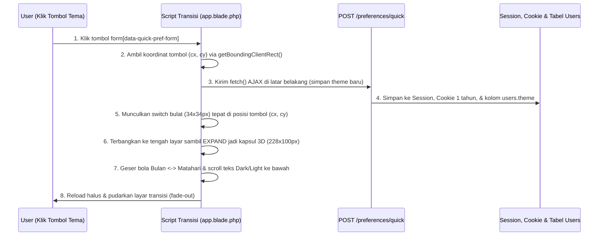

# Modul 2: Bedah Navbar, Animasi Toggle Switch 3D, Dark Mode, & Sistem Translate

Dokumen ini membedah secara mendalam bagaimana bagian antarmuka global di [resources/views/layouts/app.blade.php](file:///d:/digisafepurwakarta/Digi-Safe-Purwakarta/resources/views/layouts/app.blade.php) dan [resources/css/app.css](file:///d:/digisafepurwakarta/Digi-Safe-Purwakarta/resources/css/app.css) bekerja dari detail terkecil.

---

## 1. Bagaimana Navbar Bisa Melayang, Transparan, & Menandai Menu Aktif?

Seluruh kode navbar berada di [resources/views/layouts/app.blade.php](file:///d:/digisafepurwakarta/Digi-Safe-Purwakarta/resources/views/layouts/app.blade.php#L155-L530).

### A. Struktur Kapsul Melayang (*Floating Glass Capsule*)
- Pada elemen `<header>` ([app.blade.php](file:///d:/digisafepurwakarta/Digi-Safe-Purwakarta/resources/views/layouts/app.blade.php#L156)):
  - Menggunakan class `fixed top-4 inset-x-0 z-50 px-4 sm:px-6 lg:px-8`.
  - Artinya: navbar dikunci di posisi `16px` (`top-4`) dari tepi atas layar (`fixed`), merentang di tengah, dan berada di lapisan atas (`z-50`) sehingga saat halaman di-scroll ke bawah, navbar tetap melayang mengikuti layar.
- Pada elemen `<nav>` di dalamnya ([app.blade.php](file:///d:/digisafepurwakarta/Digi-Safe-Purwakarta/resources/views/layouts/app.blade.php#L159)):
  - Menggunakan `max-w-5xl mx-auto rounded-full backdrop-blur-md shadow-neutral px-3 py-2 flex items-center justify-between`.
  - `rounded-full` membentuk kapsul melengkung penuh.
  - `backdrop-blur-md` memberikan efek kaca buram (*frosted glass*) sehingga konten halaman yang lewat di belakang navbar terlihat samar secara elegan.
  - Warnanya otomatis menyesuaikan mode layar:
    - Saat **Light Mode**: `bg-white/95 border border-gray-100`
    - Saat **Dark Mode**: `bg-[#111827]/95 border border-slate-800`

### B. Bagaimana Navbar Tahu Menu Mana yang Sedang Aktif?
- Di bagian atas `<header>`, terdapat daftar array PHP `$navItems` ([app.blade.php](file:///d:/digisafepurwakarta/Digi-Safe-Purwakarta/resources/views/layouts/app.blade.php#L168-L176)):
  ```php
  [
      'label' => __('ui.nav.education'),
      'url' => url('/edukasi'),
      'active' => request()->is('edukasi*'),
  ]
  ```
- Fungsi `request()->is('edukasi*')` atau `request()->routeIs('minigame.*')` memeriksa URL yang sedang dibuka user saat itu.
- Jika bernilai `true` (aktif), Blade otomatis menambahkan:
  1. Warna teks biru (`text-sky`).
  2. Garis indikator kecil di bawah teks menu:
     ```html
     <span class="absolute bottom-0.5 left-1/2 -translate-x-1/2 w-4 h-0.5 rounded-full bg-sky"></span>
     ```

### C. Bagaimana Menu Mobile (HP) dan Dropdown Profil Bekerja Tanpa Reload?
- Menggunakan **Alpine.js** yang dipasang langsung pada `<header x-data="{ mobileOpen: false }">`:
  - Saat tombol *hamburger* (garis tiga) di layar HP diklik, `@click="mobileOpen = !mobileOpen"` mengubah nilai `mobileOpen` menjadi `true`.
  - Panel menu mobile yang memiliki `x-show="mobileOpen"` langsung terbuka halus dengan transisi `x-transition`.
  - Begitu pula pada foto profil di kanan atas navbar: menggunakan `x-data="{ open: false }"` dan `@click.outside="open = false"` sehingga menu profil otomatis menutup saat user mengklik area luar.

---

## 2. Bagaimana Animasi Toggle Switch 3D (Light Mode $\leftrightarrow$ Dark Mode) Bekerja?

Ini adalah salah satu bagian paling menarik yang sering ditanyakan penguji. Seluruh logikanya berada di [resources/views/layouts/app.blade.php](file:///d:/digisafepurwakarta/Digi-Safe-Purwakarta/resources/views/layouts/app.blade.php#L821-L1155).

### Alur Langkah demi Langkah Saat User Mengklik Tombol Tema di Navbar:



### Detail Teknis 4 Tahap Animasi di `createIllustratedThemeSwitch()`:

1. **Menangkap Titik Koordinat Tombol yang Diklik (`originX`, `originY`)**:
   - Saat user mengklik tombol tema di navbar, JavaScript memanggil `btn.getBoundingClientRect()` untuk mengetahui posisi persis tombol tersebut di layar:
     ```javascript
     const cx = Math.round(rect.left + rect.width / 2);
     const cy = Math.round(rect.top + rect.height / 2);
     ```
   - Karena kanvas `#pref-transition-veil` memusatkan elemen di tengah layar (`window.innerWidth / 2`, `window.innerHeight / 2`), script menghitung selisih jarak dari tengah layar ke tombol navbar:
     ```javascript
     const dx = Math.round(originX - (window.innerWidth / 2));
     const dy = Math.round(originY - (window.innerHeight / 2) + 27);
     ```

2. **Berawal Sebagai Bulatan Switch Kecil dari Navbar Lalu Terbang & *Expand* ke Tengah**:
   - Pada milidetik ke-0 (`0ms`), elemen `track` dibuat berbentuk **bulatan sempurna (`width: 100px; height: 100px; border-radius: 999px`)** dan diperkecil dengan `scale(0.34)` (`34px × 34px`) tepat di koordinat `(dx, dy)` tombol navbar!
   - Di dalam bulatan itu, bola *thumb* (`80px × 80px`) berada tepat di tengah bulatan (`0px`) menampilkan ikon mode saat ini (misal **Bulan Berkawah 3D** jika sedang Dark Mode, atau **Matahari Emas** jika sedang Light Mode).
   - Pada `110ms - 430ms`, bulatan tersebut meluncur ke tengah layar `translate3d(0, 0, 0) scale(1)` sekaligus **melebar secara horizontal (`width: 100px` $\rightarrow$ `width: 228px`)** menjadi kapsul *toggle switch* 3D lengkap dengan langit berbintang atau awan berlapis.

3. **Bola Bulan Berkawah $\leftrightarrow$ Matahari Emas Meluncur (`520ms - 1060ms`)**:
   - Setelah kapsul *switch* 3D terbentuk utuh di tengah layar pada mode awalnya, bola *thumb* meluncur menyeberangi kapsul (`0px` $\leftrightarrow$ `128px`) dengan kurva pegas `cubic-bezier(0.34, 1.36, 0.64, 1)`.
   - Saat berpindah dari **Dark Mode ke Light Mode**:
     - Wajah **Bulan Lavender-Perak Berkawah 3D** (digambar dengan SVG lingkaran kawah berlapis dan `radial-gradient`) berputar dan memudar menjadi **Matahari Kuning-Emas**.
     - Lapisan **Bintang 4 Sudut (`✦`)** bergerak naik dan digantikan lapisan **Awan Putih Berlapis** yang naik dari bawah di atas langit biru (`#38BDF8 -> #0284C7`).
     - Latar belakang layar penuh (`#pref-transition-veil`) ikut bertransisi halus dari gelap (`#0B1120`) ke terang (`#F4F6FB`).

4. **Animasi Teks: Kata `"Mode"` Mutlak (Diam) & Kata `"Dark"` / `"Light"` (`"Gelap"` / `"Terang"`) Scroll ke Bawah**:
   - Di bawah kapsul switch 3D terdapat kapsul teks `statusBar`.
   - Kata **`Mode`** ditaruh di dalam `staticModeSpan` yang **sama sekali tidak bergerak (mutlak)**.
   - Di sebelahnya terdapat jendela pemotong vertikal (`wordWindow`) dengan `height: 24px; overflow: hidden;`.
   - Di dalam jendela tersebut terdapat pita vertikal (`wordReel`) berisi 2 baris bertumpuk:
     - **Baris Atas (0)**: Kata tujuan (`Light` / `Terang` atau `Dark` / `Gelap`).
     - **Baris Bawah (1)**: Kata awal sebelum berubah.
   - Awalnya pita berada di posisi `transform: translate3d(0, -24px, 0)` (menampilkan baris bawah/kata awal).
   - Saat switch bergeser, pita bergerak **turun ke bawah** menuju `transform: translate3d(0, 0px, 0)`! Akibatnya, kata lama terdorong turun keluar melalui batas bawah, dan kata baru turun masuk dari atas tepat di samping kata **`Mode`**.

---

## 3. Bagaimana Sistem Dark Mode Mengubah Warna Seluruh Halaman?

Jika penguji bertanya: **"Bagaimana website ini menyimpan dan menerapkan mode gelap (Dark Mode) di semua halaman?"**, jelaskan 3 bagian ini:

1. **Penyimpanan Preferensi di Backend ([ProfileController::quickPreferences](file:///d:/digisafepurwakarta/Digi-Safe-Purwakarta/app/Http/Controllers/ProfileController.php#L477-L512))**:
   - Saat tombol tema diklik, request `POST /preferences/quick` menyimpan pilihan `'dark'` atau `'light'` ke **3 tempat sekaligus**:
     - **Session Laravel** (`session(['user_theme' => $theme])`) agar langsung aktif.
     - **Database Tabel `users`** (`$user->update(['theme' => $theme])`) jika user sedang login, sehingga saat user login di perangkat lain, tema pilihannya tetap tersimpan.
     - **Browser Cookie** (`Cookie::queue('digisafe_theme', $theme, 60 * 24 * 365)`) selama 1 tahun untuk pengunjung tamu (*guest*).
2. **Pembacaan oleh Middleware ([ApplyUserPreferences.php](file:///d:/digisafepurwakarta/Digi-Safe-Purwakarta/app/Http/Middleware/ApplyUserPreferences.php#L16-L46))**:
   - Setiap kali halaman dibuka, middleware `ApplyUserPreferences` membagikan variabel `$currentTheme` ke seluruh tampilan Blade (`View::share('currentTheme', $theme)`).
   - Pada baris ke-2 [layouts/app.blade.php](file:///d:/digisafepurwakarta/Digi-Safe-Purwakarta/resources/views/layouts/app.blade.php#L2), tag `<html>` diberikan class `dark` jika `$currentTheme === 'dark'`:
     ```html
     <html lang="{{ app()->getLocale() }}" class="... {{ ($currentTheme ?? 'light') === 'dark' ? 'dark' : '' }}">
     ```
3. **Aturan CSS `html.dark` ([resources/css/app.css](file:///d:/digisafepurwakarta/Digi-Safe-Purwakarta/resources/css/app.css#L490-L1035))**:
   - Begitu `<html class="dark">` aktif, seluruh aturan `html.dark ...` di `resources/css/app.css` otomatis mengubah:
     - Latar utama `.bg-white` menjadi `#111827` dan kanvas `.bg-[#F8FAFC]` / `.bg-[#F0F8FF]` menjadi `#162032` / `#132238`.
     - Teks utama `.text-ink` menjadi `#F1F5F9` dan teks sekunder `.text-muted` menjadi `#94A3B8`.
     - Permukaan khusus seperti hero halaman Tentang (`.about-hero-surface`), kurva cekung Forum (`.forum-curve-end-stop`), kartu *pinned* (`.bg-[#FAFDFF]`), dan kapsul Testimoni (`.testi-pill-glass`) menjadi warna gelap berkontras tinggi.

---

## 4. Bagaimana Sistem Translate 2 Bahasa (Indonesia $\leftrightarrow$ Inggris) Bekerja?

Jika penguji bertanya: **"Bagaimana cara kerja fitur ganti bahasa Indonesia ke Inggris di website ini?"**, jelaskan mekanisme berikut:

### A. Untuk Teks Antarmuka Statis (Kamus Bahasa Laravel)
1. **File Kamus Bahasa**:
   - Bahasa Indonesia disimpan di [lang/id/ui.php](file:///d:/digisafepurwakarta/Digi-Safe-Purwakarta/lang/id/ui.php).
   - Bahasa Inggris disimpan di [lang/en/ui.php](file:///d:/digisafepurwakarta/Digi-Safe-Purwakarta/lang/en/ui.php).
   - Keduanya berisi array dengan *key* yang sama persis, contohnya:
     ```php
     // di lang/id/ui.php:
     'nav' => ['home' => 'Beranda', 'education' => 'Edukasi', ...],

     // di lang/en/ui.php:
     'nav' => ['home' => 'Home', 'education' => 'Education', ...],
     ```
2. **Pemanggilan di Blade (`__('ui.key')`)**:
   - Di seluruh file `.blade.php`, teks tidak ditulis mati (*hardcoded*), melainkan dipanggil dengan helper `__('ui.nav.home')`.
3. **Pengaktifan Bahasa oleh Middleware ([ApplyUserPreferences.php](file:///d:/digisafepurwakarta/Digi-Safe-Purwakarta/app/Http/Middleware/ApplyUserPreferences.php#L18-L27))**:
   - Saat user menekan tombol `ID / EN` di navbar, `ProfileController::quickPreferences` menyimpan `locale` (`'id'` atau `'en'`) ke session, cookie, dan kolom `users.locale`.
   - Middleware `ApplyUserPreferences` memanggil:
     ```php
     App::setLocale($locale);
     Carbon::setLocale($locale);
     ```
   - `App::setLocale($locale)` membuat Laravel otomatis mengambil teks dari `lang/id/ui.php` atau `lang/en/ui.php`.
   - `Carbon::setLocale($locale)` membuat waktu postingan di Forum dan Testimoni (`$created_at->diffForHumans()`) otomatis berubah antara `"5 menit yang lalu"` dan `"5 minutes ago"`.

### B. Untuk Konten Database (Modul Edukasi & Soal Minigame)
- Bagaimana dengan judul modul edukasi dan soal kuis minigame yang tersimpan di database dalam Bahasa Indonesia?
- Proyek ini memiliki **[app/Services/BilingualHelper.php](file:///d:/digisafepurwakarta/Digi-Safe-Purwakarta/app/Services/BilingualHelper.php)**!
- Saat user mengaktifkan Bahasa Inggris (`BilingualHelper::isEnglish() === true`), `BilingualHelper` menerjemahkan judul/isi modul edukasi (`translateModul()`) dan pertanyaan/opsi/pembahasan soal minigame (`translateSoalRecord()`) ke Bahasa Inggris secara *on-the-fly* tanpa mengubah data asli Bahasa Indonesia di database MySQL!
