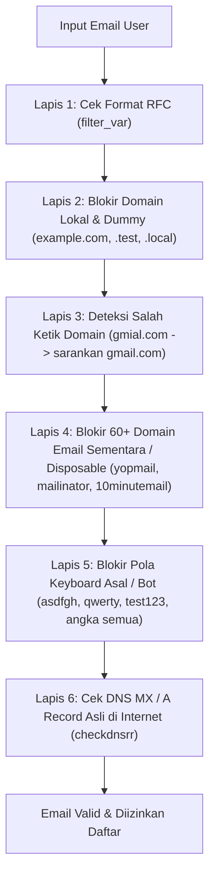

# Modul 3: Bedah Sistem Login, Register, Validasi Email Asli, Google OAuth, & Keamanan Siber

Karena **Digi-Safe Purwakarta** adalah website bertema *Cyber Security*, penguji akan sangat tertarik menanyakan bagaimana keamanan sistem Login, Register, dan perlindungan website ini dari serangan siber.

---

## 1. Bagaimana Sistem Register Mencegah Email Asal-Asalan / Spam? (`ValidRealEmail`)

Jika penguji bertanya: **"Bagaimana cara kamu mencegah orang mendaftar pakai email palsu atau asal-asalan?"**, tunjukkan file [app/Rules/ValidRealEmail.php](file:///d:/digisafepurwakarta/Digi-Safe-Purwakarta/app/Rules/ValidRealEmail.php) dan [app/Http/Controllers/AuthController.php](file:///d:/digisafepurwakarta/Digi-Safe-Purwakarta/app/Http/Controllers/AuthController.php#L84-L120).

Saat user mengisi form Register (`/register`), email harus melewati **5 lapisan penyaringan** di dalam class `ValidRealEmail`:



### Detail 6 Lapisan Validasi di `ValidRealEmail.php`:
1. **Validasi Format Standar RFC**: Memastikan struktur `nama@domain.ekstensi` sah dan bagian nama minimal 3 karakter.
2. **Blokir Domain Dummy / Lokal**: Menolak domain seperti `example.com`, `test.com`, `localhost.com`, atau akhiran `.test`, `.local`, `.invalid`.
3. **Pendeteksi Salah Ketik (*Typo Detector*)**:
   - Menyimpan daftar `$commonTypos` ([ValidRealEmail.php](file:///d:/digisafepurwakarta/Digi-Safe-Purwakarta/app/Rules/ValidRealEmail.php#L89-L110)).
   - Jika user mengetik `budi@gmial.com` atau `budi@yaho.com`, sistem menolak dan langsung memberi tahu: *"Domain email tampak salah ketik. Maksud Anda @gmail.com?"*
4. **Blokir 60+ Layanan Email Sementara (*Disposable / Temp Mail*)**:
   - Menolak domain spam sekali pakai seperti `mailinator.com`, `yopmail.com`, `tempmail.com`, `10minutemail.com`, `guerrillamail.com`, `trashmail.com`, dll.
5. **Deteksi Pola Ketikan Asal-asalan (*Keyboard Smash & Bot Pattern*)**:
   - Menggunakan ekspresi reguler (*Regex*) untuk menolak nama depan email yang hanya berisi angka (`123456@gmail.com`), huruf berulang (`aaaaa@gmail.com`), atau deretan tombol keyboard (`asdfgh@gmail.com`, `qwerty@gmail.com`, `testing123@gmail.com`).
6. **Verifikasi Server Email Aktif via DNS MX Record (`checkdnsrr`)**:
   - Di luar mode unit test, sistem memanggil fungsi jaringan PHP `checkdnsrr($domain, 'MX')` ([ValidRealEmail.php](file:///d:/digisafepurwakarta/Digi-Safe-Purwakarta/app/Rules/ValidRealEmail.php#L188-L195)).
   - Artinya: jika seseorang mengarang domain `sekolahpurwakartapalsu12345.com`, PHP akan bertanya ke server DNS internet apakah domain tersebut benar-benar memiliki server penerima email (*Mail Exchange / MX*). Jika tidak ada, pendaftaran langsung ditolak!

### Bagaimana Password Disimpan Saat Register?
- Di [AuthController.php](file:///d:/digisafepurwakarta/Digi-Safe-Purwakarta/app/Http/Controllers/AuthController.php#L106), password **tidak pernah disimpan sebagai teks biasa**, melainkan di-*hash* satu arah menggunakan algoritma **Bcrypt**:
  ```php
  'password' => Hash::make($validated['password']),
  ```
- Role akun baru juga dikunci secara otomatis menjadi `'user'` di sisi server (tidak bisa dimanipulasi menjadi `'admin'` lewat form register).

---

## 2. Bagaimana Sistem Login Manual & Logout Bekerja?

Kode login berada di [app/Http/Controllers/AuthController.php](file:///d:/digisafepurwakarta/Digi-Safe-Purwakarta/app/Http/Controllers/AuthController.php#L27-L76).

1. **Bisa Login dengan Email ATAU Username**:
   - Sistem mencari akun dengan kueri:
     ```php
     $user = User::where('email', $loginInput)
         ->orWhere('username', $loginInput)
         ->first();
     ```
2. **Pencocokan Password dengan `Hash::check()`**:
   - Sistem membandingkan password yang diketik user terhadap *hash* Bcrypt di database menggunakan `Hash::check($password, $user->password)`.
   - Terdapat juga kompatibilitas mundur (*legacy fallback*) yang otomatis meng-*upgrade* password lama menjadi Bcrypt begitu user berhasil login.
3. **Proteksi *Session Fixation* Saat Login**:
   - Begitu login sukses, Laravel menjalankan:
     ```php
     Auth::login($user);
     $request->session()->regenerate();
     ```
   - `session()->regenerate()` mengganti ID sesi lama dengan ID sesi baru agar peretas tidak bisa membajak ID sesi sebelum login.
4. **Pembersihan Sesi Saat Logout**:
   - Saat tombol Logout ditekan (`POST /logout`), sistem menjalankan `Auth::logout()`, `$request->session()->invalidate()`, dan `$request->session()->regenerateToken()` (mengganti token CSRF).

---

## 3. Bagaimana Login dengan Google (OAuth 2.0) Bekerja?

Kode Google Login berada di [app/Http/Controllers/AuthController.php](file:///d:/digisafepurwakarta/Digi-Safe-Purwakarta/app/Http/Controllers/AuthController.php#L140-L320) dan mendukung login dari **Website** maupun dari **Aplikasi Android (APK)**.

1. **Tahap 1: Redirect ke Google (`GET /auth/google/redirect`)**:
   - Sistem membuat kode rahasia acak `state` (`Str::random(32)`) yang disimpan di session (`google_oauth_state`) untuk mencegah serangan pemalsuan login (*OAuth CSRF*).
   - User diarahkan ke halaman persetujuan akun Google resmi (`accounts.google.com/o/oauth2/v2/auth`) dengan membawa `client_id`, `redirect_uri`, `scope=openid email profile`, dan `state`.
2. **Tahap 2: Callback dari Google (`GET /auth/google/callback`)**:
   - Saat user kembali dari Google:
     - Pada mode web, sistem memverifikasi bahwa parameter `state` dari URL sama persis dengan `google_oauth_state` di session (`hash_equals()`).
     - Server menukarkan `code` dari Google ke endpoint `https://oauth2.googleapis.com/token` untuk mendapatkan `id_token` dan `access_token`.
     - Server memverifikasi keaslian token ke Google (`tokeninfo`), memastikan **`aud` (Audience)** sama persis dengan `GOOGLE_CLIENT_ID` aplikasi kita, dan memastikan **`email_verified === true`**.
3. **Tahap 3: Sinkronisasi Akun User**:
   - Jika email sudah terdaftar di tabel `users`, sistem langsung meloginkan user tersebut.
   - Jika belum terdaftar, sistem otomatis membuatkan akun baru dengan username unik dan menyimpan foto profil Google user.
   - Jika login berasal dari aplikasi Android (`mode=mobile`), sistem membuatkan *Bearer Token* di tabel `api_tokens` dan mengarahkan kembali ke aplikasi lewat *deep link* `digisafe://auth?...`.

---

## 4. 7 Lapisan Keamanan Siber (Cyber Security Hardening) di Digi-Safe

Hafalkan 7 poin ini! Jika penguji bertanya **"Apa saja fitur keamanan siber yang sudah kamu terapkan di kode website ini?"**, jawab dengan 7 poin berikut:

| No | Fitur Keamanan | Lokasi File | Cara Kerja Singkat |
| :--- | :--- | :--- | :--- |
| **1** | **Anti-Spam & DNS MX Email Check** | [ValidRealEmail.php](file:///d:/digisafepurwakarta/Digi-Safe-Purwakarta/app/Rules/ValidRealEmail.php) | Memblokir 60+ domain email palsu/sementara, mendeteksi typo, dan mengecek DNS MX server email asli. |
| **2** | **Anti-RCE File Upload & `.htaccess` Guard** | [UploadValidationHelper.php](file:///d:/digisafepurwakarta/Digi-Safe-Purwakarta/app/Services/UploadValidationHelper.php) | Saat upload avatar/banner, sistem **tidak pernah memakai ekstensi dari nama file user**, melainkan membaca *magic bytes* gambar asli (`getimagesize()`) dan memblokir eksekusi `.php`/`.svg` di folder upload. |
| **3** | **Rate Limiting (`throttle`) Anti-Brute Force** | [routes/web.php](file:///d:/digisafepurwakarta/Digi-Safe-Purwakarta/routes/web.php) & [routes/api.php](file:///d:/digisafepurwakarta/Digi-Safe-Purwakarta/routes/api.php) | Membatasi login maks 10x/menit, register 5x/menit, simpan skor 15x/menit, testimoni 5x/menit. Jika lewat batas, server otomatis menolak dengan kode `429 Too Many Requests`. |
| **4** | **HTTP Security Headers** | [SecurityHeaders.php](file:///d:/digisafepurwakarta/Digi-Safe-Purwakarta/app/Http/Middleware/SecurityHeaders.php) | Memasang header `X-Frame-Options: SAMEORIGIN` (anti-Clickjacking), `X-Content-Type-Options: nosniff`, `Referrer-Policy`, dan `Permissions-Policy`. |
| **5** | **Anti-Cheat / Anti-Tampering Skor Minigame** | [MinigameController.php](file:///d:/digisafepurwakarta/Digi-Safe-Purwakarta/app/Http/Controllers/MinigameController.php#L180-L245) | Membatasi skor maksimum yang masuk akal, memvalidasi jumlah jawaban benar/salah (`0..50`), dan menghitung ulang lencana *100% Akurasi* langsung di server agar tidak bisa dicurangi lewat *Inspect Element*. |
| **6** | **Verifikasi Password Lama & Revokasi Token API** | [ProfileController.php](file:///d:/digisafepurwakarta/Digi-Safe-Purwakarta/app/Http/Controllers/ProfileController.php#L205-L245) | Untuk mengganti password di halaman profil, user wajib memasukkan `current_password` yang benar, dan seluruh token API lama langsung dihapus (*revoke*). |
| **7** | **Proteksi Privasi Followers & Akun Owner** | [FollowController.php](file:///d:/digisafepurwakarta/Digi-Safe-Purwakarta/app/Http/Controllers/FollowController.php) & [Admin/UserController.php](file:///d:/digisafepurwakarta/Digi-Safe-Purwakarta/app/Http/Controllers/Admin/UserController.php) | Akun yang mengaktifkan *Mode Privat* otomatis menyembunyikan daftar *Followers/Following* dari publik (`403`), dan akun **Owner** dilindungi secara mutlak sehingga tidak bisa diturunkan atau dihapus oleh Admin mana pun. |
